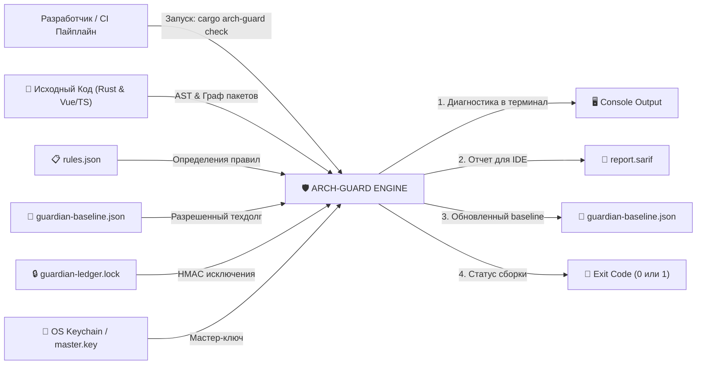
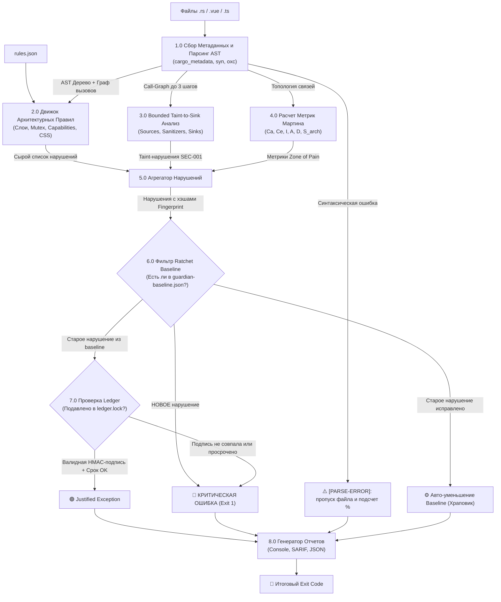

# 🦀 01. АРХИТЕКТУРА ЯДРА `cargo-arch-guard` (RUST CORE)

> **Назначение**: Автономный Rust CLI-инструмент для глубокого AST-анализа, топологической проверки архитектуры, Bounded Taint-to-Sink анализа (глубина $\le$ 3) и двухуровневого аудита макросов (`syn` + `--expanded`).

---

## 1. Стек и Зависимости Крейта

```toml
[package]
name = "cargo-arch-guard"
version = "0.1.0"
edition = "2021"

[dependencies]
# 1. Парсинг структуры и метаданных воркспейса
cargo_metadata = "0.23.1"
clap = { version = "4.4", features = ["derive", "env"] }

# 2. Быстрый AST-анализ синтаксиса Rust (Rust 2024 / syn 3.0 ready)
syn = { version = "3.0.5", features = ["full", "visit", "extra-traits"] }
proc-macro2 = "1.0"
quote = "1.0"

# 3. Графы зависимостей и потоков данных (Taint)
petgraph = "0.8.3"

# 4. Безопасность и хранение ключей (RustCrypto 2026 stack)
keyring = "4.2.0"
sha2 = "0.11.0"
hmac = "0.13.0"
chrono = { version = "0.4", features = ["serde"] }

# 5. Высокопроизводительный параллелизм и файловая система
rayon = "1.8"
walkdir = "2.4"
fs2 = "0.4"
colored = "3.1.1"

# 6. Машинное обучение и кластеризация (DBSCAN)
tract-onnx = "0.21"
tokenizers = "0.20"
ndarray = "0.16"
linfa = "0.8"
linfa-clustering = "0.8.1"

# 7. Сериализация и отчеты
serde = { version = "1.0", features = ["derive"] }
serde_json = "1.0"
toml = "0.8"
colored = "2.1"
```

---

## 2. Детальная Архитектура Модулей `cargo-arch-guard`

```
crates/cargo-arch-guard/src/
├── main.rs                  # CLI entrypoint, аргументы командной строки
├── config/                  # Загрузка rules.json и Cargo.toml в runtime
│   ├── mod.rs
│   ├── loader.rs            # Runtime-загрузка rules.json (путь --rules-path)
│   ├── rules.rs             # Модели, реестр и алгоритм --validate-rules
│   └── preset.rs            # Встроенные пресеты (hexagonal, layered, hardened)
├── ast/                     # Движок обхода AST синтаксиса (syn)
│   ├── visitor.rs           # Архитектурный Visitor (сбор use, fn, struct, async)
│   ├── imports.rs           # Анализ запрещенных cross-crate импортов
│   ├── macros.rs            # Рекурсивный парсинг macro_rules! и поддержка --expanded
│   ├── async_rules.rs       # Поиск MutexGuard через .await и зомби tokio::spawn
│   └── capabilities.rs      # Проверка прямого вызова std::env, std::net, std::process
├── taint/                   # Движок Bounded Taint-to-Sink Data-Flow анализа (depth <= 3)
│   ├── graph.rs             # Bounded Call-Graph потока данных переменной
│   ├── sources.rs           # Детектор источников (tauri::command arguments)
│   ├── sanitizers.rs        # Белый список валидаторов и атрибутов #[arch_guard(sanitizes)]
│   └── sinks.rs             # Детектор опасных стоков (Command::new, fs::write)
├── metrics/                 # Математический аппарат связности
│   ├── martin.rs            # Расчет Ca, Ce, Instability (I), Abstractness (A), Distance (D)
│   └── pressure.rs          # Расчет Architectural Complexity Score (S_arch)
├── ledger/                  # Криптографический реестр исключений
│   ├── suppress.rs          # Парсер атрибутов #[arch_guard(suppress = ...)]
│   ├── storage.rs           # KeyStorage trait: KeychainStorage, FileStorage, MockStorage
│   └── hmac_validator.rs    # Валидация подписей в guardian-ledger.lock
└── report/                  # Форматирование вывода
    ├── console.rs           # Человекочитаемый красивый вывод с цветами
    ├── sarif.rs             # SARIF для интеграции с IDE и GitHub Code Scanning
    └── json.rs              # JSON для CI пайплайнов
```

### 🧩 Описание Обязанностей Каждого Файла:

#### 1. Точка Входа и CLI (`main.rs`)
* **Обязанности**: Разбор аргументов командной строки (`clap`), оркестрация пайплайна сканирования и возврат Exit Code (`0` или `1`).
* **Команды CLI**:
  * `cargo arch-guard check` — стандартный аудит (AST + Bounded Taint + Baseline);
  * `cargo arch-guard check --expanded` — глубокий аудит с предварительным раскрытием процедурных макросов через компилятор;
  * `cargo arch-guard baseline reconcile` — слияние и дедупликация `guardian-baseline.json` после Git Merge;
  * `cargo arch-guard ledger sign --rule <ID> --file <PATH>` — подпись исключения человеком;
  * `cargo arch-guard ledger re-sign --all` — пакетная переподпись при смене ключа;
  * `cargo arch-guard explain --clusters` — семантическая кластеризация техдолга;
  * `cargo arch-guard --validate-rules` — валидация консистентности `rules.json` $\leftrightarrow$ код.

#### 2. Подсистема Конфигурации (`config/`)
* **`config/loader.rs`**: Загружает `rules.json` в runtime по пути `--rules-path <PATH>`. Загружает оверрайды из `Cargo.toml`.
* **`config/rules.rs`**: Содержит структуры `RuleDefinition`, `Category`, `Severity`. Реализует **алгоритм `--validate-rules`**:
  1. Сканирует все `rule_id`, выдаваемые в коде анализаторов;
  2. Сравнивает со списком правил в `rules.json`;
  3. Выдает ошибку `Exit 1`, если:
     * Код генерирует `rule_id`, отсутствующий в `rules.json`;
     * В `rules.json` есть неиспользуемое «мертвое» правило;
     * Поле `rule_version` в коде не совпадает с версией в `rules.json`.
* **`config/preset.rs`**: Предоставляет встроенные архитектурные пресеты (`hexagonal-strict`, `hardened-sandbox`, `permissive`).

#### 3. Движок AST-Анализа (`ast/`)
* **`ast/visitor.rs`**: Главный `syn::visit::Visit` обходчик. Реализует параллельный прогон файлов через `rayon`.
* **`ast/imports.rs`**: Проверяет узлы `ItemUse` на нарушение границ слоев:
  * В `worldwiki-domain`: запрет внешних SDK (`tauri`, `tokio`, `surrealdb`, `reqwest`);
  * В `worldwiki-application`: запрет типов `tauri::*`;
  * Вне `crates/adapters/tauri`: запрет `#[tauri::command]`.
* **`ast/macros.rs`**: Реализует **двухуровневый аудит макросов**:
  * *Уровень 1 (внутри `syn`)*: Рекурсивный парсинг аргументов вызовов макросов (`macro.tokens`) и аудит шаблонов `macro_rules!`;
  * *Уровень 2 (через `--expanded`)*: Разворачивание процедурных макросов (`#[derive]`, атрибуты) через `cargo rustc --profile=check -- -Zunpretty=expanded`.
* **`ast/async_rules.rs`**: Реализует `ScopeStack` для отслеживания удержания `std::sync::MutexGuard` через точки `.await` (`ASYNC-001`).
* **`ast/capabilities.rs`**: Проверяет прямое обращение к `std::env::var`, `std::net::*` и системным шеллам.

#### 4. Движок Bounded Taint-to-Sink (`taint/`)
* **`taint/sources.rs`**: Находит параметры `#[tauri::command]`, сырое чтение `std::io::Read`, аргументы CLI.
* **`taint/graph.rs`**: Строит локальный граф передачи идентификаторов аргументов (Call-Graph) внутри крейта на **глубину до 3 шагов**.
* **`taint/sanitizers.rs`**: Проверяет прохождение через `#[arch_guard(sanitizes)]`, `validate_safe_path()`, `sanitize_filename()`, либо потребление строки числовым парсером `parse::<u64>()`.
* **`taint/sinks.rs`**: Детектирует опасные стоки: `std::process::Command::new`, вызовы шелла, небезопасную запись путей.

#### 5. Математический Аппарат Связности (`metrics/`)
* **`metrics/martin.rs`**: Вычисляет метрики Роберта Мартина ($C_a, C_e, I, A, D$) и детекцию **Zone of Pain**.
* **`metrics/pressure.rs`**: Рассчитывает интегральный показатель $S_{\text{arch}}$ (Architectural Pressure Score).

#### 6. Криптографический Реестр Исключений (`ledger/`)
* **`ledger/suppress.rs`**: Парсит аннотации `#[arch_guard(suppress = ...)]`.
* **`ledger/storage.rs`**: Реализует трейт `KeyStorage` с адаптерами `KeychainStorage` (OS Keychain), `FileStorage` (`~/.config/archguard/master.key`) и `MockStorage` (для dev/тестов).
* **`ledger/hmac_validator.rs`**: Проверяет валидность HMAC-SHA256 подписи каждого подавления и актуальность даты `expires` в UTC.

#### 7. Подсистема Отчетов (`report/`)
* **`report/console.rs`**: Цветной вывод в терминал с подсветкой сниппета, координат строки и рецепта решения (`remediation`).
* **`report/sarif.rs`**: Экспорт в формат SARIF для подсветки ошибок прямо в редакторах VS Code / Cursor и GitHub Code Scanning.
* **`report/json.rs`**: Генерация машиночитаемого `target/arch-guard/rust-report.json`.

---

## 🔄 3. Диаграммы Потоков Данных (Data Flow Diagrams — DFD)

### 3.1. DFD Уровень 0: Контекстная Диаграмма Системы



---

### 3.2. DFD Уровень 1: Процессы Обработки, Ошибки Парсинга и Храповик



---

### 3.3. DFD Уровень 2: Детальный Поток Taint-to-Sink Анализа

```mermaid
flowchart TD
    TAURI_CMD["#[tauri::command] fn import_archive(path: String)"]
    -->|Маркировка аргумента| TAINT_VAR["path = [TAINTED]"]
    
    TAINT_VAR --> HOP1{"Шаг 1: Вызов внутри функции?"}
    
    HOP1 -->|Прямой вызов Sink| SINK_HIT["💥 SINK: Command::new(path)"]
    HOP1 -->|Проброс в helper: extract(path)| HOP2{"Шаг 2: Внутри extract(target)?"}
    
    HOP2 -->|Прохождение санитизатора: validate_safe_path(&target)| CLEAN["✅ СТАТУС ОЧИЩЕН: [CLEAN]"]
    HOP2 -->|Проброс без проверки: run_unzip(target)| HOP3{"Шаг 3: Внутри run_unzip(arg)?"}
    
    HOP3 -->|Вызов опасного стока: Command::new(arg)| SINK_HIT
    HOP3 -->|Глубина > 3 вызовов| UNKNOWN["⚠️ Глубина превышена (Warn/Manual Review)"]
    
    SINK_HIT --> EMIT_SEC["🛑 Генерация Violation [SEC-001]\n(Tainted input reached process execution sink)"]
```

---

## 4. Фундаментальный Контракт: Структура `Violation`

```rust
use serde::{Deserialize, Serialize};
use std::path::PathBuf;

#[derive(Debug, Clone, Serialize, Deserialize, PartialEq, Eq)]
pub enum Category {
    Architecture, // Границы слоев (Domain, Application, Tauri)
    Security,     // Taint-to-Sink, Environment leaks, Capabilities
    Robustness,   // MutexGuard across .await, Panic surface, Zombie tasks
    Convention,   // SLOC, Dead code, Style, CSS
}

#[derive(Debug, Clone, Serialize, Deserialize, PartialEq, Eq)]
pub enum Severity {
    Deny, // Блокирует компиляцию / CI (Exit 1)
    Warn, // Предупреждение
}

#[derive(Debug, Clone, Serialize, Deserialize)]
pub struct Violation {
    pub rule_id: String,           // "ARCH-001", "SEC-001", "ASYNC-001"
    pub rule_version: String,      // "1.0" (для инвалидации хэша при ужесточении правил)
    pub category: Category,
    pub severity: Severity,
    pub file: PathBuf,             // Относительный путь (crates/domain/src/entity.rs)
    pub line: usize,               // 1-based (для подсветки в IDE)
    pub column: usize,
    pub symbol: String,            // Имя родительской функции/структуры
    pub snippet: String,           // Исходный фрагмент кода
    pub message: String,           // Человекочитаемое описание нарушения
    pub remediation: String,       // 💡 Четкий рецепт исправления для разработчика
    pub fingerprint: String,       // SHA-256 устойчивый хэш
}
```

---

## 5. Алгоритм Вычисления Стабильного Fingerprint

```rust
use sha2::{Sha256, Digest};

pub fn compute_fingerprint(
    rule_id: &str,
    rule_version: &str,
    symbol: &str,
    snippet: &str,
) -> String {
    let mut hasher = Sha256::new();
    hasher.update(rule_id.as_bytes());
    hasher.update(b":");
    hasher.update(rule_version.as_bytes());
    hasher.update(b":");
    hasher.update(symbol.as_bytes());
    hasher.update(b":");
    // Нормализация сниппета: удаление пробелов, переносов строк и комментариев
    let normalized = snippet.split_whitespace().collect::<Vec<_>>().join(" ");
    hasher.update(normalized.as_bytes());
    format!("{:x}", hasher.finalize())
}
```

---

## 6. Детектор Scope-Aware `MutexGuard` через `.await`

### 🔍 Реализация и Границы Эвристики:
Поскольку `syn` анализирует синтаксис без полного вывода типов компилятора (`rustc`), детектор `ASYNC-001` использует **Scope Stack** и синтаксическую эвристику:

```rust
use syn::visit::{self, Visit};
use syn::{Block, ExprAwait, Local, Pat};
use std::path::Path;

pub struct MutexGuardVisitor<'a> {
    pub current_file: &'a Path,
    pub scope_stack: Vec<Vec<syn::Ident>>, // Стек активных guards по лексическим блокам { ... }
    pub violations: Vec<Violation>,
}

impl<'a, 'ast> Visit<'ast> for MutexGuardVisitor<'a> {
    fn visit_block(&mut self, node: &'ast Block) {
        self.scope_stack.push(Vec::new()); // Вход в блок
        visit::visit_block(self, node);
        self.scope_stack.pop();            // Выход из блока: guards уничтожаются (RAII)
    }

    fn visit_local(&mut self, node: &'ast Local) {
        // Эвристика AST: проверяется инициализация let guard = <expr>.<lock|read|write>(),
        // где <expr> НЕ содержит `tokio` в пути вызова и НЕ содержит `.await`.
        if is_std_mutex_lock_expression(&node.init) {
            if let Pat::Ident(pat_ident) = &node.pat {
                if let Some(current_scope) = self.scope_stack.last_mut() {
                    current_scope.push(pat_ident.ident.clone());
                }
            }
        }
        visit::visit_local(self, node);
    }

    fn visit_expr_await(&mut self, node: &'ast ExprAwait) {
        let active_count: usize = self.scope_stack.iter().map(|s| s.len()).sum();
        if active_count > 0 {
            self.violations.push(Violation {
                rule_id: "ASYNC-001".into(),
                rule_version: "1.0".into(),
                category: Category::Robustness,
                severity: Severity::Deny,
                file: self.current_file.to_path_buf(),
                line: node.await_token.span.start().line,
                column: node.await_token.span.start().column,
                symbol: "async_block".into(),
                snippet: quote::quote!(#node).to_string(),
                message: "Holding std::sync::MutexGuard across .await point causes tokio worker deadlocks".into(),
                remediation: "💡 Use tokio::sync::Mutex or drop the guard before .await point.".into(),
                fingerprint: "".into(),
            });
        }
        visit::visit_expr_await(self, node);
    }
}

/// Эвристика AST: проверяется инициализация let guard = <expr>.<lock|read|write>(),
/// где <expr> НЕ содержит `tokio` в пути вызова и НЕ содержит `.await`.
fn is_std_mutex_lock_expression(init: &Option<syn::LocalInit>) -> bool {
    if let Some(local_init) = init {
        if let syn::Expr::MethodCall(method_call) = &*local_init.expr {
            let method_name = method_call.method.to_string();
            if matches!(method_name.as_str(), "lock" | "read" | "write") {
                let receiver_str = quote::quote!(#method_call.receiver).to_string();
                let is_tokio = receiver_str.contains("tokio");
                let has_await = quote::quote!(#local_init.expr).to_string().contains("await");
                return !is_tokio && !has_await;
            }
        }
    }
    false
}
```

* **Границы применимости**:
  * Случаи со скрытыми type aliases, кастомными generic-обертками `Arc<MyCustomMutex>` и сторонними мьютексами без явного имени `.lock()` в AST не детектируются без полного вывода типов.

---

## 7. Обработка Ошибок Парсинга и Ограничения AST

### 🛡️ Устойчивость к ошибкам:
* Если `syn` встречает синтаксическую ошибку в файле:
  1. Ошибка логируется в отчет как `[PARSE-ERROR] <file>: <error>`;
  2. Файл исключается из проверки без падения процесса (`panic!`);
  3. **Пороги срабатывания**:
     * В **CI**: если повреждено $> 2\%$ от общего числа анализируемых `.rs` файлов $\implies$ `Exit 1`;
     * В **Pre-commit**: порог предупреждения `5%`.

### ⚠️ Фундаментальные Границы Анализа Макросов и Режим `--expanded`

#### 1. Границы синтаксического анализа (`syn`):
* **Source AST (`syn`)**: Анализатор работает с исходным синтаксическим деревом до этапа компиляции.
  * **`macro_rules!` и Function-like макросы (`my_macro!(...)`)**: Их синтаксические токены явно присутствуют в файле исходного кода. Анализатор рекурсивно парсит токены из `macro.tokens` и тело определений `macro_rules!`.
  * **Proc-macro derive (`#[derive(SurrealRecord)]`) и proc-macro атрибуты**: Являются **«чёрным ящиком»** для `syn`. Анализатор видит только имя структуры и атрибут `#[derive(...)]`, но **принципиально не видит код, генерируемый макросом** (генерация происходит внутри внешней скомпилированной `.dll`/`.so` библиотеки макроса на этапе компиляции `rustc`).

```rust
#[derive(SurrealRecord)]  // ← syn видит эту строку и структуру User
struct User { ... }

// Код, сгенерированный внутри proc-macro библиотеки:
// impl SurrealRecord for User {
//     fn table() -> &'static str {
//         Command::new("...")  // ← syn НЕ ВИДИТ ЭТОТ ВЫЗОВ В ИСХОДНИКАХ
//     }
// }
```

#### 2. Режим глубокого аудита через компилятор (`--expanded`):
* Для аудита кода, скрытого внутри процедурных макросов и derives, запускается режим `--expanded`.
* **Точная команда извлечения раскрытого кода**:
  ```bash
  cargo rustc --profile=check -- -Zunpretty=expanded
  ```
  *(или вызов эквивалентной CLI-обертки `cargo expand`)*.
* **Требование к Toolchain**: Флаг `-Zunpretty=expanded` требует наличия **Nightly-компилятора** (устанавливается изолированно через `rustup toolchain install nightly`, не меняя дефолтный `stable` toolchain проекта: `cargo +nightly rustc --profile=check -- -Zunpretty=expanded`).
* **Важное отличие**: Команда `cargo check --message-format=json` **НЕ выдаёт** раскрытый код — она предназначена исключительно для получения диагностических сообщений компилятора (ошибок и предупреждений).

#### 3. Ограничение «Lossy» (Приближение текстового представления):
* Согласно официальной спецификации `cargo-expand` / `rustc`:
  > *"Macro expansion to text is a lossy process. This is a debugging aid only. There should be no expectation that the expanded code can be compiled successfully, nor that if it compiles then it behaves the same as the original code."*
* **Вывод для архитектурного фаервола**: Текстовый вывод `--expanded` является аппроксимацией синтаксиса и не предназначен для повторной компиляции. Однако для **статического архитектурного анализа** (поиска скрытых вызовов `Command::new`, запрещенных импортов `tauri::*` или сетевых сокетов внутри derives) точности раскрытого AST более чем достаточно.

---

## 8. Области Анализа и Песочница `build.rs`

* **`src/**/*.rs`**: применяются все правила (`ARCH-*`, `SEC-*`, `ASYNC-*`, `POLICY-*`).
* **`tests/**/*.rs` и `#[cfg(test)]`**: правила архитектурной изоляции (`ARCH-*`) отключаются (разрешены моки и тестовые хелперы), но правила безопасности (`SEC-*`) продолжают действовать.
* **`build.rs` (Песочница компиляции)**:
  * ❌ Запрещен импорт `std::net::*`;
  * ❌ Запрещен импорт HTTP-клиентов (`reqwest`, `hyper`, `ureq`);
  * ❌ Запрещен вызов `Command::new` с утилитами скачивания (`curl`, `wget`, `nc`).
