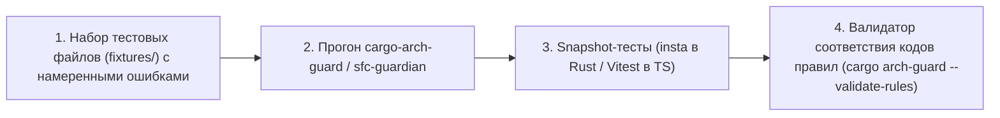

# 🚀 05. ПОШАГОВЫЙ ПЛАН РЕАЛИЗАЦИИ И МИГРАЦИИ (ROADMAP)

> **Назначение**: Практический пошаговый план разработки, инфраструктура тестирования (Fixtures & Snapshots), бенчмарки и план безопасной миграции.

---

## ⏱️ Целевые Бенчмарки Производительности

* **Pre-commit хук (только измененные файлы)**: **$<$ 2 секунд**;
* **CI полный скан (все 600 файлов)**: **$<$ 30 секунд**;
* **`explain --clusters` (с эмбеддингами `CodeBERTa-small-v1` через `tract-onnx`)**: **$<$ 60 секунд**.

---

## 🧪 Инфраструктура Тестирования Анализаторов

AST-анализ тестируется по строгой трехслойной модели:



### Структура тестовых фикстур:
```
crates/cargo-arch-guard/tests/fixtures/
├── invalid_domain_imports/     # Файлы с use tauri, use tokio
├── invalid_mutex_await/        # let g = mutex.lock(); ... .await
├── valid_clean_hexagonal/      # Образцовые чистые модули (0 ошибок)
└── taint_depth_3/              # Цепочки передачи IPC аргументов в шелл
```

---

## 📅 Спринт 1: Разработка Ядра `cargo-arch-guard` (Rust CLI)

- [ ] **Шаг 1.1**: Создать крейт `crates/cargo-arch-guard` в `Cargo.toml`.
- [ ] **Шаг 1.2**: Реализовать runtime-загрузчик `rules.json` (`loader.rs`) и команду `--validate-rules`.
- [ ] **Шаг 1.3**: Реализовать структуру `Violation` и вычисление стабильного `fingerprint` с учетом `rule_version`.
- [ ] **Шаг 1.4**: Реализовать `syn` Visitor:
  - `ARCH-001..ARCH-008` (границы крейтов);
  - `ASYNC-001` (Scope-aware детектор `MutexGuard` через `.await` с эвристикой инициализации);
  - `SEC-001` (Bounded Taint-to-Sink до глубины 3 вызовов).
- [ ] **Шаг 1.5**: Реализовать толерантный парсинг (пропуск ошибок `[PARSE-ERROR]` с порогом $2\%$ в CI).
- [ ] **Шаг 1.6**: Покрыть snapshot-тестами с помощью крейта `insta`.

---

## 📅 Спринт 2: Разработка Фронтенд-Анализатора `sfc-guardian` (TypeScript/Vue)

- [ ] **Шаг 2.1**: Создать пакет `packages/sfc-guardian` в `pnpm-workspace.yaml`.
- [ ] **Шаг 2.2**: Подключить runtime-загрузку `rules.json`.
- [ ] **Шаг 2.3**: Реализовать парсер `<script setup>` на базе `oxc-parser` (`VUE-001`, `VUE-002`, `LEAK-001`).
- [ ] **Шаг 2.4**: Реализовать 4 Закона CSS на базе `lightningcss`:
  - `CSS-001`: Запрет сырого CSS в `.vue` (только внешний `src="..."`);
  - `CSS-002`: Зеркальная структура в `@worldwiki/resources`;
  - `CSS-003`: Детектор дублирования CSS-правил;
  - `CSS-004`: Тотальный запрет `#hex` и хардкода значений.
- [ ] **Шаг 2.5**: Покрыть тестами парсинг SFC-компонентов на Vitest.

---

## 📅 Спринт 3: Ratchet Baseline, Крипто-Ledger и Векторный Кластеризатор

- [ ] **Шаг 3.1**: Реализовать `npx arch-guard init --hooks` / `cargo arch-guard init --hooks` (настройка `simple-git-hooks` для WorldWiki, поддержка `cargo-husky` для standalone).
- [ ] **Шаг 3.2**: Реализовать команду `cargo arch-guard baseline reconcile` с авто-разрешением merge-конфликтов.
- [ ] **Шаг 3.3**: Реализовать трейт `KeyStorage` с защитой от `mock` в проде и команду `re-sign --all`.
- [ ] **Шаг 3.4**: Реализовать Spike по инференсу `tract-onnx` + `tokenizers 0.20` на модели `CodeBERTa-small-v1`.
- [ ] **Шаг 3.5**: Реализовать кластеризацию `linfa-clustering` DBSCAN с L2-нормализацией (`eps = 0.836`) и файловым локом `fs2`.
- [ ] **Шаг 3.6**: Реализовать команду `cargo arch-guard explain --clusters`.

---

## 📅 Спринт 4: Полная Миграция и Удаление Старых Скриптов

### Порядок миграции и ликвидации старого зоопарка:
1. **Этап 4.1**: Добавить `target/arch-guard/` и `.archguard/cache/` в `.gitignore`.
2. **Этап 4.2**: Запуск `arch-guard init` на всем монорепозитории WorldWiki (фиксация baseline).
3. **Этап 4.3**: Замена команд в `package.json`:
   ```json
   "scripts": {
     "lint:arch": "sfc-guardian && cargo arch-guard",
     "lint": "eslint . && pnpm lint:arch"
   }
   ```
4. **Этап 4.4**: Безопасное удаление 7 устаревших `.js` файлов:
   - ❌ `analyze_vue_monoliths.js`
   - ❌ `detect_god_files.js`
   - ❌ `find_css_hardcode.js`
   - ❌ `deep_css_inspector.js`
   - ❌ `analyze_css.js`
   - ❌ `analyze_css_bloat.js`
   - ❌ `check_components_duplicates.js`
5. **Этап 4.5**: Подключение фаервола в Git Pre-commit и CI пайплайн.

---

## 🔄 План Отката (Rollback Strategy)

Если на этапе внедрения в CI будет обнаружен непредвиденный сбой:
* Фаервол переключается в режим предупреждений одной переменной окружения: `ARCH_GUARD_MODE=warn`.
* Сборка и релизы не блокируются, пока разработчик изучает диагностический отчет.
