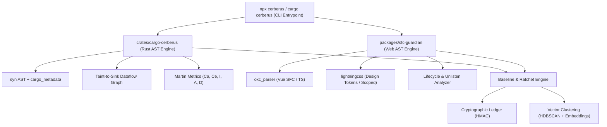

# 🛡️ ARCHITECTURAL & CAPABILITY FIREWALL (`Cerberus` / `cargo-cerberus`)
## Инженерный Хаб и План Реализации

> **Проект**: Независимый, сверхбыстрый архитектурный и капабилити-фаервол нового поколения для Rust, Vue 3, TypeScript и CSS.  
> **Миссия**: Блокировать архитектурную эрозию, побег AI-агентов, скрытые утечки памяти и деградацию связности на уровне AST и Taint-графа компилятора.

---

## 📚 Структура Документации и Планов Реализации

В этой директории собраны исчерпывающие спецификации и пошаговые инженерные инструкции для создания фаервола:

| Документ | Описание | Основные Технологии |
|---|---|---|
| [**01_ARCHITECTURE_CORE.md**](./01_ARCHITECTURE_CORE.md) | Архитектура ядра Rust CLI: `syn` AST Visitor, `cargo_metadata`, граф зависимостей, Taint-to-Sink Data-Flow Engine. | Rust, `syn`, `cargo_metadata`, `rayon`, `petgraph` |
| [**02_FRONTEND_GUARDIAN.md**](./02_FRONTEND_GUARDIAN.md) | Анализатор Vue 3 SFC, TypeScript и CSS: чистота `<script setup>`, Scoped CSS, детектор утечек ресурсов и IPC. | TypeScript, `oxc_parser`, `lightningcss`, AST |
| [**03_VECTOR_INTELLIGENCE.md**](./03_VECTOR_INTELLIGENCE.md) | Семантическая кластеризация Baseline (HDBSCAN), выявление 15 корневых паттернов и Architecture Memory RAG. | `bge-m3`, `all-MiniLM`, HDBSCAN, SurrealDB HNSW |
| [**04_RATCHET_AND_LEDGER.md**](./04_RATCHET_AND_LEDGER.md) | Принцип Храповика (`cerberus-baseline.json`), криптографический реестр `cerberus-ledger.lock` и Human-in-the-Loop. | SHA-256/HMAC, JSON Baseline, CLI Wizard |
| [**05_IMPLEMENTATION_ROADMAP.md**](./05_IMPLEMENTATION_ROADMAP.md) | Пошаговый спринтерский план разработки, файлы проекта, команды запуска и чеклист сдачи. | Спринты 1–4, миграция 7 JS-скриптов |

---

## 🎯 Архитектурная Топология Инструмента



---

## ⚡ Быстрый Старт для Разработчика (Будущий DX)

```bash
# 1. Инициализация в 1 команду
cargo cerberus init

# 2. Запуск в CI / pre-commit
cargo cerberus check

# 3. Интеллектуальный отчет по кластерам техдолга
cargo cerberus explain --clusters
```
