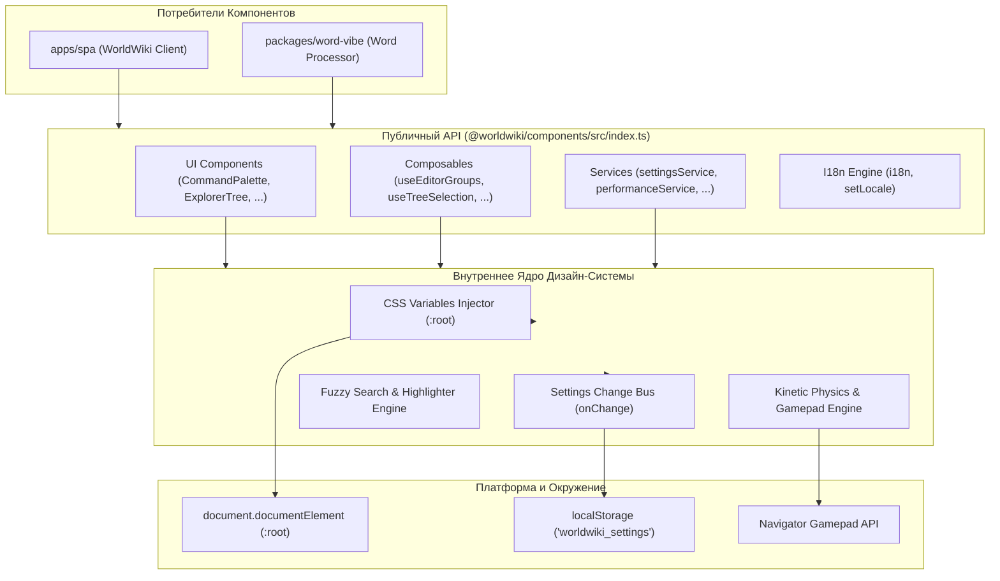
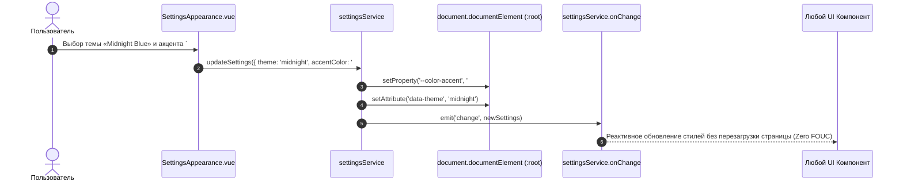

# @worldwiki/components — Генеральный Атлас Дизайн-Системы, Каталог Компонентов и Дорожная Карта

> **Назначение**: Автономный пакет базовых UI-компонентов, синглтон-сервисов, дизайн-токенов и композаблов экосистемы WorldWiki. Предоставляет единую дизайн-систему, адаптивные рабочие каркасы (`WorkspaceLayout`), виртуализированные проводники (`ExplorerTree`), многооконные сплит-панели (`EditorTabBar`, `EditorGroupPane`), оверлеи быстрого поиска (`CommandPalette`, `QuickOpen`), плавающие окна (`FloatingWindow`), кинетические колёса ввода (`XboxWheel`) и полнофункциональный модуль глобальных настроек (`Settings`).

---

## 🗺️ Дорожная Карта и Навигатор по Документации (Documentation Roadmap)

Пакет `@worldwiki/components` разделен на логические слои, каждый из которых снабжен детальной инженерной документацией:

```
packages/components/
├── README.md                           # 🌟 Генеральный архитектурный атлас и дорожная карта (текущий файл)
│
├── 🎨 src/components/Vue/               # [Слой UI-Компонентов Дизайн-Системы]
│   ├── README_VueComponents.md         # 📖 Документация 28 компонентов (Палитра, Вкладки, Деревья, Колёса)
│   ├── CommandPalette.vue              # Командная палитра (Ctrl+P / Cmd+K) с Fuzzy Search
│   ├── QuickOpen.vue                   # Быстрый переход по объектам проекта (Ctrl+O)
│   ├── WorkspaceLayout.vue             # Главный адаптивный сплиттер панелей
│   ├── ExplorerTree.vue                # Виртуализированное дерево сущностей и глав
│   ├── EditorTabBar.vue                # Панель вкладок с Drag & Drop и Pin
│   ├── FloatingWindow.vue              # Плавающие окна с клампингом к экрану
│   ├── XboxWheel.vue                   # Кинетический ввод для мыши и геймпадов
│   ├── AppDialog.vue                   # Базовое модальное окно с фокус-ловушкой
│   ├── TagsField.vue                   # Селектор цветных тегов с автодополнением
│   ├── ThemeSwitcher.vue               # Компактный переключатель тем
│   ├── HighlightText.vue               # Безопасная подсветка поисковых запросов
│   ├── SafeHtml.vue                    # Санитизированный рендер через DOMPurify
│   │
│   └── ⚙️ Settings/                    # [Модуль Глобальных Настроек Приложения]
│       ├── README_Settings.md          # 📖 Документация 6 вкладок настроек и дизайн-токенов
│       ├── SettingsNavRail.vue         # Боковая рельса навигации по категориям
│       ├── SettingsAppearance.vue      # Темы (Dark, Light, Cyberpunk), акценты, Glassmorphism
│       ├── SettingsInterface.vue       # Плотность UI (Cozy/Compact), ориентация колёс
│       ├── SettingsEditor.vue          # Автосохранение, AI Ghost Text, горячие клавиши
│       ├── SettingsTypography.vue      # Системные шрифты, масштаб UI (80-150%)
│       ├── SettingsMotion.vue          # Физика анимаций, режим Reduce Motion
│       ├── SettingsPerformance.vue     # Монитор памяти, аппаратное ускорение
│       └── SettingsLivePreview.vue     # Интерактивный предпросмотр дизайн-токенов
│
└── ⚡ src/ts/                           # [Слой Core-Сервисов, Композаблов и Типов]
    ├── README_ComponentsCore.md        # 📖 Документация сервисов, интернационализации и DTO
    ├── i18n.ts                         # Двуязычная локализация (RU/EN), функция t()
    ├── services/                       # settingsService, performanceService, editorService, apiService
    ├── composables/                    # useEditorGroups, useShellApp, useTreeSelection, useAppDialog
    └── types/                          # Строгая типизация AppSettings, TreeNodeData, Tauri
```

---

## 🏛️ Генеральная Архитектурная Модель Пакета



---

## 🔄 Жизненный цикл применения дизайн-токенов в приложении (Sequence Diagram)



---

## 📦 Сводная Таблица Публичного Экспорта (`src/index.ts`)

| Экспортируемый Символ | Категория | Роль в системе | Ссылка на документацию |
|---|---|---|---|
| **`CommandPalette`** | Компонент | Глобальная командная палитра (`Ctrl+P` / `Cmd+K`) с нечетким поиском | [README_VueComponents.md](./src/components/Vue/README_VueComponents.md#1-commandpalettevue--usecommandpalettets) |
| **`QuickOpen`** | Компонент | Мгновенный переход по проекту (`Ctrl+O`) к главам, сущностям, датам | [README_VueComponents.md](./src/components/Vue/README_VueComponents.md) |
| **`ExplorerTree`** | Компонент | Виртуализированное иерархическое дерево с Drag & Drop | [README_VueComponents.md](./src/components/Vue/README_VueComponents.md#2-explorertreevue--treenodesvue) |
| **`EditorTabBar`** | Компонент | Панель вкладок открытых документов с Pin и Dirty-state | [README_VueComponents.md](./src/components/Vue/README_VueComponents.md#4-editortabbarvue--useeditortabbarts) |
| **`EditorGroupPane`** | Компонент | Рабочая панель сплит-редактора с заголовком и мультисплитом | [README_VueComponents.md](./src/components/Vue/README_VueComponents.md) |
| **`FloatingWindow`** | Компонент | Плавающее окно с перемещением, ресайзом и стеком Z-index | [README_VueComponents.md](./src/components/Vue/README_VueComponents.md#3-floatingwindowvue--usefloatingwindowts) |
| **`XboxWheel`** | Компонент | Кинетический контрол прокрутки для мыши и геймпадов Xbox/DualSense | [README_VueComponents.md](./src/components/Vue/README_VueComponents.md#-кинетическая-физика-xboxwheel-интерфейс-ввода-геймпада-и-мыши) |
| **`Settings`** | Компонент | Модальное окно глобальных настроек (6 вкладок дизайн-системы) | [README_Settings.md](./src/components/Vue/Settings/README_Settings.md) |
| **`WorkspaceLayout`** | Компонент | Главный адаптивный сплит-каркас рабочих панелей | [README_VueComponents.md](./src/components/Vue/README_VueComponents.md) |
| **`TagsField`** | Компонент | Редактор цветных тегов с автодополнением и валидацией | [README_VueComponents.md](./src/components/Vue/README_VueComponents.md#5-tagsfieldvue--usetagsfieldts) |
| **`SafeHtml`** | Компонент | Санитизатор пользовательского HTML через `DOMPurify` | [README_VueComponents.md](./src/components/Vue/README_VueComponents.md#6-safehtmlvue) |
| **`useEditorGroups`** | Composable | Логика мультисплита редакторов (Horizontal / Vertical Split) | [README_ComponentsCore.md](./src/ts/README_ComponentsCore.md#-жизненный-цикл-мультисплита-редакторов-useeditorgroups-sequence-diagram) |
| **`useTreeSelection`** | Composable | Алгоритм диапазонного выделения в деревьях (`Shift+Click`, `Ctrl+Click`) | [README_ComponentsCore.md](./src/ts/README_ComponentsCore.md#-алгоритм-диапазонного-мультиселекта-usetreeselection) |
| **`settingsService`** | Сервис | Синглтон управления токенами, темами и параметрами | [README_ComponentsCore.md](./src/ts/README_ComponentsCore.md#1-settingsservicets) |
| **`i18n`** | Локализация | Двуязычный движок локализации (RU/EN) | [README_ComponentsCore.md](./src/ts/README_ComponentsCore.md#4-i18nts) |

---

## 🎨 Спецификация Дизайн-Токенов (:root)

```css
:root {
  /* Акцентный цвет и прозрачности */
  --color-accent: #00e5ff;
  --color-accent-hover: #33ebff;
  --color-accent-subtle: rgba(0, 229, 255, 0.15);

  /* Фоновые и текстовые цвета */
  --color-bg-primary: #0f1218;
  --color-bg-secondary: #161b24;
  --color-text-primary: #e6edf3;
  --color-text-secondary: #8b949e;

  /* Геометрия скруглений */
  --border-radius-sm: 4px;
  --border-radius-md: 8px;
  --border-radius-lg: 12px;

  /* Glassmorphism подложка */
  --glass-bg: rgba(22, 27, 36, 0.75);
  --glass-border: 1px solid rgba(255, 255, 255, 0.1);
  --glass-blur: blur(12px);

  /* Масштаб интерфейса */
  --ui-scale: 1.0;
}
```

---

## ⚠️ Важные нюансы реализации (Gotchas & Best Practices)

1. **Изоляция от Pinia-хранилищ SPA**:
   * Пакет `@worldwiki/components` спроектирован как полностью автономный UI-kit и не зависит от глобальных сторов `apps/spa`. Все данные передаются через Props / Emits / Composable-хуки.
2. **Исключение циклических зависимостей**:
   * Компоненты импортируют стили исключительно через дизайн-токены `--color-*`, что позволяет менять темы без перекомпиляции бандла.
3. **Безопасность Gamepad API**:
   * Опрос геймпада через `requestAnimationFrame` запускается только при фокусе на `XboxWheel` и гарантированно уничтожается при `unmounted`.

---

## 🧪 Верификация и тестирование пакета

```bash
# 1. Проверка типов TypeScript
pnpm --filter @worldwiki/components typecheck

# 2. Запуск юнит-тестов компонентов и сервисов
pnpm --filter @worldwiki/components test

# 3. Сборка пакета и генерация деклараций
pnpm --filter @worldwiki/components build
```
