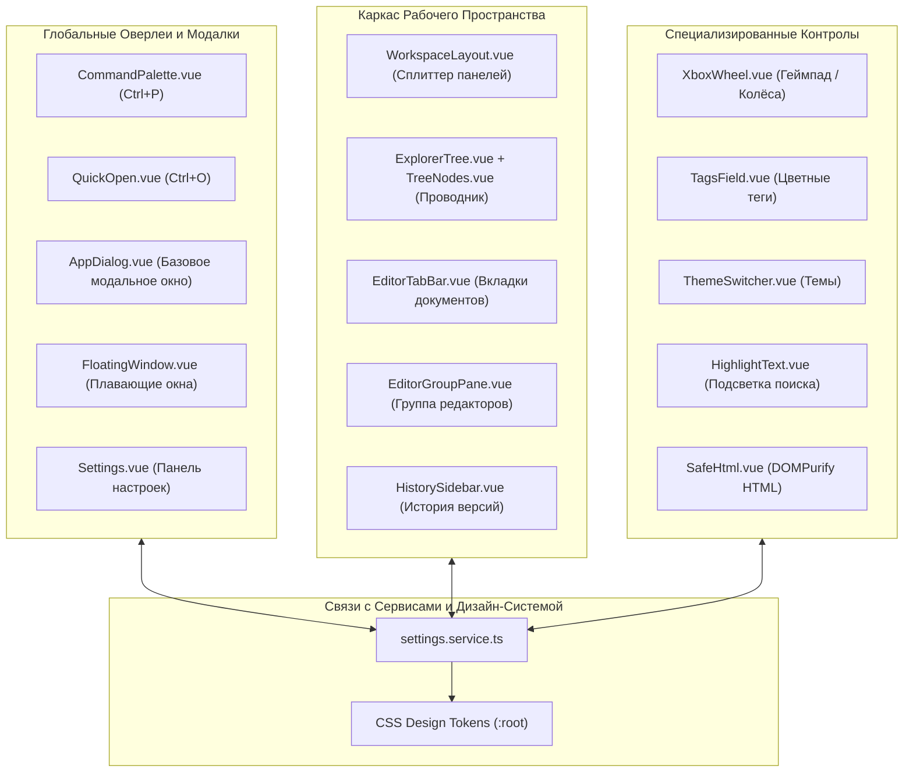
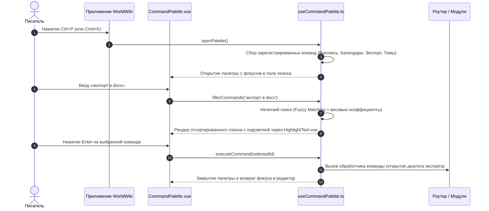

# packages/components/src/components/Vue — Библиотека Базовых UI-Компонентов WorldWiki

> **Назначение**: Основная библиотека переиспользуемых Vue 3 компонентов дизайн-системы WorldWiki. Включает глобальные интерфейсные механизмы: командную палитру (`CommandPalette`), быстрый переход (`QuickOpen`), многооконные сплит-панели и вкладки (`EditorTabBar`, `EditorGroupPane`), виртуализированные иерархические деревья (`ExplorerTree`, `TreeNodes`), плавающие окна с физикой перемещения (`FloatingWindow`), кинетические колёса ввода для мыши и геймпада (`XboxWheel`), компонент безопасного HTML (`SafeHtml`), редактор тегов (`TagsField`) и навигационный сплит-каркас (`WorkspaceLayout`).

---

## 📁 Структура папок и файлов

```
packages/components/src/components/Vue/
├── README_VueComponents.md             # 🌟 Данная всеобъемлющая документация библиотеки UI-компонентов
│
├── AppDialog.vue                       # Базовое модальное окно: Teleport, анимация fade/scale, фокус-ловушка
├── CommandPalette.vue                  # Командная палитра (Ctrl+P / Cmd+K) с нечетким поиском (Fuzzy Search)
├── useCommandPalette.ts                # Composable: горячие клавиши, фильтрация действий, категории команд
├── QuickOpen.vue                       # Быстрый переход по проекту (Ctrl+O): главы, сущности, даты, события
├── useQuickOpen.ts                     # Composable быстрого поиска объектов по всей базе данных
│
├── EditorTabBar.vue                    # Панель вкладок открытых документов (Drag & Drop, Pin, Dirty state)
├── useEditorTabBar.ts                  # Composable управления активными вкладками, историей закрытия
├── EditorGroupPane.vue                 # Рабочая панель сплит-редактора с заголовком и кнопками сплита
│
├── ExplorerTree.vue                    # Виртуализированное проводниковое дерево (главы, папки, сущности)
├── useExplorerTree.ts                  # Composable: раскрытие веток, сортировка, контекстные меню, драг-н-дроп
├── TreeNodes.vue                       # Рекурсивный узел дерева с отступами уровней и иконками типов
│
├── FloatingWindow.vue                  # Плавающее окно с перемещением (Drag), ресайзом и Z-index стеком
├── useFloatingWindow.ts                # Composable: координаты x/y, размеры w/h, привязка к границам экрана
│
├── XboxWheel.vue                       # Кинетический контрол прокрутки для мыши и геймпадов Xbox/DualSense
├── useXboxWheel.ts                     # Composable: физика инерции, демпфирование, виброотклик (Haptic Feedback)
│
├── TagsField.vue                       # Редактор тегов: автодополнение, цветовые бейджи, клавиатурный ввод
├── useTagsField.ts                     # Composable: поиск тегов, валидация дубликатов, выбор цветов
│
├── ThemeSwitcher.vue                   # Компактный переключатель тем (Dark, Light, Cyberpunk, System)
├── useThemeSwitcher.ts                 # Composable: синхронизация с settingsService и переключение классов
│
├── HighlightText.vue                   # Подсветка совпадений поисковых запросов в тексте
├── useHighlightText.ts                 # Composable безопасного экранирования RegExp и разделения на токены
├── HistorySidebar.vue                  # Боковая панель истории ревизий и снимков проекта
├── useHistorySidebar.ts                # Composable управления снимками истории и отката версий
│
├── SafeHtml.vue                        # Безопасный рендерер пользовательского HTML через DOMPurify
├── WorkspaceLayout.vue                 # Главный адаптивный сплит-каркас рабочих панелей
├── useWorkspaceLayout.ts               # Composable ресайза панелей и сохранения ширин в localStorage
│
├── Settings.vue                        # Модальное окно глобальных настроек (обертка модуля Settings)
├── useSettings.ts                      # Composable вызова модалки настроек из любого места приложения
└── Settings/                           # Модуль вкладок настроек (Внешний вид, Интерфейс, Шрифты, и т.д.)
    └── README_Settings.md              # 📖 Документация модуля настроек
```

---

## 🏛️ Архитектурная модель библиотеки компонентов



---

## 🔄 Жизненный цикл Командной Палитры (`CommandPalette` Sequence Diagram)



---

## 🎮 Кинетическая физика `XboxWheel` (Интерфейс ввода геймпада и мыши)

Контрол `XboxWheel` используется в селекторах дат, барабанах времени и числовых шкалах:

### 1. Математика инерции и демпфирования

При скролле мыши или отклонении стика геймпада $A_{\text{stick}} \in [-1.0, 1.0]$ скорость прокрутки $V_t$ пересчитывается каждый кадр ($\Delta t \approx 16.6\text{ мс}$):

$$V_{t} = V_{t-1} \times \mu_{\text{friction}} + A_{\text{stick}} \times K_{\text{sensitivity}}$$
$$X_{t} = X_{t-1} + V_{t} \times \Delta t$$

где:

- $\mu_{\text{friction}} = 0.88$ — коэффициент вязкого трения;
- $K_{\text{sensitivity}} = 1.45$ — чувствительность стика;
- При достижении шага $X_t \pmod{\text{itemHeight}} = 0$ триггерится тактильный виброотклик геймпада (GamePad Haptic Vibration API, длительность $15\text{ мс}$, интенсивность $0.3$).

---

## 🧩 Подробный справочник компонентов библиотеки

### 1. `CommandPalette.vue` & `useCommandPalette.ts`

- **Горячие клавиши**: `Ctrl+P`, `Cmd+K`, `Escape` (закрытие), `ArrowDown`/`ArrowUp` (навигация), `Enter` (выполнение).
- **Категории**: _Навигация, Редактор, Форматирование, Настройки, Инструменты ИИ_.
- **Подсветка**: Интеграция с `HighlightText.vue` для подсветки найденных символов.

### 2. `ExplorerTree.vue` & `TreeNodes.vue`

- **Возможности**: Иерархическое представление с неограниченной вложенностью, кастомные иконки по типам узлов, индикаторы статуса (черновик / готово), подсчет количества слов.
- **Drag & Drop**: Визуальная линия вставки (сверху, снизу, внутрь папки) с защитой от перетаскивания родителя в собственного потомка.

### 3. `FloatingWindow.vue` & `useFloatingWindow.ts`

- **Физика**: Свободное перемещение за шапку, 8-направленный ресайз по границам, автоматический подъем активного окна на вершину Z-index стека.
- **Клапминг**: Автоматическое удержание окна в пределах видимой области экрана пользователя.

### 4. `EditorTabBar.vue` & `useEditorTabBar.ts`

- **Управление**: Вкладки открытых глав и сущностей, индикатор несохраненных изменений (`dirty`), закрепленные вкладки (`pinned`), контекстное меню закрытия (_Закрыть другие, Закрыть справа_).

### 5. `TagsField.vue` & `useTagsField.ts`

- **Интерактив**: Ввод тегов через запятую или `Enter`, палитра из 12 предустановленных гармоничных цветов, всплывающее меню автодополнения существующих тегов проекта.

### 6. `SafeHtml.vue`

- **Безопасность**: Санитизация любого входящего HTML через `DOMPurify.sanitize()` с поддержкой безопасных SVG-иконок и математических формул MathML.

---

## ⚠️ Важные нюансы реализации (Gotchas & Best Practices)

1. **Фокус-ловушка в `AppDialog` и `CommandPalette`**:
   - При открытии модального окна фокус принудительно захватывается внутри контейнера (`Focus Trap`), предотвращая переход по элементам фонового интерфейса по нажатию `Tab`.
2. **Очистка слушателей Gamepad API**:
   - `useXboxWheel` запускает цикл `requestAnimationFrame` для опроса состояния геймпада только при активном фокусе на контроле и гарантированно останавливает опрос в хуке `onUnmounted()`.
3. **Безопасное экранирование в `HighlightText`**:
   - Все поисковые подстроки экранируются функцией `escapeRegExp()`, исключая ошибки при вводе спецсимволов `[`, `(`, `*`, `+`, `?`.

---

## 🧪 Верификация и тестирование

Запуск тестового набора библиотеки компонентов:

```bash
# Тесты всех компонентов Vue дизайн-системы
pnpm test packages/components/src/components/Vue

# Тесты командной палитры и быстрого перехода
pnpm test packages/components/src/components/Vue/useCommandPalette.ts
pnpm test packages/components/src/components/Vue/useQuickOpen.ts

# Тесты проводникового дерева и вкладок
pnpm test packages/components/src/components/Vue/useExplorerTree.ts
pnpm test packages/components/src/components/Vue/useEditorTabBar.ts
```
