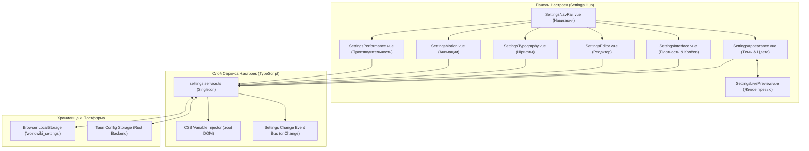
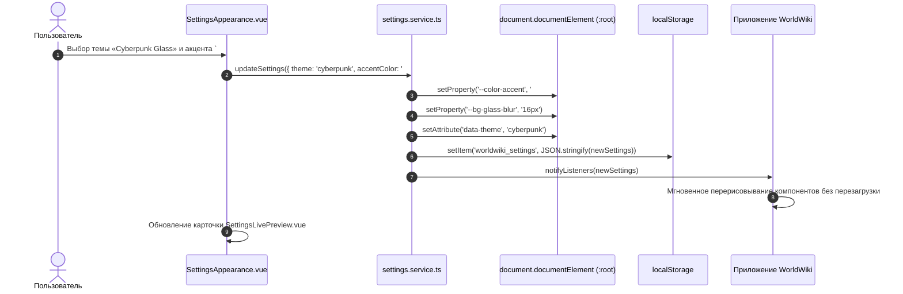

# packages/components/.../Settings — Архитектура Модуля Глобальных Настроек и Дизайн-Системы

> **Назначение**: Централизованный графический конфигуратор всех пользовательских настроек, тем оформления, дизайн-токенов, типографики, физики анимаций и аппаратной производительности приложения WorldWiki. Обеспечивает мгновенное реактивное применение стилей через инъекцию CSS-переменных в `:root`, сохранение параметров в `localStorage` и синхронизацию с Tauri Backend через `settings.service.ts`.

---

## 📁 Структура папок и файлов

```
packages/components/src/components/Vue/Settings/
├── README_Settings.md                  # Данная всеобъемлющая документация модуля настроек
│
├── SettingsNavRail.vue                 # Левая навигационная рельса: переключение категорий настроек
├── SettingsAppearance.vue              # Вкладка 1: Темы (Dark, Light, Cyberpunk, Midnight), акценты, Glassmorphism
├── useSettingsAppearance.ts            # Composable управления палитрой, акцентным цветом и радиусами
├── SettingsInterface.vue               # Вкладка 2: Плотность UI (Cozy/Compact), ориентация колёс даты, тулбары
├── SettingsEditor.vue                  # Вкладка 3: Параметры редактора (автосохранение, AI Ghost Text, горячие клавиши)
├── SettingsTypography.vue              # Вкладка 4: Системные шрифты (Inter, Garamond, JetBrains), масштабирование (80-150%)
├── SettingsMotion.vue                  # Вкладка 5: Физика переходов, скорость анимаций, режим Reduce Motion
├── SettingsPerformance.vue             # Вкладка 6: Аппаратное ускорение WebView2, кэширование, лимиты памяти
├── useSettingsPerformance.ts           # Composable мониторинга FPS, очистки кэша и оптимизации DOM
├── SettingsLivePreview.vue             # Интерактивный виджет живого предпросмотра применяемых токенов
└── useSettingsLivePreview.ts           # Composable реактивного обновления карточки превью
```

---

## 🏛️ Архитектурная модель Дизайн-Системы и Настроек



---

## 🔄 Жизненный цикл изменения настройки (Sequence Diagram)



---

## 🎨 Спецификация Дизайн-Токенов (CSS Custom Properties)

При изменении настроек `settings.service.ts` динамически инжектирует в `:root` следующий набор токенов:

```css
:root {
  /* 1. Цветовая палитра и акценты */
  --color-accent: #00e5ff;
  --color-accent-hover: #33ebff;
  --color-accent-subtle: rgba(0, 229, 255, 0.15);
  --color-bg-primary: #0f1218;
  --color-bg-secondary: #161b24;
  --color-text-primary: #e6edf3;
  --color-text-secondary: #8b949e;

  /* 2. Скругления и геометрия */
  --border-radius-sm: 4px;
  --border-radius-md: 8px;
  --border-radius-lg: 12px;
  --border-radius-full: 9999px;

  /* 3. Glassmorphism эффекты */
  --glass-bg: rgba(22, 27, 36, 0.75);
  --glass-border: 1px solid rgba(255, 255, 255, 0.1);
  --glass-blur: blur(12px);

  /* 4. Типографика и масштабирование */
  --font-family-sans: 'Inter', system-ui, sans-serif;
  --font-family-serif: 'Garamond', 'Georgia', serif;
  --font-family-mono: 'JetBrains Mono', monospace;
  --ui-scale: 1.0; /* 0.8 .. 1.5 */

  /* 5. Физика анимаций */
  --transition-fast: 150ms cubic-bezier(0.4, 0, 0.2, 1);
  --transition-normal: 250ms cubic-bezier(0.4, 0, 0.2, 1);
}
```

---

## 🧭 Подробный обзор вкладок настроек

### 1. Внешний вид (`SettingsAppearance`)
* **Пресеты тем**: Dark (Тёмная), Light (Светлая), Midnight Blue, Cyberpunk Neon, Vintage Parchment.
* **Пользовательский акцент**: Палитра из 8 фирменных оттенков + Color Picker с генерацией гармоничных оттенков HSL.
* **Интенсивность Glassmorphism**: Настройка размытия подложки (`backdrop-filter: blur(0..24px)`).

### 2. Интерфейс (`SettingsInterface`)
* **Плотность компоновки**: `Compact` (для небольших экранов ноутбков), `Cozy` (стандарт), `Comfortable` (крупные тач-элементы).
* **Ориентация колёс даты**: Переключение барабанов `DateWheels` между вертикальным списком и компактной горизонтальной лентой с поддержкой геймпадов Xbox.

### 3. Текстовый Редактор (`SettingsEditor`)
* **Автосохранение**: Переключатель и интервал дебаунса (1000..5000 мс).
* **AI Ghost Text**: Включение автодополнения текста-призрака и клавиши принятия (`Tab` / `Right Arrow`).
* **Отображение семантики**: Подсветка блоков диалогов `!д`, описаний `!о` и мыслей `!м`.

### 4. Типографика (`SettingsTypography`)
* **Выбор шрифтов**: Селекторы гарнитур для интерфейса, текста рукописи и кода.
* **Масштаб UI**: Плавный ползунок масштабирования от 80% до 150% через CSS Zoom / Transform.

### 5. Анимации (`SettingsMotion`)
* **Режим Reduce Motion**: Мгновенное отключение параллаксов, блюров и тяжелых CSS keyframe анимаций для слабых GPU.
* **Кривые сглаживания**: Выбор характера переходов (`ease-out`, `spring-physics`).

### 6. Производительность (`SettingsPerformance`)
* **Кэширование изображений**: Очистка кэша Base64 медиа-вложений и миниатюр.
* **Виртуализация списков**: Настройка порога виртуального скролла для деревьев глав и сущностей (> 100 элементов).

---

## ⚠️ Важные нюансы реализации (Gotchas & Best Practices)

1. **Безопасность инъекции токенов в `:root`**:
   * Все входящие цвета и радиусы валидируются перед установкой `setProperty()`, исключая возможность внедрения некорректных CSS-значений или XSS.
2. **Мгновенная синхронизация без перезагрузки**:
   * `settingsService.onChange()` оповещает все активные компоненты и WebGL/Canvas холсты о смене темы, обеспечивая бесшовный переход без мерцания белым экраном (FOUC).
3. **Устойчивость к сбросу кэша**:
   * При повреждении структуры `localStorage` служба `settingsService` автоматически восстанавливает безопасные дефолтные значения `DEFAULT_SETTINGS`.

---

## 🧪 Верификация и тестирование

Запуск тестового набора модуля настроек:
```bash
# Тесты компонентов и хуков настроек
pnpm test packages/components/src/components/Vue/Settings
```
