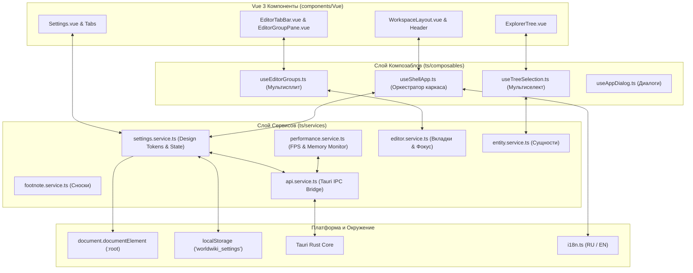
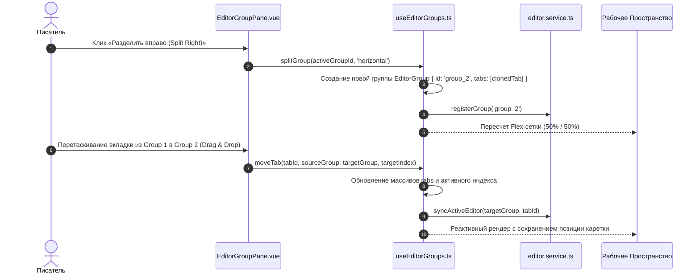

# packages/components/src/ts — Архитектура Сервисов, Композаблов и Core-Слоя Компонентов

> **Назначение**: Фундаментальный слой логики, служб и композаблов пакета `@worldwiki/components`. Содержит центральные синглтон-сервисы (`settings.service`, `performance.service`, `editor.service`, `api.service`), систему интернационализации (`i18n`), архитектуру мультисплита редакторов (`useEditorGroups`), оркестратор десктопной оболочки (`useShellApp`), менеджер мультиселекта деревьев (`useTreeSelection`) и типизацию платформы Tauri.

---

## 📁 Структура папок и файлов

```
packages/components/src/ts/
├── README_ComponentsCore.md            # 🌟 Данная всеобъемлющая документация Core-слоя компонентов
├── i18n.ts                             # Подсистема интернационализации: словари (RU/EN), реактивная функция t()
│
├── services/                           # Синглтон-сервисы уровня приложения
│   ├── settings.service.ts             # Управление настройками, инъекция CSS-токенов в :root, Tauri IPC
│   ├── performance.service.ts          # Мониторинг FPS, профилирование памяти, бенчмаркинг рендеринга
│   ├── editor.service.ts               # Управление активными вкладками, фокусом и состоянием редакторов
│   ├── entity.service.ts               # Сервис быстрого резолва сущностей и связей лора
│   ├── footnote.service.ts             # Сервис динамической индексации и нумерации сносок
│   └── api.service.ts                  # Базовый транспортный слой вызовов Tauri IPC и REST API
│
├── composables/                        # Ключевые архитектурные Composable-хуки
│   ├── useShellApp.ts                  # Оркестратор оболочки: тайтлбар, сайдбары, меню, горячие клавиши
│   ├── useEditorGroups.ts              # Мультисплит: сетка панелей редактора (Split Horizontal / Vertical)
│   ├── useTreeSelection.ts             # Мультиселект в деревьях: Shift+Click, Ctrl+Click, Range Selection
│   └── useAppDialog.ts                 # Программный вызов модальных окон (Alert, Confirm, Prompt)
│
├── app/                                # Системные константы и конфигурация
│   └── settings.ts                     # Дефолтные схемы и начальные значения настроек DEFAULT_SETTINGS
│
├── types/                              # Декларации глобальных типов
│   ├── settings.d.ts                   # Строгая типизация всех параметров дизайн-системы и интерфейса
│   └── tauri.d.ts                      # Контракты вызовов Tauri Core и плагинов Rust
│
└── utils/                              # Вспомогательные утилиты
    └── dialogs.ts                      # Хелперы системных и кастомных диалогов подтверждения
```

---

## 🏛️ Архитектурная модель Core-Слоя



---

## 🔄 Жизненный цикл Мультисплита Редакторов (`useEditorGroups` Sequence Diagram)



---

## 🧮 Алгоритм Диапазонного Мультиселекта (`useTreeSelection`)

При зажатых клавишах `Shift` или `Ctrl` хук `useTreeSelection` вычисляет непрерывный диапазон выделенных узлов дерева:

1. Пусть $L = [n_0, n_1, \dots, n_k]$ — плоский список всех видимых (развернутых) узлов дерева.
2. При клике на узел $n_B$ с зажатым `Shift` от предыдущего якоря $n_A$:
   $$i_A = \text{indexOf}(n_A, L), \quad i_B = \text{indexOf}(n_B, L)$$
   $$\text{SelectedRange} = L[\min(i_A, i_B) \dots \max(i_A, i_B)]$$
3. Множество выделения объединяется в `Set<string>`:
   $$\text{Selection}_{\text{new}} = \text{Selection}_{\text{existing}} \cup \text{SelectedRange}$$

---

## 🧩 Подробный справочник сервисов

### 1. `settings.service.ts`
* **Роль**: Глобальный синглтон управления дизайн-токенами, темами и параметрами.
* **Методы**:
  * `updateSettings(partial)`: Атомарное обновление с инъекцией переменных в `:root`.
  * `onChange(callback)`: Подписка на изменение настроек (Event Bus).
  * `resetToDefaults()`: Безопасный сброс до заводских значений.

### 2. `performance.service.ts`
* **Роль**: Непрерывный аудит производительности рендеринга.
* **Метрики**:
  * Вычисление скользящего среднего FPS ($\text{FPS} = 1000 / \Delta t_{\text{frame}}$).
  * Детекция просадок кадров (Jank Detection) и автоматическое предложение включить режим *Reduce Motion*.
  * Мониторинг объема кучи `performance.memory` (в средах с поддержкой).

### 3. `editor.service.ts`
* **Роль**: Координатор открытых вкладок и фокуса каретки между группами сплит-редактора.
* **Функции**: Синхронизация состояния dirty (несохраненные правки), восстановление сессии вкладок при перезапуске.

### 4. `i18n.ts`
* **Роль**: Двуязычная локализация приложения (Русский / English).
* **Сигнатура**: `t(path: string, params?: Record<string, string>): string`.
* **Плюрализация**: Поддержка славянских форм множественного числа (1 глава, 2 главы, 5 глав).

---

## ⚠️ Важные нюансы реализации (Gotchas & Best Practices)

1. **Защита от циклических импортов в Сервисах**:
   * Все сервисы в `ts/services` используют принцип Dependency Injection и не импортируют Vue-компоненты напрямую. Связь с UI осуществляется через реактивные `ref` и `EventEmitter`.
2. **Изоляция Tauri IPC в браузере (Fallback Mode)**:
   * `api.service.ts` автоматически проверяет наличие глобального объекта `window.__TAURI_INTERNALS__`. При запуске в обычном браузере (dev-mode без Tauri) все IPC-вызовы бесшовно переключаются на mock-хранилище `localStorage` без крашей.
3. **Очистка слушателей событий**:
   * При подписке через `settingsService.onChange(cb)` метод возвращает функцию отписки `UnsubscribeFn`, которую необходимо вызывать в `onUnmounted()`.

---

## 🧪 Верификация и тестирование

Запуск тестового набора Core-слоя компонентов:
```bash
# Тесты сервисов настроек и производительности
pnpm test packages/components/src/ts/services

# Тесты композаблов мультисплита и мультиселекта
pnpm test packages/components/src/ts/composables
```
