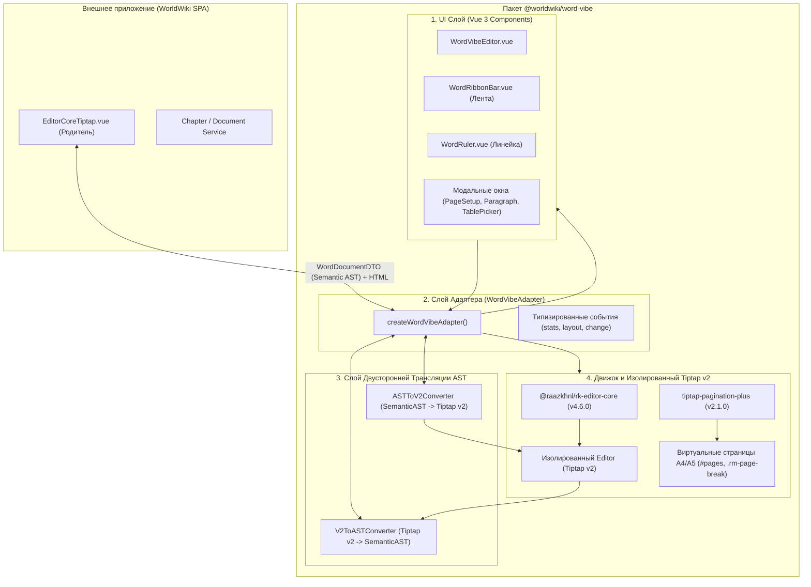
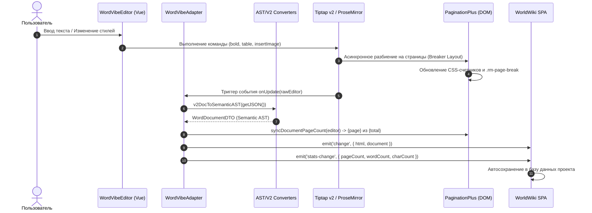

# @worldwiki/word-vibe — Архитектура и Движок Word-режима WorldWiki

> **Назначение**: Полностью изолированный, высокопроизводительный пакет постраничного WYSIWYG-редактирования Word-класса для WorldWiki. Построен на базе ядра `@raazkhnl/rk-editor-core` (версия 4.6.0) и системы постраничной вёрстки `tiptap-pagination-plus` (версия 2.1.0) с собственной изолированной средой Tiptap v2. 
> 
> **Архитектурный инвариант пакета**:  
> **«Наружу — только чистые данные»** (Clean Data Boundary). Пакет не имеет прямых зависимостей от SPA-хранилищ Pinia, Tauri API, роутера или Tiptap v3. Вся коммуникация с внешним миром осуществляется через типизированный адаптер (`WordVibeAdapter`), события и DTO абстрактного синтаксического дерева (`WordDocumentDTO` / `SemanticDocument`).

---

## 📁 Структура папок и файлов

```
packages/word-vibe/
├── README_WordVibe.md                  # Всеобъемлющая документация архитектуры, геометрии и DTO
├── package.json                        # Изолированные зависимости: rk-editor-core, tiptap-pagination-plus, vue
├── tsconfig.json                       # Конфигурация TypeScript (strict mode, JSX/Vue preserve)
├── __tests__/                          # Набор интеграционных и модульных тестов
│   └── wordVibeAdapter.spec.ts         # Тесты адаптера, событий, конвертеров и геометрии
│
└── src/
    ├── index.ts                        # Главная точка входа пакета (экспорт компонентов, адаптера, типов)
    ├── styles.ts                       # Экспорт путей стилей
    │
    ├── types/                          # Контракты данных и DTO
    │   ├── dto.ts                      # WordDocumentDTO, WordLayoutDTO, WordSelectionDTO, WordStatsDTO
    │   ├── semanticAst.ts              # Semantic AST типы узлов (Paragraph, Table, Figure, Equation)
    │   └── v2Node.ts                   # Схема JSON-узлов движка Tiptap v2 / ProseMirror
    │
    ├── adapter/                        # Слой абстракции движка над UI
    │   ├── WordVibeAdapter.ts          # Интерфейс контракта адаптера (mount, execCommand, loadDocument)
    │   ├── createWordVibeAdapter.ts    # Фабрика инкапсулированного адаптера с поддержкой событий
    │   └── events.ts                   # Типизированная карта событий (change, layout-change, stats-change)
    │
    ├── converter/                      # Двусторонние трансляторы AST <-> Tiptap v2 JSON
    │   ├── ASTToV2Converter.ts         # Трансляция Semantic AST -> ProseMirror v2 Document JSON
    │   └── V2ToASTConverter.ts         # Трансляция ProseMirror v2 Document JSON -> Semantic AST
    │
    ├── editor/                         # Ядро редактора и интеграционные мосты
    │   ├── geometryHelper.ts           # Математика и формулы перевода размеров (мм <-> px при 96 DPI)
    │   ├── rkPaginationBridge.ts       # Мост виртуальных страниц, расчет геометрии и DOM-синхронизация
    │   ├── useRkWordEditor.ts          # Composable жизненного цикла редактора и реактивного состояния
    │   ├── RkWordEditor.model.ts       # Интерфейс пропсов и эмиттов компонента RkWordEditor
    │   └── extensions/                 # Специализированные расширения ГОСТ и разметки
    │       ├── GostTableCaption.ts     # ГОСТ-подписи таблиц «Таблица N — Название» с автонумерацией
    │       ├── GostFigureCaption.ts    # ГОСТ-подписи рисунков «Рисунок N — Название» с автонумерацией
    │       ├── SectionOrientation.ts   # Секционная смена ориентации страниц (Landscape / Portrait)
    │       ├── SceneBreakExtension.ts  # Разрывы сцен (звездочки, линии, отступы)
    │       ├── EntityReferenceExtension.ts # Ссылки на сущности WorldWiki (персонажи, локации, лор)
    │       ├── CrossReferenceExtension.ts  # Перекрестные ссылки на таблицы/рисунки/главы
    │       └── UnsupportedBlockExtension.ts # Fallback-контейнер для неподдерживаемых блоков AST
    │
    ├── ribbon/                         # Командный интерфейс ленты инструментов
    │   └── commands.ts                 # Типизированные сигнатуры команд ленты Word
    │
    └── components/                     # Vue 3 компоненты интерфейса Word
        ├── WordVibeEditor.vue          # Главный монолит-компонент Word-режима (Лента + Линейка + Листы + Статусбар)
        ├── WordVibeEditor.model.ts     # Контракт пропсов и событий WordVibeEditor
        ├── useWordVibeEditor.ts        # Composable контроллера WordVibeEditor
        │
        ├── ribbon/                     # Лента инструментов (Ribbon Bar)
        │   ├── WordRibbonBar.vue       # Вкладки: Главная, Вставка, Макет, Конструктор таблицы, Вид
        │   └── useWordRibbonBar.ts     # Логика дропдаунов, переключения вкладок и выполнения команд
        │
        ├── ruler/                      # Интерактивная линейка (Word Ruler)
        │   ├── WordRuler.vue           # Горизонтальная линейка с делениями в см и бегунками отступов
        │   └── useWordRuler.ts         # Drag & drop бегунков (красная строка, левый/правый отступ)
        │
        └── modals/                     # Диалоговые и модальные окна настроек
            ├── HeaderFooterDialog/     # Диалог настройки колонтитулов (верхний, нижний, первая страница)
            ├── PageSetupModal/         # Модальное окно параметров страницы (Поля, Бумага, Макет)
            ├── ParagraphFormatModal/   # Форматирование абзаца (красная строка, отступы, интервалы)
            ├── TablePickerPopup/       # Hover-сетка выбора размера создаваемой таблицы (до 10x8)
            ├── ImageInsertDialog/      # Диалог вставки рисунков (загрузка файла / URL / base64)
            ├── LinkInsertDialog/       # Диалог вставки гиперссылок и перекрестных ссылок
            └── EquationInsertDialog/   # Редактор математических формул LaTeX
```

---

## 🏛️ Архитектурная модель и разделение слоев

Система построена по принципу 4-уровневой изолированной слоистой архитектуры:



---

## 🔄 Жизненный цикл и двусторонняя синхронизация (Sequence Diagram)

Схема взаимодействия при редактировании текста, пересчёте пагинации и смене параметров страницы:



---

## 📐 Геометрия страниц и математика верстки

### 1. Формулы перевода физических величин (96 DPI)
Печать и постраничное отображение строго нормированы в соответствии с полиграфическим стандартом:
$$1\text{ дюйм} = 25.4\text{ мм} = 96\text{ px}$$
$$\text{Pixels} = \text{Millimeters} \times \frac{96}{25.4} \approx \text{Millimeters} \times 3.779527559$$
$$\text{Centimeters} = \text{Pixels} \times \frac{2.54}{96} \approx \text{Pixels} \times 0.026458333$$

### 2. Таблица форматов бумаги и геометрии
| Формат | Ширина × Высота (мм) | Книжная (Portrait px) | Альбомная (Landscape px) | Стандартное применение |
|---|---|---|---|---|
| **A4** | $210 \times 297$ | $794 \times 1123$ | $1123 \times 794$ | Основной формат ГОСТ 7.32, книги, отчеты |
| **A5** | $148 \times 210$ | $559 \times 794$ | $794 \times 559$ | Художественная литература, брошюры |
| **A3** | $297 \times 420$ | $1123 \times 1587$ | $1587 \times 1123$ | Широкие карты миров, схемы родословных |
| **B5** | $176 \times 250$ | $665 \times 945$ | $945 \times 665$ | Академические издания |
| **Letter**| $215.9 \times 279.4$ | $816 \times 1056$ | $1056 \times 816$ | Международный стандарт США |

### 3. Пресеты полей страницы
* **ГОСТ 7.32-2017 (Стандарт рукописи)**:
  * Левое: `30 мм` (подшив), Правое: `15 мм`, Верхнее: `20 мм`, Нижнее: `20 мм`.
* **Нормальные**: все по `20 мм`.
* **Узкие**: все по `12.7 мм` ($0.5''$).
* **Широкие**: Левое/Правое: `50.8 мм` ($2''$), Верх/Низ: `25.4 мм` ($1''$).

---

## 🗃️ Спецификация контрактов данных (DTO)

### `WordDocumentDTO` (Semantic AST)
Единый межслойный контракт документа Word-режима:
```typescript
export interface WordDocumentDTO {
  id?: string;
  profileId: string; // 'gost' | 'fiction' | 'academic' | 'custom'
  metadata: {
    title: string;
    authors?: string[];
    createdAt?: number;
    updatedAt?: number;
    academic?: {
      faculty?: string;
      department?: string;
      discipline?: string;
      studentGroup?: string;
      supervisor?: string;
      year: number;
      city: string;
    };
  };
  blocks: BlockNode[]; // Paragraph, Heading, Table, Figure, Equation, SceneBreak
}
```

### `WordLayoutDTO`
Параметры раскладки виртуального листа:
```typescript
export interface WordLayoutDTO {
  pageSize: 'A3' | 'A4' | 'A5' | 'Letter' | 'B5';
  orientation: 'portrait' | 'landscape';
  marginsMm: {
    top: number;
    bottom: number;
    left: number;
    right: number;
  };
}
```

### `WordSelectionDTO`
Состояние курсора и активного выделения для линейки и контекстных вкладок:
```typescript
export interface WordSelectionDTO {
  empty: boolean;
  isInsideTable: boolean;
  firstLineIndentCm: number; // Отступ первой строки (красная строка, по умолчанию 1.25 см)
  leftIndentCm: number;      // Левый отступ блока
  rightIndentCm: number;     // Правый отступ блока
  alignment?: 'left' | 'center' | 'right' | 'justify';
  isBold?: boolean;
  isItalic?: boolean;
  isUnderline?: boolean;
  headingLevel?: number;
}
```

---

## 🧩 Ключевые модули и алгоритмы

### 1. Мост виртуальных страниц (`rkPaginationBridge.ts`)
Управляет интеграцией `tiptap-pagination-plus`. Инкапсулирует:
* Создание виртуального контейнера `#pages` с разделителями `.rm-page-break` и зазорами `.rm-pagination-gap`.
* Автоматическую дедупликацию расширений Tiptap по имени (`name`) для предотвращения конфликтов схем ProseMirror.
* Подстановку колонтитулов и динамический расчет общего числа страниц `{total}` через прямой обход DOM (`syncDocumentPageCount`).

### 2. Динамический Numbering Engine (ГОСТ)
* **Таблицы (`GostTableCaption.ts`)**: При вставке таблицы автоматически генерируется подпись `Таблица N — ...` **над** таблицей.
* **Рисунки (`GostFigureCaption.ts`)**: При вставке изображения генерируется подпись `Рисунок N — ...` **под** рисунком.
* Номер $N$ не хардкодится в документ, а рассчитывается чистой функцией от порядкового номера узла данного типа в документе, гарантируя целостность нумерации при удалении и перемещении блоков.

### 3. Секционная ориентация (`SectionOrientation.ts`)
Позволяет размещать внутри одного документа страницы разной ориентации:
* Вставка разрыва раздела `SectionBreak` с флагом `data-orientation="landscape"`.
* Автоматическая адаптация ширины холста (с $794\text{px}$ на $1123\text{px}$) при переходе каретки на лист с широкой таблицей или схемой.
* Генерация соответствующих секционных тегов `<w:sectPr>` при экспорте в DOCX.

### 4. Интерактивная линейка (`WordRuler.vue` & `useWordRuler.ts`)
* Отображает физическую шкалу документа в сантиметрах с шагом в $1\text{ мм}$ и крупными метками каждые $1\text{ см}$.
* Три независимых бегунка (Draggable Handlers):
  1. **Верхний левый (First Line Indent)**: управляет красной строкой абзаца (ГОСТ стандарт $1.25\text{ см}$).
  2. **Нижний левый (Left Indent)**: сдвиг левого края абзаца.
  3. **Правый (Right Indent)**: сдвиг правого края абзаца.
* Drag-события мгновенно транслируются в атрибуты текущего ProseMirror-узла через команды `setFirstLineIndent` / `setLeftIndent`.

---

## ⚠️ Важные нюансы реализации (Gotchas & Best Practices)

1. **Двойной инстанс Tiptap (v2 vs v3)**:
   * SPA использует `@tiptap/core` v3, в то время как `@raazkhnl/rk-editor-core` работает на `@tiptap/core` v2.
   * **Правило**: Никогда не импортировать типы или классы Tiptap напрямую из `apps/spa` в `packages/word-vibe` и наоборот. Мостом служат только DTO и JSON-сериализаторы.
2. **Асинхронность DOM-пагинации**:
   * `tiptap-pagination-plus` формирует разделители страниц асинхронно в микротаске после рендера ProseMirror View.
   * Для точного чтения общего числа страниц используется `MutationObserver` на контейнере редактора, вызывающий `syncDocumentPageCount`.
3. **Безопасность изображений в Tauri/Offline**:
   * Вставка изображений через `imageUploadHandler` транслирует `File` в локальный Base64 Data URL, что обеспечивает полную работоспособность экспорта и оффлайн-рендера без внешних HTTP-серверов.

---

## 🧪 Верификация и тестирование

Запуск тестового набора пакета:
```bash
# Проверка типов TypeScript
pnpm --filter @worldwiki/word-vibe typecheck

# Запуск юнит- и интеграционных тестов
pnpm test packages/word-vibe
```
Тестовый набор покрывает:
* Двустороннюю трансляцию AST <-> V2 JSON без потери форматирования (`bold`, `italic`, `tables`, `scene_break`, `figures`).
* Корректность работы команд `WordVibeAdapter` (`toggleBold`, `setPageLayout`, `insertTable`, `exportDocx`).
* Расчет геометрии листа при смене книжной и альбомной ориентаций.
