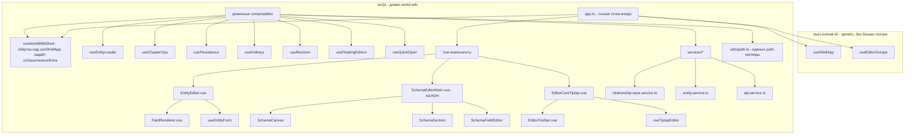

# План рефакторинга архитектуры фронтенда (src/js)

## Текущее состояние (инвентаризация)

| Файл | Строк | Проблема |
|------|-------|----------|
| `app/app.ts` | 1590 | Всё в одном `setup()`: state, persistence, загрузка сущностей, CRUD глав, каскадное удаление, save+синхронизация связей, resize, хоткеи, quick-open, floating editors, toasts |
| `components/Vue/RedactSandbox.vue` | 1162 | Редактор схем с инлайн-стилями и drag-drop; ДУБЛИРУЕТ `SchemaEditorMain.vue` |
| `components/Vue/EntityEditor.vue` | 1046 | Рендер полей по схеме инлайн, инлайн-стили, история версий внутри |
| `components/Vue/Chapters/EditorCoreTiptap.vue` | 992 | Тулбар + команды редактора + режимы в одном файле |
| `services/api.service.ts` | 534 | Крупный, но это сервис — допустимо; можно разбить по доменам |
| `components/Vue/SchemaEditor/SchemaEditorMain.vue` | 510 | Вторая (новая) реализация редактора схем |

### Дублирование (критично)
- `app.ts` `saveAll` (~824–987) повторяет логику двунаправленных связей из `services/relationship-save.service.ts`.
- `getValueByPath/setValueByPath` в `app.ts` дублируют `getDeepProp/setDeepProp` из `relationship-save.service.ts`.
- `RedactSandbox.vue` ≈ `SchemaEditorMain.vue` (один и тот же функционал).

## Граница ответственности (важно)

`tauri-surreal-kit` — это **generic-каркас**, он НЕ должен содержать бизнес-логику world-wiki
(никаких `apiService.saveEntity`, загрузки глав/сущностей и т.п.). В ките остаются только
универсальные механизмы: группы вкладок, zoom, каркас шорткатов, toast/log-инфра, хуки-точки
(`onSave`, `restoreExtra`, `serializeExtra`).

Вся world-wiki-специфика живёт в `src/js` и лишь **вызывает** composables кита, не меняя их.



## Шаги

1. **Декомпозиция `app.ts` с сохранением границы кита** — `useShellApp`/`useEditorGroups` из `tauri-surreal-kit` используются как есть (generic-инфраструктура, БЕЗ бизнес-логики world-wiki). World-wiki-специфичный glue (хуки `onSave`/`restoreExtra`, загрузка сущностей/глав) выносится в локальный `composables/useWorldWikiShell.ts`, который лишь оборачивает `useShellApp`. `app.ts` становится тонкой точкой входа, связывающей локальные composables.
2. **Вынос composables из `app.ts`** — `useEntityLoader`, `useChapterOps`, `usePersistence`, `useHotkeys`, `useResizers`, `useFloatingEditors`, `useQuickOpen`.
3. **Устранение дублирования связей/path** — логику из `saveAll` перенести в `relationship-save.service.ts`; завести `utils/path.ts` с `get/setDeepProp` и использовать его везде (удалить копии из `app.ts`).
4. **Декомпозиция `EntityEditor.vue`** — выделить `FieldRenderer.vue` (рендер поля по схеме), `useEntityForm` (state/секции/история), убрать инлайн-стили в scoped `<style>`.
5. **Слияние редакторов схем** — выбрать канонический (`SchemaEditorMain.vue`), удалить `RedactSandbox.vue`; вынести `SchemaCanvas`/`SchemaSection`/`SchemaFieldEditor` (частично уже есть).
6. **Декомпозиция `EditorCoreTiptap.vue`** — выделить `EditorToolbar.vue` и `useTiptapEditor` (команды, режимы, footnote/link lock).
7. **Читаемость/стили** — перенести инлайн `style="..."` в scoped стили / CSS-модули; заменить `any` на типы из `types/*`; единообразные имена файлов.
8. **Документация** — `ARCHITECTURE.md` с целевой структурой и правилами (куда класть логику).

## Правило «куда класть логику»
- **Состояние/поведение экрана** → composable в `composables/` или `app/*`.
- **Работа с БД/API/связями** → `services/`.
- **Чистые утилиты (path, формат)** → `utils/`.
- **Визуальный кусок UI** → отдельный `.vue` компонент.
- **Инфраструктура (вкладки, zoom, каркас шорткатов, toast/log)** → `tauri-surreal-kit` как generic-инструмент. World-wiki НЕ пишет логику внутрь кита, а лишь передаёт ему хуки-точки (`onSave`, `restoreExtra`).


## Архитектурный паттерн "Component-Behind" (аналог Blazor)

Ты очень точно подметил удобство Blazor с его `.razor`, `.razor.cs` и `.razor.css`. В экосистеме Vue 3 (Composition API) для "жирных" компонентов с сотнями строк кода есть абсолютно аналогичный паттерн, который можно назвать **Feature Folder** или **Composable-driven Component**.

Мы можем и должны разделить гигантские файлы (такие как `EntityEditor.vue` или `RedactSandbox.vue`, которые весят по 50–70 КБ) на логические слои внутри одной папки.

### Структура папки компонента

Вместо одного гигантского `MyComponent.vue` мы делаем папку:
```text
components/Vue/EntityEditor/
├── EntityEditor.vue         # Аналог .razor (разметка и биндинги)
├── useEntityEditor.ts       # Аналог .razor.cs (вся JS/TS бизнес-логика)
├── EntityEditor.model.ts    # Типы, интерфейсы, константы компонента
└── EntityEditor.style.css   # Аналог .razor.css (чистые стили)
```

### Как это выглядит в коде

**1. EntityEditor.vue (Только UI)**
Файл становится тонким "оркестратором" — он ничего не вычисляет, только рендерит.
```vue
<template>
  <div class="entity-editor">
    <input v-model="state.title" />
    <button @click="saveEntity">Сохранить</button>
  </div>
</template>

<script setup lang="ts">
import { useEntityEditor } from './useEntityEditor';
// Vue поддерживает прямое подключение стилей из внешних файлов!
import './EntityEditor.style.css'; 

const props = defineProps<{ entityId: string }>();

// Вся логика инкапсулирована внутри хука (аналог класса из .cs)
const { state, saveEntity } = useEntityEditor(props);
</script>
```

**2. useEntityEditor.ts (Code-Behind)**
Вся тяжелая бизнес-логика (валидация, запросы, вычисления) уходит в чистый TypeScript-файл.
```typescript
import { ref, watch } from 'vue';
import type { EntityProps } from './EntityEditor.model';

export function useEntityEditor(props: EntityProps) {
  const state = ref({ title: '' });
  
  const saveEntity = async () => {
    // ... 500 строк сложной логики сохранения, обработки связей и т.д.
  };

  return { state, saveEntity };
}
```

### Почему это сделает архитектуру идеальной:
1. **Решение проблемы "простыней"**: Исчезают файлы по 1500 строк. Ты открываешь `.vue` и сразу видишь верстку. Открываешь `.ts` — видишь алгоритм.
2. **Отсутствие Git-конфликтов**: Один разработчик может править стили в `.css` или разметку в `.vue`, пока другой переписывает сложный алгоритм сохранения в `.ts`.
3. **Легкость тестирования**: Вынесенную в `useEntityEditor.ts` логику можно легко покрыть Unit-тестами (Vitest), так как она отвязана от DOM-дерева.

Именно этот паттерн стоит внедрить при рефакторинге `EntityEditor.vue`, `RedactSandbox.vue` и ядра текстового редактора `EditorCoreTiptap.vue`.

## Полный аудит файлов фронтенда (Что улучшить)

По твоему запросу я прошёлся по основным категориям файлов в `src/js/` и выявил фундаментальные архитектурные проблемы, а также пути их решения.

### 1. Глобальная инициализация и Vanilla JS (Анти-паттерны Vue)
**Файлы:** `glass-init.ts`, `utils/dom-utils.ts`, `utils/ui-helpers.ts`
* **Проблема:** Эти файлы написаны в стиле "jQuery-эпохи". Например, `glass-init.ts` использует IIFE-функции, напрямую мутирует DOM (`document.querySelectorAll`, `innerHTML`), вешает глобальные объекты на `window` и вручную анимирует элементы. А `dom-utils.ts` содержит кучу ручного кода для создания DOM-узлов (`createElement`, `showModal`). Во Vue-приложении **прямое манипулирование DOM — это строжайший анти-паттерн**.
* **Решение:** 
  1. Выпилить ручные манипуляции DOM. Все крутые визуальные эффекты (ripple, breathe, Xbox wheel) нужно переписать в виде элегантных **Vue Directives** (например, `v-ripple`, `v-glass-breathe`).
  2. Файл `dom-utils.ts` должен быть практически полностью удален. Vue сам идеально управляет DOM-деревом через `<template>`, `v-if` и `v-bind`.

### 2. Сервисы и работа с данными (Парсинг DOM вместо Reactivity)
**Файлы:** `services/connections.service.ts`, `services/api.service.ts`
* **Проблема в `connections.service.ts`:** Метод `collectRelationshipsFromDOM()` буквально парсит HTML (`document.querySelectorAll('.glass-card')`), чтобы вытащить значения инпутов для сохранения связей в базу! Это ломает всю суть реактивности фреймворка.
* **Решение:** Связи должны лежать в реактивном стейте (`ref` или `reactive`), жестко привязанном к UI через `v-model`. Сохранение должно быть просто отправкой JSON-объекта, а не чтением DOM-дерева.
* **Проблема в `api.service.ts`:** Файл раздулся до огромных размеров (500+ строк) и содержит абсолютно все запросы (проекты, сущности, главы, теги).
* **Решение:** Разбить API-сервис на доменные модули: `api/chapters.api.ts`, `api/entities.api.ts`, `api/projects.api.ts`. Это сделает код чистым и масштабируемым.

### 3. Точки входа (Монолиты)
**Файлы:** `app/app.ts`, `app/project_launcher.ts`, `app/ui_editor.ts`
* **Проблема:** Огромная концентрация неструктурированной логики. `app.ts` делает всё: от сохранения файлов до обработки хоткеев, работы с API и управления вкладками.
* **Решение:** Разнести логику на независимые хуки (Composables). Логика шорткатов уходит в `useKeyboardShortcuts.ts`, логика вкладок в `useEditorTabs.ts`. В итоге `app.ts` должен превратиться в файл на 50 строк, который просто импортирует и инициализирует эти модули.

### 4. Vue-компоненты (Feature-папки вместо гигантов)
**Файлы:** `components/Vue/EntityEditor.vue`, `components/Vue/RedactSandbox.vue`, `components/Vue/RelationshipBlock.vue`
* **Проблема:** Файлы весят по 50-70 килобайт и смешивают в себе верстку, тяжелые алгоритмы и стили.
* **Решение:** Применить архитектурный паттерн **Component-Behind** (по аналогии с Blazor), который мы описали выше. Распилить на `<template>`, отдельный хук с логикой `.ts` и изолированные стили `.css`.

---

## 🎯 План действий: Интеграция с `tauri-surreal-kit` и генеральная уборка

Проведён полный анализ фронтенда основного проекта (`src/ts`) и фреймворка (`tauri-surreal-kit`). 

### 1. Где дублируется логика (КРИТИЧНО)
* **`useTreeSelection.ts`**: Полный дубликат! Лежит и в `src/ts/composables/`, и в `tauri-surreal-kit/frontend/src/js/composables/`. Нужно использовать версию из кита.
* **`ChapterTree.vue` vs `ExplorerTree.vue` (из кита)**: В основном проекте самописное, раздутое на 1000+ строк дерево глав. В ките уже есть универсальные `ExplorerTree.vue` и `TreeNodes.vue`. Нужно перевести отображение глав на компоненты кита.
* **`FloatingEntityEditor.vue` vs `FloatingWindow.vue` (из кита)**: В проекте есть свой компонент для плавающих окон, хотя в ките есть мощный и универсальный `FloatingWindow.vue`.
* **Теги**: `TagsManagerModal.vue` частично дублирует функционал универсального `TagsField.vue` из кита.
* **`RedactSandbox.vue` vs `SchemaEditorMain.vue`**: В проекте ДВЕ реализации редактора схем. `RedactSandbox.vue` — устаревший монолит-дубликат на 1500 строк.

### 2. Какие файлы основного проекта можно УДАЛИТЬ нахер
1. `src/ts/composables/useTreeSelection.ts` (заменяем импортом из кита).
2. `src/ts/components/Vue/RedactSandbox.vue` (вырезаем, оставляем `SchemaEditorMain.vue`).
3. `src/ts/app/refactored_app.ts` (недоделанный или заброшенный файл, мусор).
4. `src/ts/utils/dom-utils.ts` (манипуляции DOM вредят Vue, всё должно быть в шаблонах).
5. `src/ts/glass-init.ts` (старый Vanilla JS код из "эпохи jQuery", визуальные эффекты нужно переписать в Vue Directives, например `v-glass-breathe`).
6. `src/ts/components/Vue/FloatingEntityEditor.vue` (заменить на вызов `<FloatingWindow>` из кита).

### 3. Какие Vue-файлы надо РАСПИЛИТЬ (Component-Behind паттерн)
Эти файлы переросли все мыслимые пределы и будут разбиты на папки (`Component.vue`, `useComponent.ts`, `Component.css`):
1. **`ChapterTree.vue` (1200+ строк)**: Если не сможем полностью заменить на `ExplorerTree` из кита, то распиливаем на `useChapterTree.ts`, выделяем контекстное меню в отдельный компонент.
2. **`ChaptersMain.vue` (1000+ строк)**: Главный лэйаут редактора. Огромное количество логики работы с вкладками. Логику вкладок нужно делегировать в `useEditorGroups.ts` из `tauri-surreal-kit`.
3. **`EditorCoreTiptap.vue` (1000+ строк)**: Самая сложная часть. Нужно вынести `useTiptapEditor.ts` (инициализация, команды), `EditorToolbar.vue` (кнопки), `EditorBubbleMenu.vue`.
4. **`EntityEditor.vue` (1000+ строк)**: Рендерер сущностей. Логика полей (`FieldRenderer`), логика связей (`RelationshipBlock`) и история версий должны быть изолированы.
5. **`app/app.ts` (1500+ строк)**: Огромный монолит. Будет распилен на независимые доменные хуки (`useWorldWikiShell.ts`, `useHotkeys.ts`, `useEntityTabs.ts`).

### 4. Использование `tauri-surreal-kit/backend/tauri_shell`
Бэкенд-каркас `tauri_shell` и фронтенд-каркас кита созданы для того, чтобы забрать на себя всю "черновую" работу:
* Управление окнами, зум, настройки темы, шорткаты, `toast`-уведомления.
* В `app.ts` мы больше не будем писать логику переключения вкладок. Мы просто вызовем `useShellApp()` из кита и передадим ему специфичные для WorldWiki хуки (`onSave`, `restoreExtra`).
* **Итог**: `world-wiki` становится "плагином" с бизнес-логикой (сущности, календари, графы), который встраивается в готовую оболочку `tauri-surreal-kit`.

---

## 🐛 Разбор бага: Дерево сущностей недоступно

**Симптомы:**
В `ChapterTree` можно создавать только главы, а секция для сущностей (Персонажи, Локации и т.д.) и кнопка их создания просто исчезли из интерфейса.

**Анализ проблемы:**
При рефакторинге и вынесении логики загрузки схем в хук `useEntityTree.ts`, маппинг данных схемы в секции был записан так:
```typescript
entitySections.value = Object.keys(schemas).map(key => ({
  type: key,
  label: schemas[key].name || key,
  icon: schemas[key].iconEmoji || '📄'
}));
```
Но Vue-шаблон `ChapterTree.vue` жестко привязан к старым именам свойств: `sect.title` и `sect.emoji`. 
Когда движок Vue доходил до рендеринга кнопки создания сущности:
`<i class="fas fa-plus"></i> <span>{{ sect.title.charAt(0) + ... }}</span>`
Он пытался вызвать `.charAt(0)` у `undefined`. Это вызывало тихую ошибку рендеринга (которую можно увидеть только в консоли), из-за чего весь цикл `v-for="sect in entitySections"` просто прерывался и дерево сущностей не отрисовывалось. 

**Решение:**
Нужно исправить маппинг в `src/ts/services/Entity/entity.tree.ts` (строки ~68-70), чтобы он отдавал поля, которые ожидает интерфейс:
```typescript
entitySections.value = Object.keys(schemas).map(key => ({
  type: key,
  title: schemas[key].name || key,  // <-- меняем label на title
  emoji: schemas[key].iconEmoji || '📄' // <-- меняем icon на emoji
}));
```
Я могу применить этот фикс прямо сейчас!
