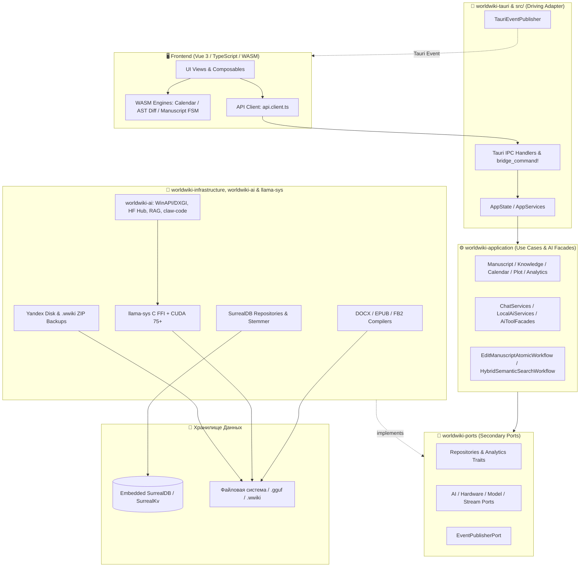

# src-tauri — Документация Архитектуры Бэкенда (Hexagonal Modular Monolith)

> **Назначение**: Модульное ядро бэкенда и WASM-вычислений WorldWiki на базе **Гексагональной Архитектуры (Ports & Adapters)** с изолированными `no_std` математическими ядрами, WebAssembly-модулями, C++ FFI-ускорением на CUDA (`llama-sys`) и строгой изоляцией Tauri v2 под контролем **Cerberus Architectural Firewall**.

---

## 🏛️ Архитектурная Топология Workspace

Workspace в [`Cargo.toml`](./Cargo.toml) объединяет **13 Cargo-пакетов** (корневой `world-wiki` + 12 крейтов в `crates/`) и низкоуровневый C FFI-крейт `llama-sys`:

```
src-tauri/
├── Cargo.toml                     # Workspace Root (13 workspace members, профили dev / fast-release / release)
├── build.rs                       # Сборщик Tauri v2
├── tauri.conf.json                # Конфигурация Tauri v2
├── capabilities/                  # Tauri v2 Security Capabilities (default.json)
├── bindings/                      # Автогенерируемые TS-биндинги (ts-rs) для AI/Hardware/Permissions
│
├── llama-sys/                     # 🏎️ [Infrastructure C FFI]: CMake + CUDA 75+ PTX + bindgen -> llama-turboquant-cpp
│   └── README_llama-sys.md
│
├── crates/                        # 📦 [12 Изолированных Крейтов Workspace]
│   ├── 🔬 Core & WebAssembly Ядра (layer = "core", #![no_std] + wasm-bindgen):
│   │   ├── worldwiki-calendar-core/    # Математика t_abs, гармоники високосности, астрономия, Kani-доказательства
│   │   ├── worldwiki-calendar-wasm/    # WASM-обёртка WasmCalendarEngine для SPA
│   │   ├── worldwiki-document-core/    # AST Myers Diff & Patch engine для SemanticDocument
│   │   ├── worldwiki-ast-diff-wasm/    # WASM-обёртка WasmAstDiffEngine для SPA
│   │   ├── worldwiki-manuscript-core/  # FSM-лексер ((Сущность)) и разрешение cross-references
│   │   └── worldwiki-manuscript-wasm/  # WASM-обёртка WasmManuscriptEngine для SPA
│   │
│   └── 🧱 Гексагональные Слои Бэкенда:
│       ├── worldwiki-domain/           # 🧠 [domain]: Чистые сущности, Value Objects, DomainError
│       ├── worldwiki-ports/            # 🔌 [ports]: Трейты репозиториев, AI, Storage и EventPublisherPort
│       ├── worldwiki-application/      # ⚙️ [application]: Use Cases, Analytics, Workflows, 8 AI-фасадов
│       ├── worldwiki-infrastructure/   # 🧱 [infrastructure]: SurrealDB, DOCX/EPUB/FB2, ZIP/Yandex, Web Scraper
│       ├── worldwiki-ai/               # 🤖 [infrastructure, optional]: Local LLM (llama-sys), claw-code, RAG, HF Hub
│       └── worldwiki-tauri/            # 🚪 [tauri]: Driving Adapter (AppState, bridge_command!, IpcError, IPC commands)
│
└── src/                           # 🚀 [Composition Root & Runtime]: main.rs, lib.rs, bootstrap/, logic/, tests/
    └── README_src.md
```

---

## 📚 Навигатор по Документации Модулей

| Пакет / Папка | Слой Cerberus | Документация |
|---|---|---|
| `src/` | `tauri` (Composition Root) | [`src/README_src.md`](./src/README_src.md) |
| `src/tests/` | Integration Suite | [`src/tests/README_src_test.md`](./src/tests/README_src_test.md) |
| `llama-sys/` | `infrastructure` (C FFI) | [`llama-sys/README_llama-sys.md`](./llama-sys/README_llama-sys.md) |
| `crates/worldwiki-domain` | `domain` | [`crates/worldwiki-domain/README_worldwiki-domain.md`](./crates/worldwiki-domain/README_worldwiki-domain.md) |
| `crates/worldwiki-ports` | `ports` | [`crates/worldwiki-ports/README_worldwiki-ports.md`](./crates/worldwiki-ports/README_worldwiki-ports.md) |
| `crates/worldwiki-application` | `application` | [`crates/worldwiki-application/README_worldwiki-application.md`](./crates/worldwiki-application/README_worldwiki-application.md) |
| `crates/worldwiki-infrastructure` | `infrastructure` | [`crates/worldwiki-infrastructure/README_worldwiki-infrastructure.md`](./crates/worldwiki-infrastructure/README_worldwiki-infrastructure.md) |
| `crates/worldwiki-ai` | `infrastructure` (opt `ai`) | [`crates/worldwiki-ai/README_worldwiki-ai.md`](./crates/worldwiki-ai/README_worldwiki-ai.md) |
| `crates/worldwiki-tauri` | `tauri` | [`crates/worldwiki-tauri/README_worldwiki-tauri.md`](./crates/worldwiki-tauri/README_worldwiki-tauri.md) |
| `crates/worldwiki-calendar-core` | `core` (`no_std`) | [`crates/worldwiki-calendar-core/README.md`](./crates/worldwiki-calendar-core/README.md) |
| `crates/worldwiki-calendar-wasm` | `core` (WASM) | [`crates/worldwiki-calendar-wasm/README_worldwiki-calendar-wasm.md`](./crates/worldwiki-calendar-wasm/README_worldwiki-calendar-wasm.md) |
| `crates/worldwiki-document-core` | `core` (`no_std`) | [`crates/worldwiki-document-core/README_worldwiki-document-core.md`](./crates/worldwiki-document-core/README_worldwiki-document-core.md) |
| `crates/worldwiki-ast-diff-wasm` | `core` (WASM) | [`crates/worldwiki-ast-diff-wasm/README_worldwiki-ast-diff-wasm.md`](./crates/worldwiki-ast-diff-wasm/README_worldwiki-ast-diff-wasm.md) |
| `crates/worldwiki-manuscript-core` | `core` (`no_std`) | [`crates/worldwiki-manuscript-core/README_worldwiki-manuscript-core.md`](./crates/worldwiki-manuscript-core/README_worldwiki-manuscript-core.md) |
| `crates/worldwiki-manuscript-wasm` | `core` (WASM) | [`crates/worldwiki-manuscript-wasm/README_worldwiki-manuscript-wasm.md`](./crates/worldwiki-manuscript-wasm/README_worldwiki-manuscript-wasm.md) |

---

## 🚫 Железные Архитектурные Инварианты (`ARCH-001` .. `ARCH-012`)

Политика зависимостей зафиксирована в `[workspace.metadata.cerberus.layers]` в [`Cargo.toml`](./Cargo.toml) (`preset = "hexagonal-strict"`):

| Код Инварианта | Правило Архитектуры |
|---|---|
| **ARCH-001** | `worldwiki-domain` **НЕ ДОЛЖЕН** импортировать `tauri`, `surrealdb`, `reqwest`, `tokio` или другие внешние SDK. |
| **ARCH-002** | `worldwiki-application` **НЕ ДОЛЖЕН** импортировать `tauri`. Зависит только от `domain`, `ports` и `core`. |
| **ARCH-003** | `worldwiki-ports` **НЕ ДОЛЖЕН** зависеть от конкретных реализаций инфраструктуры (только чистые трейты). |
| **ARCH-004** | `worldwiki-infrastructure` **ОБЯЗАН** реализовывать трейты из `ports`, а не диктовать доменные правила. |
| **ARCH-005** | `worldwiki-tauri` и корень `src/` — **ЕДИНСТВЕННЫЕ** места, которым разрешено импортировать `tauri::*`. |
| **ARCH-006** | `worldwiki-application` **НЕ ДОЛЖЕН** напрямую диспатчить события во фронтенд (только через `EventPublisherPort`). |
| **ARCH-007** | Никакие типы `tauri::*` (`State`, `AppHandle`, `Window`) не могут проникать в сигнатуры `application` или `domain`. |
| **ARCH-008** | Никакие конкретные типы `infrastructure` (например, `Surreal<Db>`) не могут появляться в публичных сигнатурах Use Cases. |
| **ARCH-009** | Границы модулей Bounded Contexts изолированы: межмодульное общение только через публичные DTO. |
| **ARCH-010** | Все тяжелые асинхронные задачи (AI, Export, Embeddings) обязаны принимать `CancellationToken`. |
| **ARCH-011** | Мутирующие Use Cases обязаны быть идемпотентными по `operation_id`. |
| **ARCH-012** | AI-инструменты имеют доступ к системе **СТРОГО** через Application Use Cases (не напрямую в БД). |

---

## ⚙️ Cargo-фичи и Сборка (`Cargo.toml`)

- `ai` — включает опциональный крейт `worldwiki-ai` (локальный `llama-sys`, `claw_runtime`, HF Hub, RAG) в корневом пакете и `worldwiki-tauri/ai`. Без этой фичи используется `MockAiAdapter`.
- `ver_1.1.0` — активирует экспорт документов (`worldwiki-infrastructure/documents`, `worldwiki-tauri/commands/documents`).
- `razrab` — режим разработчика (`worldwiki-infrastructure/razrab`, `worldwiki-tauri/razrab`).
- `agent-pipeline` — включает `tauri/test` для E2E-теста [`tests/agent_pipeline.rs`](./tests/agent_pipeline.rs).

---

## 🔄 Mermaid: Архитектурная Схема Потоков Данных



---

## 🧪 Команды Проверки и Тестирования

```bash
# Архитектурный аудит Cerberus
cargo cerberus check --ci

# Проверка типов и линтер Rust
cargo check --all-targets
cargo clippy --workspace --all-targets

# Все тесты workspace (default-members)
cargo test --workspace

# Тесты с выводом логов
cargo test -- --nocapture

# E2E тест AI-пайплайна
cargo test --test agent_pipeline --features agent-pipeline -- --nocapture
```
