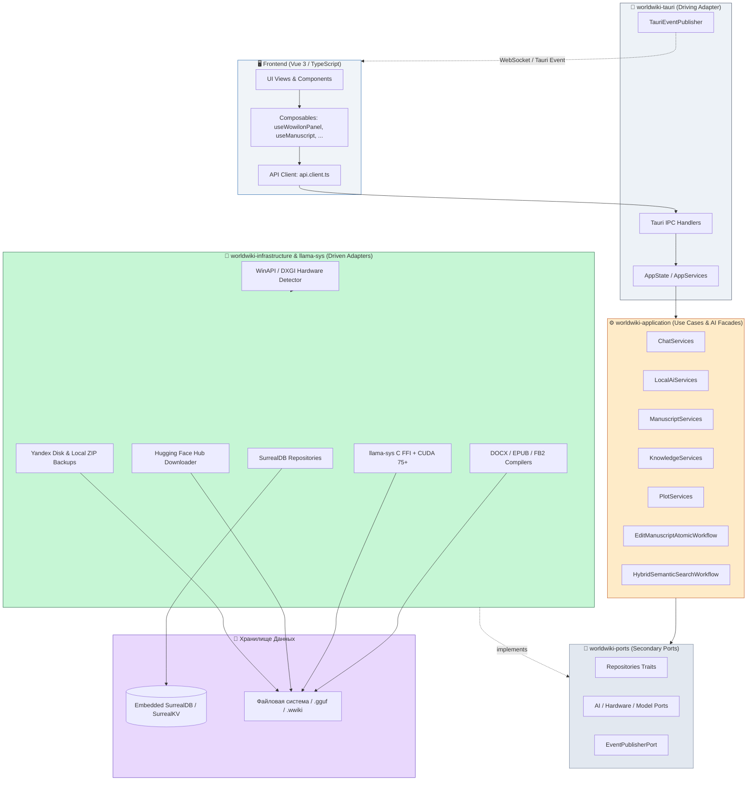

# src-tauri — Документация Архитектуры Бэкенда (Hexagonal Modular Monolith)

> **Назначение**: Промышленное модульное ядро WorldWiki на базе **Гексагональной Архитектуры (Ports & Adapters / Modular Monolith)** с изолированными предметными контекстами (Bounded Contexts), C++ FFI-ускорением на базе CUDA (`llama-sys`), модульным ядром из 5 изолированных крейтов и изоляцией фреймворка Tauri.

---

## 🏛️ Архитектурная Топология Workspace

Бэкенд физически разделен на изолированные Cargo-крейты в `crates/`, низкоуровневый C FFI-крейт `llama-sys/` и центральную точку сборки (Composition Root) в `src/`:

```
src-tauri/
├── Cargo.toml                     # Workspace Root (декларация workspace, общие зависимости и профили)
├── build.rs                       # Сборщик Tauri v2
├── tauri.conf.json                # Конфигурация Tauri v2 (окна, безопасность, плагины)
├── capabilities/                  # Tauri v2 Security Capabilities (default.json)
│
├── llama-sys/                     # 🚀 [Low-Level C FFI]: Биндинги к llama-turboquant-cpp с поддержкой CUDA
│   ├── Cargo.toml                 # Манифест крейта (bindgen, cc, libc)
│   ├── build.rs                   # CMake-сборка llama.cpp + CUDA 75+ / PTX fatbin, TurboQuant, bindgen
│   ├── src/lib.rs                 # include! сгенерированных bindings.rs
│   └── prebuilt-libs/             # Постоянный кэш сборки библиотек вне target/
│
├── crates/                        # 📦 [5 Гексагональных Крейтов Монорепозитория]
│   ├── 🧠 worldwiki-domain/       # [Чистый Домен]: Сущности, Value Objects, DomainError (0 внешних SDK)
│   │   ├── manuscript/            # Главы, сцены, тома, арки, AST-модели
│   │   ├── knowledge/             # Сущности лора, универсальные схемы, типизированные связи
│   │   ├── calendar/              # Золотой эталон абсолютной минуты M_abs, астрономия, эпохи
│   │   ├── plot/                  # Сюжетные обещания (Чеховские ружья), планы, закрытия
│   │   ├── document/              # ГОСТ-модели документов (DOCX, EPUB, FB2)
│   │   ├── ai/                    # Типы оборудования, профили, модели, разрешения, HfHub
│   │   ├── storage/               # Структуры облачного бэкапа (YandexBackupFile)
│   │   └── errors.rs              # Доменные ошибки DomainError
│   │
│   ├── 🔌 worldwiki-ports/        # [Интерфейсы и Контракты]: Secondary Ports
│   │   ├── repositories.rs        # ChapterRepository, EntityRepository, RelationRepository, PlotPromiseRepository, PlanRepository, RAGPort
│   │   ├── ai.rs                  # HardwareDetectorPort, LocalModelManagerPort, PermissionsPort, ModelHubPort, ChatRepository, AiProfileRepository
│   │   ├── storage.rs             # FileSystemPort, BackupStoragePort
│   │   ├── events.rs              # EventPublisherPort + типизированные ApplicationEvent
│   │   └── unit_of_work.rs        # UnitOfWork для атомарных транзакций
│   │
│   ├── ⚙️ worldwiki-application/  # [Сценарии Использования & AI-Фасады]: CQRS + Workflows
│   │   ├── manuscript/            # Use Cases: GetChapter, SaveChapter, ReorderNode, AutoExtend
│   │   ├── knowledge/             # Use Cases: GetEntityCard, ManageEntity, RelateEntities
│   │   ├── calendar/              # Use Cases: CalculateDate, ConvertEras, GenerateSummary
│   │   ├── plot/                  # Use Cases: PlantPromise, CompletePlan, AuditVolumeConsistency
│   │   ├── document/              # Use Cases: ExportDocx, ExportEpub, ExportFb2
│   │   ├── ai/                    # 8 Консолидированных AI-Фасадов + ChatServices + LocalAiServices
│   │   │   ├── tools.rs           # 8 Consolidated AI Facades (query_world, inspect_entity, edit_manuscript, ...)
│   │   │   ├── chat_services.rs   # ChatServices (дерево, ветки, сообщения, форки, модели, профили)
│   │   │   └── local_services.rs  # LocalAiServices (опрос железа, расчет VRAM, каталоги)
│   │   ├── workflows/             # EditManuscriptAtomicWorkflow, HybridSemanticSearchWorkflow
│   │   └── common/                # JobManager (CancellationToken & асинхронные задачи)
│   │
│   ├── 🧱 worldwiki-infrastructure/ # [Адаптеры Портов]: Driven Adapters
│   │   ├── surrealdb/             # Реализации репозиториев (SurrealChapterRepository, chat_repo, memory_repos)
│   │   ├── ai/                    # Hardware (WinAPI/DXGI), LocalManager, StaticPermissions, ModelHub, Chunker
│   │   │   ├── hardware.rs        # WinAPI GlobalMemoryStatusEx + DirectX DXGI VRAM Detection
│   │   │   ├── local_manager.rs   # FsLocalModelManager (управление файлами моделей и квотами)
│   │   │   ├── permissions.rs     # StaticPermissionsCatalog (каталог уровней доступа и пресетов)
│   │   │   ├── hub.rs             # Hugging Face Model Hub API + стриминг загрузки GGUF
│   │   │   ├── chunker.rs         # Нарезка текста рукописи и лора на семантические чанки
│   │   │   └── retrieval/         # Векторный эмбеддер и фоновый индексатор SurrealDB
│   │   ├── documents/             # Компиляторы DOCX (OpenXML ГОСТ 7.32), EPUB 3.3, FB2 2.0
│   │   ├── storage/               # Локальные архивы .wwiki (ZIP) и облачный интегратор Yandex Disk
│   │   └── events/                # InMemoryEventPublisher
│   │
│   └── 🚪 worldwiki-tauri/        # [Driving Adapter]: Единственный слой с доступом к Tauri SDK
│       ├── bridge_macro.rs        # bridge_command! — декларативный макрос-мост
│       ├── state.rs               # AppState & AppServices
│       ├── error.rs               # IpcError (типизированный маппинг ApplicationError -> JSON)
│       ├── events.rs              # TauriEventPublisher (реализация EventPublisherPort через AppHandle)
│       └── commands/              # Модульные IPC-команды:
│           ├── manuscript.rs      # Команды глав и рукописи
│           ├── knowledge.rs       # Команды сущностей и графа связей
│           ├── calendar.rs        # Команды абсолютной минуты и конвертации дат
│           ├── plot.rs            # Команды сюжетных ружей и планов
│           ├── documents.rs       # Команды экспорта ГОСТ-документов
│           ├── backup.rs          # Команды резервного копирования и Яндекс.Диска
│           ├── chat.rs            # Команды ИИ-чата (дерево, ветки, правки, регенерация)
│           ├── local_ai.rs        # Команды локальных моделей, VRAM и разрешений
│           └── ai.rs              # 8 высокоуровневых AI-фасадов и RAG-индексации
│
└── src/                           # 🚀 [Composition Root & Runtime]
    ├── main.rs                    # Минимальная точка входа Windows/Linux
    ├── lib.rs                     # Запуск рантайма, DDL схема, entity_commands!, Tauri plugins
    ├── bootstrap/
    │   └── services.rs            # build_surreal_app_services — сборка полного графа зависимостей
    ├── logic/                     # Макросы сущностей, универсальные CRUD и проектная иерархия
    │   ├── models.rs              # surreal_entity! & surreal_relation! декларации всех структур
    │   ├── projects.rs            # CRUD проектов и конфигураций
    │   ├── entities.rs            # Универсальные сущности, схемы и ревизии
    │   ├── chapters.rs            # Главы, HTML текстовые блоки, история ревизий
    │   ├── volumes.rs             # Иерархия: Проект -> Тома -> Арки -> Главы (граф contains)
    │   ├── connections.rs         # Пользовательские связи (entity_rel)
    │   ├── batch.rs               # Пакетные транзакции (get_entities_batch, upsert_connections_batch)
    │   └── schema.rs              # Заглушка обратной совместимости схемы
    └── tests/                     # 350+ модульных, доменных и сквозных интеграционных тестов
```

---

## 🚫 Железные Архитектурные Инварианты (`ARCH-001` .. `ARCH-012`)

| Код Инварианта | Правило Архитектуры |
|---|---|
| **ARCH-001** | `worldwiki-domain` **НЕ ДОЛЖЕН** импортировать `tauri`, `surrealdb`, `reqwest`, `tokio` или другие внешние SDK. |
| **ARCH-002** | `worldwiki-application` **НЕ ДОЛЖЕН** импортировать `tauri`. Зависит только от `domain` и `ports`. |
| **ARCH-003** | `worldwiki-ports` **НЕ ДОЛЖЕН** зависеть от конкретных реализаций инфраструктуры (только чистые трейты). |
| **ARCH-004** | `worldwiki-infrastructure` **ОБЯЗАН** реализовывать трейты из `ports`, а не диктовать доменные правила. |
| **ARCH-005** | `worldwiki-tauri` — **ЕДИНСТВЕННЫЙ** слой/крейт, которому разрешено импортировать `tauri::*`. |
| **ARCH-006** | `worldwiki-application` **НЕ ДОЛЖЕН** напрямую диспатчить события во фронтенд (только через `EventPublisherPort`). |
| **ARCH-007** | Никакие типы `tauri::*` (`State`, `AppHandle`, `Window`) не могут проникать в сигнатуры `application` или `domain`. |
| **ARCH-008** | Никакие конкретные типы `infrastructure` (например, `Surreal<Db>`) не могут появляться в публичных сигнатурах Use Cases. |
| **ARCH-009** | Границы модулей Bounded Contexts изолированы: межмодульное общение только через публичные DTO. |
| **ARCH-010** | Все тяжелые асинхронные задачи (AI, Export, Embeddings) обязаны принимать `CancellationToken`. |
| **ARCH-011** | Мутирующие Use Cases обязаны быть идемпотентными по `operation_id`. |
| **ARCH-012** | AI-инструменты имеют доступ к системе **СТРОГО** через Application Use Cases (не напрямую в БД). |

---

## 🏎️ Подсистема `llama-sys` (Low-Level C FFI & CUDA 75+ Acceleration)

Крейт `llama-sys` обеспечивает низкоуровневую привязку к C++ библиотеке `llama-turboquant-cpp` / `ggml`:

### Особенности сборки (`build.rs`):
- **Спецификация CUDA**: Сборка под архитектуру `CMAKE_CUDA_ARCHITECTURES=75` (Turing: RTX 20xx / GTX 16xx) с генерацией PTX. Новые поколения GPU (Ampere RTX 30xx, Ada Lovelace RTX 40xx, Blackwell) автоматически JIT-компилируют PTX через драйвер NVIDIA с сохранением в шейдерный кэш ОС.
- **Флаги компилятора CMake**:
  - `GGML_CUDA=ON` — аппаратное ускорение тензорных операций на CUDA ядрах.
  - `GGML_TCQ=ON` — TurboQuant алгоритмы ускоренного квантования.
  - `LLAMA_SWA=ON` — поддержка скользящего окна внимания (Sliding Window Attention).
  - `LLAMA_HYBRID_RECURRENT=ON` — поддержка гибридных рекуррентных и State-Space архитектур.
- **Постоянный кэш `prebuilt-libs/`**:
  - Скомпилированные статические библиотеки (`llama.lib`, `ggml.lib`, `ggml-cuda.lib`) кэшируются в `llama-sys/prebuilt-libs`.
  - Кэш не удаляется при `cargo clean`, что ускоряет сборку монорепозитория.
  - Принудительная пересборка активируется переменной окружения `LLAMA_SYS_FORCE_REBUILD=1`.
- **Статическая линковка**:
  - Статические библиотеки движка: `llama`, `ggml`, `ggml-base`, `ggml-cpu`, `ggml-cuda`.
  - Статические библиотеки CUDA SDK: `cudart_static`, `cublas`, `cublasLt`.
- **Автоматическая кодогенерация `bindgen`**:
  - `bindgen` сканирует заголовочные файлы `llama.h` и `ggml.h`, создавая типобезопасные FFI-структуры в `OUT_DIR/bindings.rs`.

---

## 🤖 Спецификация 8 Консолидированных AI-Фасадов (Two-Tier Model)

1. **`ai_query_world`**: Единая точка семантического поиска (Graph + BM25 + Vector HNSW).
2. **`ai_inspect_entity`**: Полная карточка сущности с матрицей связей и схемами за 1 вызов.
3. **`ai_manage_entity`**: Создание, обновление, связывание и удаление сущностей в лоре.
4. **`ai_read_manuscript`**: Чтение текста глав, оглавления и аутлайна томов/арок.
5. **`ai_edit_manuscript`**: Атомарная транзакция (`EditManuscriptAtomicWorkflow`): текст главы + Чеховские ружья + закрытие планов.
6. **`ai_timeline_manager`**: Фасад континуума времени $M_{\text{abs}}$ и синхронизации событий.
7. **`ai_audit_consistency`**: Валидация противоречий лора и аудит незакрытых ружей тома.
8. **`ai_delegate_task`**: Оркестрация специализированных саб-агентов (`SubagentOrchestrator`).

---

## 📄 Документация Файлов и Модулей

### 1. Точки Входа и Конфигурация

#### `src/main.rs`
**Назначение**: Точка входа в бинарный исполняемый файл приложения под Windows (`windows_subsystem = "windows"` для скрытия консольного окна в релизе).
**Функции**: Вызывает `world_wiki_lib::run()`.

#### `src/lib.rs`
**Назначение**: Центральный рантайм и Composition Root приложения:
- `init_database()`: Создаёт директорию `data/surreal_db`, поднимает embedded SurrealDB движок на `SurrealKv`, применяет DDL схему `apps/spa/src/logic/surreal_schema.surql`.
- `AppState`: Хранит подключение `Surreal<Db>` и реализует трейт `surreal_domain::SurrealDb`.
- `run()`: Регистрирует плагины Tauri (`tauri_plugin_dialog`, `tauri_plugin_opener`, `tauri_plugin_window_state`), макрос `entity_commands!` со 100+ IPC-командами, инициализирует сервисы `build_surreal_app_services` и внедряет их в `AppState` через `app.manage()`.

#### `src/bootstrap/services.rs`
**Назначение**: Сборщик графа зависимостей приложения:
- `build_surreal_app_services(db, event_publisher)`: Создаёт продакшн-граф с реальными SurrealDB репозиториями (`SurrealChapterRepository`, `SurrealEntityRepository`, `SurrealRelationRepository`, `SurrealPlotPromiseRepository`, `SurrealPlanRepository`, `SurrealChatRepository`, `SurrealAiProfileRepository`, `SurrealRAGAdapter`), инстанцирует сервисы приложения и регистрирует их в `AppServices`.
- `build_app_services()`: Создаёт изолированный in-memory граф на базе `InMemory*Repository` для быстрого модульного тестирования без диска и базы данных.

---

### 2. Модули Домена и Базы Данных (`src/logic/`)

#### `src/logic/models.rs`
**Назначение**: Централизованное определение всех сущностей приложения через макросы `surreal_entity!` и `surreal_relation!`. Генерирует:
- Rust-структуры с `serde` и `ts_rs` деривами.
- Реализации трейта `SurrealRepository` для CRUD-операций.
- TypeScript типы в `apps/spa/src/ts/types/generated/`.
- Системные сущности: `Chapter`, `Volume`, `Plan`, `PlotPromise`, `Tag`, `Calendar`, `Chat`, `ChatMessage`, `AutoApprovalSetting`, `AiProfile`, `AiMode`, `Artifact`, `AiSkill`, `TextBlock`, `AgentMemory`, `WebCache`, `DictionaryWord`.
- Пользовательские сущности и связи: `Entity`, `EntitySchema`, `FieldDef`, `EntityRel`, `RelationSchema`, `Cites`.

#### `src/logic/projects.rs`
**Назначение**: Управление проектами (таблица `projects`):
- `get_projects`, `create_project`, `get_project_config`, `save_project_config`, `delete_project`.

#### `src/logic/entities.rs`
**Назначение**: Универсальные сущности лора, схемы, связи и ревизии:
- `get_entities`, `get_entity`, `save_entity`, `delete_entity`, `search_entities`, `get_entities_batch`.
- Схемы сущностей: `get_entity_schemas`, `save_entity_schema`, `delete_entity_schema`, `get_schema_history`, `toggle_schema_history_pin`.
- Связи: `get_entity_relations`, `create_entity_relation`, `delete_entity_relation`.
- Ревизии: `get_entity_revisions`, `toggle_entity_history_pin`.

#### `src/logic/chapters.rs`
**Назначение**: Рукопись и текстовые блоки:
- `get_global_timeline` — получение всех глав.
- `save_text_blocks` — парсинг HTML в структурированные блоки (`text_blocks`) с ACID-сохранением.
- `get_chapter_revisions`, `toggle_chapter_history_pin` — история версий глав.

#### `src/logic/volumes.rs`
**Назначение**: Иерархия структуры книги (Проект ➔ Тома ➔ Главы):
- `get_chapter_hierarchy` — полная иерархическая структура с сортировкой.
- `create_volume`, `update_volume`, `assign_chapter`, `reorder_node`.

#### `src/logic/connections.rs`
**Назначение**: Пользовательский граф связей между сущностями:
- `get_connections`, `save_connections`, `remove_connections_by_source`.

#### `src/logic/batch.rs`
**Назначение**: Пакетные транзакции высокой производительности:
- `get_entities_batch` — выборка сущностей нескольких типов за один запрос.
- `upsert_connections_batch` — атомарная перезапись пачки связей.
- `save_entity_with_relations` — транзакционное сохранение сущности и её связей.

---

### 3. Модульные Крейты (`src-tauri/crates/`)

#### `worldwiki-domain`
- `manuscript/`: Структуры глав, томов, арок, AST-документов.
- `knowledge/`: Карточки сущностей, схемы полей, валидаторы.
- `calendar/`: Математика абсолютной минуты $M_{\text{abs}}$, расчет фаз лун, перевод дат между эпохами.
- `plot/`: Чеховские ружья (`PlotPromise`), сюжетные планы (`Plan`), статусы исполнения.
- `document/`: Спецификации экспорта (`ExportDocumentRequest`, форматы DOCX, EPUB, FB2, PDF).
- `ai/`: Типы оборудования (`HardwareInfo`), карточки моделей (`HfModelCard`, `InstalledModelInfo`), разрешения (`ToolPermissionConfig`).
- `storage/`: Структуры облачного хранения (`YandexBackupFile`).
- `errors.rs`: `DomainError` (NotFound, ValidationError, ConcurrencyError).

#### `worldwiki-ports`
- `repositories.rs`: Трейты репозиториев (`ChapterRepository`, `EntityRepository`, `RelationRepository`, `PlotPromiseRepository`, `PlanRepository`, `RAGPort`).
- `ai.rs`: Трейты инференса и локальных моделей (`HardwareDetectorPort`, `LocalModelManagerPort`, `PermissionsPort`, `ModelHubPort`, `ChatRepository`, `AiProfileRepository`).
- `storage.rs`: Трейты работы с файловой системой и бэкапами (`FileSystemPort`, `BackupStoragePort`).
- `events.rs`: Трейт `EventPublisherPort` и типизированные события `ApplicationEvent`.
- `unit_of_work.rs`: Трейт `UnitOfWork` для атомарных многорепозиторных транзакций.

#### `worldwiki-application`
- `manuscript/`: Сценарии чтения, записи и авторасширения глав.
- `knowledge/`: Сценарии получения полных карточек и управления сущностями.
- `calendar/`: Сценарии конвертации дат и астрономических расчетов.
- `plot/`: Сценарии закладывания сюжетных обещаний и аудита целостности тома.
- `document/`: Сценарии экспорта документов.
- `ai/tools.rs`: 8 консолидированных фасадов для агентов.
- `ai/chat_services.rs`: Логика веток чата, форков, редактирования и регенерации.
- `ai/local_services.rs`: Логика инспекции железа, VRAM-оценок и каталога моделей.
- `workflows/`: `EditManuscriptAtomicWorkflow` (атомарное обновление текста, обещаний и планов), `HybridSemanticSearchWorkflow`.
- `common/`: `JobManager` с поддержкой отмены через `CancellationToken`.

#### `worldwiki-infrastructure`
- `surrealdb/`: Реализации репозиториев для SurrealDB (`repos.rs`, `chat_repo.rs`, `memory_repos.rs`).
- `ai/hardware.rs`: Опрос WinAPI `GlobalMemoryStatusEx` и DirectX DXGI VRAM.
- `ai/local_manager.rs`: Управление файлами моделей на диске.
- `ai/permissions.rs`: Каталог разрешений и политик автоодобрения.
- `ai/hub.rs`: Взаимодействие с Hugging Face Model Hub.
- `ai/chunker.rs`: Семантическая нарезка текста на чанки.
- `ai/retrieval/`: Сервис векторных эмбеддингов (`embedder.rs`) и фоновый индексатор (`indexer.rs`).
- `documents/`: Генераторы документов ГОСТ DOCX (`docx.rs`), EPUB 3.3 (`epub.rs`), FB2 2.0 (`fb2.rs`).
- `storage/`: Бэкапы `.wwiki` ZIP (`backup.rs`) и Яндекс.Диск OAuth (`yandex.rs`).

#### `worldwiki-tauri`
- `bridge_macro.rs`: Макрос `bridge_command!` для связывания use-case с Tauri IPC.
- `state.rs`: Контейнеры состояния `AppState` и `AppServices`.
- `error.rs`: Структура ошибки `IpcError` с автоматической сериализацией в JSON для фронтенда.
- `events.rs`: `TauriEventPublisher` для отправки событий во фронтенд через `AppHandle`.
- `commands/`: Полный набор типизированных Tauri IPC команд.

---

## 🔄 Mermaid: Архитектурная Схема Потоков Данных



---

## 🧪 Стратегия Тестирования

В проекте реализована трехуровневая пирамида тестирования:

1. **Unit-тесты Домена (`crates/worldwiki-domain`)**:
   - Математика абсолютной минуты $M_{\text{abs}}$ и синхронизация календаря (`calendar/math.rs`).
   - Валидация структур сущностей и документов.
2. **Unit-тесты Use Cases (`crates/worldwiki-application`)**:
   - Тестирование сценариев чата, планов и рукописи с Fake/Mock репозиториями (`InMemoryChapterRepository`, `InMemoryEntityRepository` и т.д.) без подъема БД.
3. **Интеграционные и системные тесты (`src/tests/` и `tests/`)**:
   - `ai_integration.rs` — тестирование RAG-пайплайна и циклов агента.
   - `full_cycle_test.rs` — полный жизненный цикл проекта: создание, добавление томов/глав, наполнение лора, экспорт.
   - `revisions_test.rs` — версионирование и история изменений сущностей и глав.
   - `tree_test.rs` — проверка целостности древовидных структур и графовых связей `contains`.
   - `document_export_integration.rs` — валидация генерации файлов DOCX, EPUB 3.3 и FB2 2.0.

### Команды запуска тестов:
```bash
# Тесты бэкенда (все крейты)
cargo test --workspace

# Тесты с выводом логов
cargo test -- --nocapture

# Проверка линтерами
cargo clippy --workspace --all-targets
```