# src-tauri — Документация Архитектуры Бэкенда (Hexagonal Modular Monolith)

> **Назначение**: Промышленное модульное ядро WorldWiki на базе **Гексагональной Архитектуры (Ports & Adapters / Modular Monolith)** с предметными контекстами (Bounded Contexts) и изоляцией фреймворка Tauri.

---

## 🏛️ Архитектурная Топология (5 Крейтов Workspace)

Бэкенд физически разделен на 5 изолированных Cargo-крейтов в `src-tauri/crates/` и центральную точку сборки `src/`:

```
src-tauri/
├── Cargo.toml                     # Workspace Root
├── crates/
│   ├── 🧠 worldwiki-domain/       # [Чистый Домен]: Сущности, Value Objects, DomainError (0 внешних SDK)
│   │   ├── manuscript/            # Главы, сцены, тома, арки
│   │   ├── knowledge/             # Сущности лора, схемы, связи
│   │   ├── calendar/              # Абсолютная минута M_abs, астрономия, эпохи
│   │   ├── plot/                  # Сюжетные обещания (Чеховские ружья), планы
│   │   └── document/              # ГОСТ-модели документов
│   │
│   ├── 🔌 worldwiki-ports/        # [Интерфейсы и Контракты]: Secondary Ports
│   │   ├── repositories.rs        # ChapterRepository, EntityRepository, RelationRepository, PlotPromiseRepository, PlanRepository, RAGPort
│   │   ├── ai.rs                  # LlmInferencePort, EmbeddingPort
│   │   ├── storage.rs             # FileSystemPort, BackupStoragePort
│   │   ├── events.rs              # EventPublisherPort + типизированные ApplicationEvent
│   │   └── unit_of_work.rs        # UnitOfWork для атомарных транзакций
│   │
│   ├── ⚙️ worldwiki-application/  # [Сценарии Использования & AI-Фасады]: CQRS + Workflows
│   │   ├── manuscript/            # Commands/Queries: GetChapter, SaveChapter, ReorderNode, AutoExtend
│   │   ├── knowledge/             # Commands/Queries: GetEntityCard, ManageEntity, RelateEntities
│   │   ├── calendar/              # Commands/Queries: CalculateDate, ConvertEras, GenerateSummary
│   │   ├── plot/                  # Commands/Queries: PlantPromise, CompletePlan, AuditVolumeConsistency
│   │   ├── document/              # Commands/Queries: ExportDocx, ExportEpub, ExportFb2
│   │   └── ai/                    # 8 AI-Фасадов + Workflows + SubagentOrchestrator
│   │       ├── tools/             # 8 Consolidated AI Facades (query_world, inspect_entity, edit_manuscript, ...)
│   │       ├── workflows/         # EditManuscriptAtomicWorkflow, HybridSemanticSearchWorkflow
│   │       └── orchestration/     # JobManager (CancellationToken)
│   │
│   ├── 🧱 worldwiki-infrastructure/ # [Адаптеры Портов]: Driven Adapters
│   │   ├── surrealdb/             # SurrealDB реализации репозиториев (SurrealChapterRepository, GraphRAG, ...)
│   │   ├── ai/                    # llama.cpp FFI + HTTP провайдеры (OpenAI, Anthropic, Ollama)
│   │   ├── documents/             # Компиляторы DOCX (OpenXML), EPUB 3.3, FB2 2.0
│   │   └── filesystem/            # Работа с локальным диском, архивы .wwiki
│   │
│   └── 🚪 worldwiki-tauri/        # [Driving Adapter]: Единственный слой с доступом к Tauri
│       ├── bridge_macro.rs        # bridge_command! — декларативный макрос-мост
│       ├── state.rs               # AppState (обертка над AppServices)
│       ├── error.rs               # IpcError (типизированный маппинг ApplicationError -> JSON)
│       ├── events.rs              # TauriEventPublisher (реализация EventPublisherPort)
│       └── commands/              # Модульные IPC-команды (карточки, ружья, планы, 8 AI-фасадов)
│
└── src/                           # 🚀 [Composition Root & Bootstrap]
    ├── main.rs                    # Минимальная точка входа
    ├── lib.rs                     # Запуск рантайма, entity_commands!, on_window_event
    ├── bootstrap/
    │   └── services.rs            # build_surreal_app_services — сборка графа зависимостей
    └── tests/                     # 350+ модульных и интеграционных тестов
```

---

## 🚫 Железные Архитектурные Инварианты (`ARCH-001` .. `ARCH-012`)

| Код Инварианта | Правило |
|---|---|
| **ARCH-001** | `worldwiki-domain` **НЕ ДОЛЖЕН** импортировать `tauri`, `surrealdb`, `reqwest`, `tokio` или другие внешние SDK. |
| **ARCH-002** | `worldwiki-application` **НЕ ДОЛЖЕН** импортировать `tauri`. Зависит только от `domain` и `ports`. |
| **ARCH-003** | `worldwiki-ports` **НЕ ДОЛЖЕН** зависеть от конкретных реализаций инфраструктуры (только чистые трейты). |
| **ARCH-004** | `worldwiki-infrastructure` **ОБЯЗАН** реализовывать трейты из `ports`, а не диктовать доменные правила. |
| **ARCH-005** | `worldwiki-tauri` — **ЕДИНСТВЕННЫЙ** слой/крейт, которому разрешено импортировать `tauri::*`. |
| **ARCH-006** | `worldwiki-application` **НЕ ДОЛЖЕН** напрямую диспатчить события во фронтенд (только через `EventPublisherPort`). |
| **ARCH-007** | Никакие типы `tauri::*` (`State`, `AppHandle`, `Window`) не могут проникать в сигнатуры `application` или `domain`. |
| **ARCH-008** | Никакие конкретные типы `infrastructure` (например, `Surreal<Db>`) не могут появляться в публичных сигнатурах Use Cases. |
| **ARCH-009** | Границы модулей Bounded Contexts изолированы: межмодульное общение только через публичные DTO. |
| **ARCH-010** | Все тяжелые асинхронные задачи (AI, Export, Embeddings) обязаны принимать `CancellationToken`. |
| **ARCH-011** | Мутирующие Use Cases обязаны быть идемпотентными по `operation_id`. |
| **ARCH-012** | AI-инструменты имеют доступ к системе **СТРОГО** через Application Use Cases (не напрямую в БД). |

---

## 🤖 Спецификация 8 Консолидированных AI-Фасадов (Two-Tier Model)

1. **`ai_query_world`**: Единая точка семантического поиска (Graph + BM25 + Vector HNSW).
2. **`ai_inspect_entity`**: Полная карточка сущности с матрицей связей и схемами за 1 вызов.
3. **`ai_manage_entity`**: Создание, обновление, связывание и удаление сущностей в лоре.
4. **`ai_read_manuscript`**: Чтение текста глав, оглавления и аутлайна томов/арок.
5. **`ai_edit_manuscript`**: Атомарная транзакция (`EditManuscriptAtomicWorkflow`): текст главы + Чеховские ружья + закрытие планов.
6. **`ai_timeline_manager`**: Фасад континуума времени $M_{\text{abs}}$ и синхронизации событий.
7. **`ai_audit_consistency`**: Валидация противоречий лора и аудит незакрытых ружей тома.
8. **`ai_delegate_task`**: Оркестрация специализированных саб-агентов (`SubagentOrchestrator`).

---

## 📄 Описание каждого файла

### `main.rs`
**Назначение**: Точка входа приложения. Инициализирует SurrealDB, применяет DDL схему, регистрирует все Tauri-команды через `entity_commands!` макрос, управляет состоянием приложения (`AppState`).

**Ключевые функции**:
- `init_database()` — создаёт/подключается к SurrealDB, применяет `surreal_schema.surql`
- `AppState` — хранит `Surreal<Db>`, реализует `surreal_domain::SurrealDb`
- `main()` — регистрирует 100+ команд через `entity_commands!`, настраивает плагины Tauri

**Зависимости**: Все модули `logic::*`, `tauri_shell::logic::system`, `surreal_domain`

---

### `lib.rs`
**Назначение**: Минимальный boilerplate для Tauri. Экспортирует функцию `run()` для тестов.

**Ключевые функции**:
- `greet()` — пример команды
- `run()` — запуск Tauri приложения

---

### `logic/mod.rs`
**Назначение**: Реэкспорт всех подмодулей `logic` (включая ИИ-подсистему `ai`) для удобства импорта.

```rust
pub mod ai;
pub mod batch;
pub mod calendar_math;
pub mod chapters;
pub mod connections;
pub mod entities;
pub mod export;
pub mod models;
pub mod projects;
pub mod schema;
pub mod volumes;
```

---

### `logic/models.rs` — **Ключевой файл**
**Назначение**: Централизованное определение **всех сущностей** приложения через `surreal_entity!` и `surreal_relation!` макросы. Генерирует:
- Rust структуры с `serde`/`ts_rs` деривами
- Реализацию `SurrealRepository` трейта (CRUD)
- Tauri-команды (при `#[tauri_commands]`)
- TypeScript типы в `apps/spa/src/ts/types/generated/`

**Секции**:
1. **AI-инфраструктура** (системные таблицы): `AutoApprovalSettings`, `AiProfile`, `Artifact`, `AiSkill`, `Chat`, `ChatMessage`, `DictionaryWord`, `WebCache`, `AgentMemory`, `TextBlock`
2. **Системные сущности** (фиксированная схема): `Calendar`, `Volume`, `Arc`, `Chapter`, `Tag`, `Plan`
3. **Пользовательские сущности** (универсальная таблица `entities`): `Entity`, `EntitySchema`, `FieldDef`, `EntityRel`, `RelationSchema`
4. **Граф связей** (system edges): `Cites`, `VolumeContainsArc`, `ArcContainsChapter`, `ProjectContainsVolume`
5. **Схема генерации** (`surreal_schema!`) — список для кодогенерации

**Зависимости**: `surreal_domain`, `serde`, `ts_rs`, `chrono`

---

### `logic/projects.rs`
**Назначение**: CRUD операции для проектов (таблица `projects`).

**Команды**:
| Команда | Описание |
|---------|----------|
| `get_projects` | Список всех проектов |
| `create_project` | Создание проекта (upsert по имени) |
| `get_project_config` | Конфигурация проекта |
| `save_project_config` | Сохранение конфига (merge) |
| `delete_project` | Удаление проекта |

**Особенности**: Работает с записями `projects:<name>`, использует `type::record` для прямого доступа.

---

### `logic/entities.rs`
**Назначение**: CRUD для пользовательских сущностей (универсальная таблица `entities`), схем сущностей (`entity_schemas`), связей (`entity_rel`), схем связей (`relation_schemas`), истории ревизий.

**Команды — Сущности**:
- `get_entities` — список с фильтром по типу/проекту
- `get_entity` — по ID
- `save_entity` — create/upsert с нормализацией RecordId
- `delete_entity` — транзакционное удаление + связи + ревизии
- `search_entities` — полнотекстовый поиск по name/description
- `get_entities_batch` — батч загрузка по типам

**Команды — Схемы сущностей**:
- `get_entity_schemas` / `save_entity_schema` / `delete_entity_schema`
- `get_schema_history` / `toggle_schema_history_pin` — версионирование схем

**Команды — Связи**:
- `get_entity_relations` / `create_entity_relation` / `delete_entity_relation`
- `get_relation_schemas` / `save_relation_schema` / `delete_relation_schema`

**Команды — Ревизии**:
- `get_entity_revisions` / `toggle_entity_history_pin`

**Хелперы**: `safe_pid`, `safe_id`, `flatten_thing`, `deserialize_list` — нормализация RecordId и десериализация.

---

### `logic/chapters.rs`
**Назначение**: Работа с главами, текстовыми блоками, ревизиями глав.

**Команды**:
| Команда | Описание |
|---------|----------|
| `get_global_timeline` | Все главы проекта (через `Chapter::find_all`) |
| `save_text_blocks` | Парсинг HTML → структурированные блоки (`text_blocks`), ACID транзакция |
| `get_chapter_revisions` | История ревизий главы |
| `toggle_chapter_history_pin` | Закрепление ревизии |

**Особенности**: Использует `scraper` для парсинга HTML, специальный формат ID `chapters:⟨id⟩`.

---

### `logic/volumes.rs`
**Назначение**: Иерархия проект → тома → арки → главы. Управление порядком через ребро `contains` с полем `sort_order`.

**Команды**:
| Команда | Описание |
|---------|----------|
| `get_chapter_hierarchy` | Полная иерархия (volumes, arcs, chapters) с sort_order |
| `create_volume` | Создание тома + связь `contains` от проекта |
| `update_volume` | Обновление названия тома |
| `create_arc` | Создание арки внутри тома/проекта |
| `update_arc` | Обновление названия арки |
| `assign_chapter` | Перемещение главы в арку/том/проект (удаляет старые `contains`) |
| `reorder_node` | Изменение `sort_order` на входящем ребре `contains` |

**Особенности**: Работает через графовые запросы SurrealDB (`<-contains`), `RecordId::new` для типобезопасных ссылок.

---

### `logic/connections.rs`
**Назначение**: Управление пользовательскими связями между сущностями (таблица `entity_rel`).

**Команды**:
| Команда | Описание |
|---------|----------|
| `get_connections` | Все связи проекта (опционально по главе), нормализация source/target в `{entityType, entityId}` |
| `remove_connections_by_source` | Удаление исходящих связей сущности |
| `save_connections` | Полная перезапись связей сущности (устаревшие удаляются в т.ч. обратные) |

**Особенности**: Маппинг frontend `role` → БД `rel_type`, поддержка периодов (`start_chapter`, `end_chapter`).

---

### `logic/export.rs`
**Назначение**: Экспорт контента, бэкапы, облачное хранение (Yandex Disk), восстановление.

**Команды**:
| Команда | Описание |
|---------|----------|
| `export_chapters` | Экспорт глав в текстовый файл (Downloads) |
| `create_cloud_backup` | Полный бэкап (DB dump + images + settings) → ZIP `.wwiki` |
| `exchange_yandex_token` | OAuth код → access token |
| `upload_to_yandex_disk` | Загрузка бэкапа на Яндекс.Диск |
| `list_yandex_disk_backups` | Список бэкапов в облаке |
| `download_and_restore_yandex` | Скачивание + восстановление из облака |
| `restore_from_backup` | Восстановление из локального `.wwiki` (распаковка, импорт DB, файлы) |
| `get_launch_args` | Аргументы запуска (файл `.wwiki` для ассоциации) |

**Зависимости**: `reqwest`, `zip`, `chrono`, Tauri `AppHandle` для путей.

---

### `logic/documents/`
**Назначение**: Семантический текстовый процессор и мультиформатный экспорт академических документов (курсовых, дипломных работ, отчетов НИР) и художественных книг напрямую в системную папку пользователя `Downloads`.

**Команды**:
| Команда | Описание |
|---------|----------|
| `export_document_docx` | Экспорт в Microsoft Word (.docx OpenXML) со строгим соблюдением ГОСТ 7.32 (TNR 14pt, полуторный интервал, абзацный отступ 1.25 см, поля 30/10/20/20 мм, таблицы, рисунки, сноски) |
| `export_document_epub` | Экспорт в электронную книгу EPUB 3.3 по спецификации IDPF (STORED mimetype, OEBPS-манифест, навигация toc.xhtml, сноски epub:type="footnote") |
| `export_document_fb2` | Экспорт в FictionBook 2.0 (.fb2 XML) с валидной схемой, метаданными title-info, секциями и телом примечаний `<body name="notes">` |
| `export_document_pdf_save` | Хук сохранения векторного PDF с подтверждением пути в Downloads |

**Особенности**:
- Автономная генерация без внешних сторонних утилит (pandoc, libreoffice).
- Сборка валидных ZIP-пакетов через `zip::ZipWriter` со сжатием `CompressionMethod::Deflated` и сохранением первого файла `mimetype` в режиме `CompressionMethod::Stored`.
- Санитизация опасных символов ОС (`/ \ : * ? " < > |`) и защита от Path Traversal.
- Интеграционные тесты вынесены в `tests/document_export_integration.rs`.

---

### `logic/batch.rs`
**Назначение**: Пакетные операции в одной транзакции для производительности.

**Команды**:
| Команда | Описание |
|---------|----------|
| `get_entities_batch` | Одним запросом загружает сущности нескольких типов, группирует по типам |
| `upsert_connections_batch` | Транзакционное удаление старых + создание новых связей батчем |
| `save_entity_with_relations` | Сохранение основной сущности + связанных (foreign_updates) в одной транзакции |

**Особенности**: Динамическое построение SurrealQL в транзакции (`BEGIN`/`COMMIT`), `RETURN $saved` для получения результата.

---

### `logic/schema.rs`
**Назначение**: Заглушка для обратной совместимости. В SurrealDB схема задаётся через `.surql` при старте.

---

### `logic/calendar_math.rs`
**Назначение**: Конвертация абсолютного времени в локальное (календарь проекта).

**Команда**: `convert_absolute_to_local` (регистрируется в `main.rs`)

---

### `logic/ai/` — ИИ-подсистема (агент, чат, провайдеры, инструменты)

**Назначение**: Полный ИИ-стек WorldWiki: агент-соавтор с циклом tool-вызовов, древовидный чат с ветвлением, RAG-поиск по базе проекта и подключение к внешним LLM через `claw_api`. Все команды регистрируются в `main.rs`/`lib.rs` через `use logic::ai::*`.

Подмодули: `chat` (дерево и операции), `agent` (промпты и цикл исполнения), `providers` (каталоги моделей), `tools` (инструменты агента).

---

#### `logic/ai/mod.rs`
**Назначение**: Re-exports публичных функций подсистемы для `logic::*`-импорта.

**Re-exports**:
- `chat::tree` → `get_chat_tree`, `get_chat_messages`, `get_message_branch`
- `chat::operations` → `fork_chat`, `update_chat_parent`, `send_chat_message`, `cancel_generation`, `delete_chat_message`, `edit_chat_message`, `regenerate_chat_message`, `switch_message_variant`, `delete_ai_chat`
- `agent::runner` → `get_ai_completion`, `generate_chat_title`
- `providers::fetch` → `fetch_ai_models`
- `hardware` → `get_hardware_info`, `calculate_quantization_estimates`, `get_recommended_local_models`
- `manager` → `list_installed_models`, `load_local_model`, `unload_local_model`, `unload_all_local_models`, `delete_local_model`
- `model_hub` → `fetch_hf_models`, `download_hf_model`
- `retrieval` → `reindex_project_lore`, `reindex_project_lore_inner`
- `permissions` → `get_tool_permissions_catalog`

**Зависимости**: `chat::*`, `agent::*`, `providers::*`, `tools::*`, `local_llm::*`, `retrieval::*`, `hardware::*`, `manager::*`

---

#### `logic/ai/local_llm.rs` — **Ключевой файл (Local LLM & CUDA C++ Engine)**
**Назначение**: Прямая FFI-обвязка над библиотекой `llama.cpp` (через `llama-sys`):
- `LocalLlm::load_model(path, params)` — загрузка генеративной модели в память GPU с настраиваемыми слоями `n_gpu_layers = -1`, контекстом 16K, аппаратными сэмплерами (Repetition Penalties 1.15, Top-K 40, Top-P 0.95, Temperature 0.7) и ChatML-токенизатором.
- `LocalLlm::load_embedding_model(path, params)` — инициализация эмбеддеров (Nemotron, Nomic, BGE) с безопасным контекстом и батчем до 4096 токенов для исключения VRAM OOM.
- `generate_stream(...)` — потоковая генерация токенов с немедленной остановкой по атомарному флагу `CANCEL_LOCAL_GEN`.
- `get_embeddings(text)` — прямое вычисление плотных векторов (Dense Embeddings) float32.
- `enable_triattention(stats_path, budget)` — интеграция сжатия и TriAttention KV-cache эвикшена.

---

#### `logic/ai/agent_runtime.rs` — **Ключевой файл (Local Agent Execution)**
**Назначение**: Полный цикл автономного локального соавтора:
1. Вызов детерминированного `QueryAnalyzer` для классификации интента.
2. Селективное извлечение цельных глав (Exact Document Fetch) или векторных чанков.
3. Бюджетирование контекста (до 12 000 символов) и инъекция в пользовательский ход диалога (`rfind("<|im_end|>")`).
4. Запуск инференса в отдельном рабочем потоке `spawn_blocking` со стримингом токенов во фронтенд через `chat_stream_chunk`.

---

#### `logic/ai/hardware.rs`
**Назначение**: Прямой опрос аппаратных ресурсов рабочей станции:
- `get_hardware_info()` — WinAPI `GlobalMemoryStatusEx` для RAM и DirectX DXGI `CreateDXGIFactory` для точного объема видеопамяти VRAM на GPU NVIDIA/AMD.
- `calculate_quantization_estimates(model_size_b)` — расчет расхода VRAM/RAM для Q4_K_M, Q8_0, BF16.
- `get_recommended_local_models()` — список карточек рекомендуемых моделей (Nemotron, Qwen 2.5 7B/14B/3B, Saiga).

---

#### `logic/ai/manager.rs`
**Назначение**: Управление файлами и жизненным циклом локальных моделей в памяти:
- `list_installed_models()` — сканирование директории моделей с неблокирующим `try_lock()`.
- `load_local_model(filename)` / `unload_local_model(filename)` — загрузка и выгрузка слотов моделей (`LOADED_MODEL` / `LOADED_EMBED`).
- `unload_all_local_models()` — экстренный сброс видеопамяти и обнуление глобальных указателей llama.
- `delete_local_model(filename)` — удаление `.gguf` с диска.

---

#### `logic/ai/model_hub.rs`
**Назначение**: Каталог HuggingFace Model Hub и фоновое скачивание квантованных GGUF:
- `fetch_hf_models(query)` — поиск по репозиториям HuggingFace API.
- `download_hf_model(repo_id, filename, token)` — потоковая загрузка с отправкой прогресса во фронтенд через событие `hf_download_progress`.

---

#### `logic/ai/permissions.rs`
**Назначение**: Каталог уровней разрешений и автоодобрения (Auto-Approval System):
- Категории: `read`, `edit_entities`, `edit_content`, `edit_relations`, `edit_calendar`, `analyze`.
- Пресеты: Безопасный (Safe), Сбалансированный (Balanced), Экспертный (Expert).
- Allowlist / Denylist по типам сущностей, связей и путям проекта.

---

#### `logic/ai/retrieval/` — **Продвинутая подсистема RAG**
**Назначение**: Модульная архитектура информационного поиска и индексации лора:
- `query_analyzer.rs` — морфологический анализ русских числительных (от «первая» до «сотая», римские `I..L`, арабские `1..100`), детекция приветствий/смолл-тока.
- `router.rs` — **Query Planner**: маршрутизация запросов между Exact Document Retrieval (глава/том целиком) и Hybrid Semantic Vector Search (BM25 + Cosine Similarity).
- `embedder.rs` — HTTP-клиент к сервисам эмбеддингов с форматированием префиксов (`query:` / `passage:`).
- `indexer.rs` — фоновый индексатор проекта: нарезка глав и сущностей на чанки, параллельная генерация векторов на GPU и сохранение в SurrealDB.

---

#### `logic/ai/agent/mod.rs`
**Назначение**: Подмодуль агента. Объявляет:
- `pub mod prompt;` — построение системного промпта и истории сообщений
- `pub mod runner;` — цикл агента (`run_agent_loop`), стриминг

---

#### `logic/ai/agent/prompt.rs`
**Назначение**: Построение системного промпта и подготовка истории чата для LLM.

**Константы**:
- `MAX_AGENT_ITERATIONS = 8` — максимум итераций «вызов инструмента → ответ LLM» в одном ходе
- `DEFAULT_MAX_TOKENS = 4096` — лимит `max_tokens` по умолчанию
- `HISTORY_CHAR_BUDGET = 120_000` — бюджет истории в символах (Context Windowing)

**Функции**:
- `build_system_prompt(role_definition, custom_instructions, project_id)` — собирает полный системный промпт: Golden Rules (соавтор, не «ИИ»), безопасность (LORE LOCK, запрет выдумывать факты), правила общения, литературная теория, регламент работы с инструментами (RAG-first)
- `history_to_input_messages(history, assistant_msg_id)` — из дерева истории (по `parent_id`) строит линейную цепочку в `Vec<InputMessage>`, отбрасывает `is_active=false`, обрезает до бюджета

---

#### `logic/ai/agent/runner.rs` — **Ключевой файл**
**Назначение**: Главный цикл агента и потоковая передача ответа. Содержит логику вызова LLM, обработки tool-calls, сохранение ответа в `chat_messages`.

**Структуры**:
- `StreamChunk` — потоковый чанк для фронта `{chat_id, message_id, text, is_done, chunk_type}`
- `AgentToolEvent` — событие вызова инструмента `{chat_id, message_id, tool_name, tool_args}`
- `ToolAssembler` — буфер сборки JSON-аргументов tool_use из стрим-дельт

**Функции**:
- `get_ai_completion(...)` — Tauri-команда; спавнит агента в `tokio::spawn` (регистрируется в `AgentTasks` для отмены)
- `run_agent_loop(app, project_id, chat_id, assistant_msg_id, user_text, mode_slug)` — читает активный `AiProfile`, строит промпт, историю и отправляет запрос со стримингом; до `MAX_AGENT_ITERATIONS` обрабатывает tool-calls через `WorldWikiTools::run`
- `build_provider_client(provider, api_key, base_url)` — создаёт `ProviderClient`: `anthropic` | `openai` | `openrouter` | `gemini` | `local`/`ollama` | `deepseek`
- `generate_chat_title(...)` — генерирует заголовок чата (2–5 слов), обновляет `chats.title`

**События (emit)**:
- `chat_stream_chunk` (payload `StreamChunk`) — текст ответа/дум-процесс/usage для UI
- `agent_tool` (payload `AgentToolEvent`) — вызов инструмента

**Зависимости**: `claw_api`, `reqwest`, `tokio`, `surrealdb`, `surreal_domain::SurrealDb`

#### `logic/ai/chat/mod.rs`
**Назначение**: Общий контекст чат-подсистемы + хелперы работы с RecordId.

**Хелперы**:
- `parse_record_id(id, default_table)` — парсит `table:id`, `⟨id⟩`, `` `id` `` → `RecordId` с подстановкой таблицы по умолчанию
- `clean_surreal_id(val)` — нормализует RecordId в строку `table:id` (или `None`)

---

#### `logic/ai/chat/tree.rs`
**Назначение**: Получение дерева чатов и сообщений для UI.

**Команды**:
- `get_chat_tree(project_id, state)` — чаты проекта + `parent_chat_id`/`sort_order` на основе рёбер `contains`
- `get_chat_messages(chat_id, state)` — все сообщения чата (санитизированные ID)
- `get_message_branch(chat_id, state)` — активная ветка (фильтрует `is_active`); используется агентом и regenerate

**Внутренние**:
- `get_chat_messages_impl(db, chat_id)` — возврат только активных сообщений (для агента и ветвления)
- `sanitize_message_ids(...)` — очистка SurrealDB-объектов RecordId в выдаче

---

#### `logic/ai/chat/operations.rs`
**Назначение**: Операции CRUD + ветвление + генерация ответов.

**Команды**:
- `send_chat_message(project_id, chat_id, text, ...)` — создаёт (при необходимости) чат, сообщение пользователя и placeholder-сообщение ассистента, затем асинхронно запускает агента через `AgentTasks`
- `cancel_generation(chat_id)` — отменяет активную генерацию (abort зарегистрированной `JoinHandle`)
- `fork_chat(project_id, message_id, new_title, ...)` — ответвление ветки: новый чат + копия истории по `parent_id` (через `id_map`)
- `update_chat_parent(...)` — перенос чата между родителями (`parent_chat_id`)
- `edit_chat_message(...)` / `delete_chat_message(...)` — редактирование/удаление сообщения (с ветвлением)
- `regenerate_chat_message(...)` — перегенерирует ответ, создавая новый вариант сообщения
- `switch_message_variant(msg_id)` — смена варианта ответа (активирует нужный `is_active`)
- `delete_ai_chat(id, ...)` — каскадное удаление чата: `chat_messages` → рёбра `contains` → `chats`

**Потоки**: `tokio::spawn` + `AgentTasks` (Arc<Mutex<HashMap<String, JoinHandle>>>).

**Зависимости**: `serde_json`, `surrealdb`, `tauri::Manager`, `surreal_domain::SurrealDb`

---

#### `logic/ai/providers/mod.rs`
**Назначение**: Подмодуль провайдеров (`pub mod fetch;`).

---

#### `logic/ai/providers/fetch.rs`
**Назначение**: Получение списков моделей от провайдеров для настроек UI.

**Команда**: `fetch_ai_models(provider, api_key)` — запрашивает каталоги моделей (OpenRouter, OpenAI, Gemini, Anthropic, local) и возвращает `Vec<AiModelInfo>` (сортировка по label).

**Структуры**: `AiModelInfo { value, label, description, context_length?, max_completion_tokens? }` — генерирует TypeScript-тип через `ts-rs`.

---

#### `logic/ai/tools/mod.rs` — **Ключевой файл**
**Назначение**: Встроенный набор инструментов агента `WorldWikiTools` — RAG-поиск и операции с БД, которые LLM вызывает через tool-use.

**Структуры и функции**:
- `WorldWikiTools { db: Surreal<Db>, project_id: String }` — состояние инструментов
- `tool_definitions()` → `Vec<ToolDefinition>` — JSON-schemа всех инструментов для `claw_api`
- `WorldWikiTools::run(name, args)` — диспетчер: вызов функции по имени, работа через `self.db`
- `param(description)` / `arg(args, key)` — хелперы схем и извлечения аргументов

**Инструменты (19)**:
- `rag_search(query, top_k)` — RAG по структурным таблицам
- `search_entities(query, type_key)` — поиск сущностей по имени/описанию
- `get_entity(id)`, `get_relations(entity_id)`
- `get_chapter(id)`, `get_chapters_list()`, `get_timeline(...)`, `get_calendar(...)`
- `get_entity_schema(...)`, `get_entity_evolution(...)`, `get_relation_history(...)`
- `update_entity(...)`, `create_entity(...)`, `create_relation(...)`, `update_chapter(...)`, `add_timeline_event(...)`
- `validate_world_consistency(statement)` — проверка согласованности мира
- `search_chat_history(query)` — поиск по истории чатов
- `spawn_subagent(task, subagent_type)` — вызов субагента (mock)

**Зависимости**: `claw_api` (ToolDefinition), `surrealdb`, `serde_json`

---

## 🔗 Mermaid: Module Dependency Graph

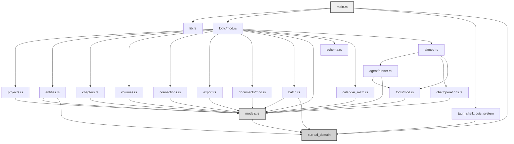

---

## 🔄 Mermaid: DFD (Data Flow Diagram)

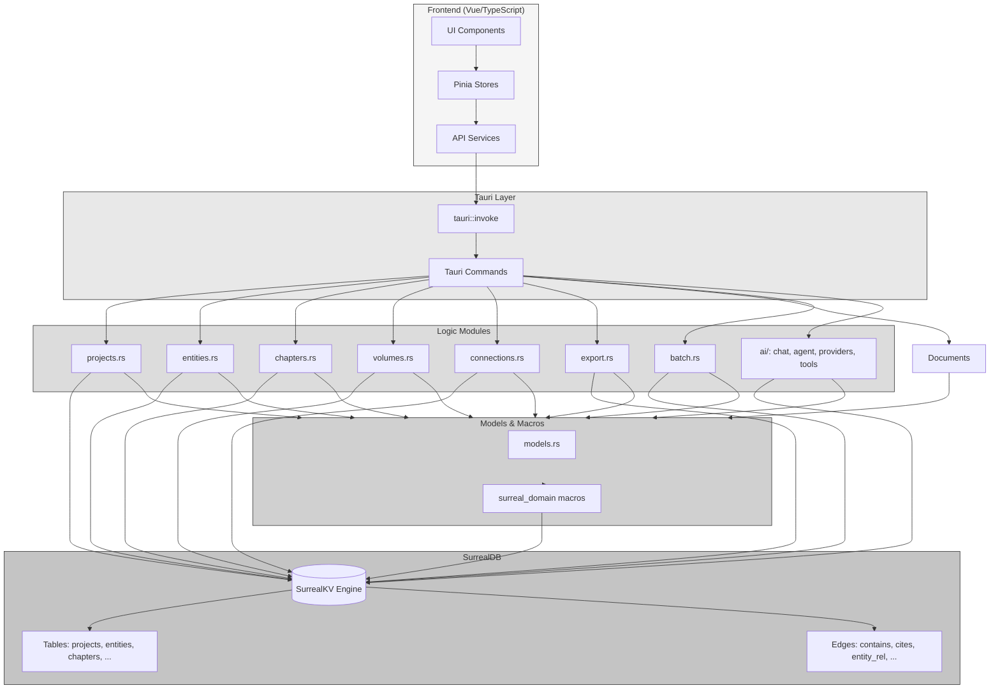

---

## 🏗 Mermaid: Class/Function Interaction Diagrams

### main.rs — Взаимодействие компонентов

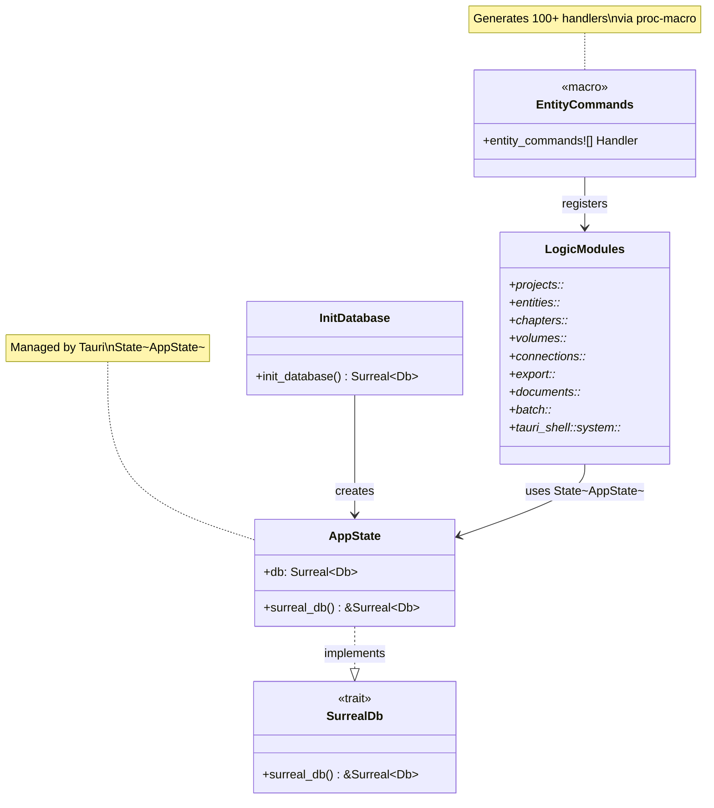

---

### models.rs — Сущности и макросы

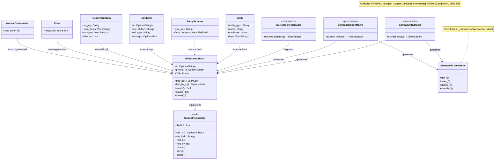

---

### entities.rs — Взаимодействие функций

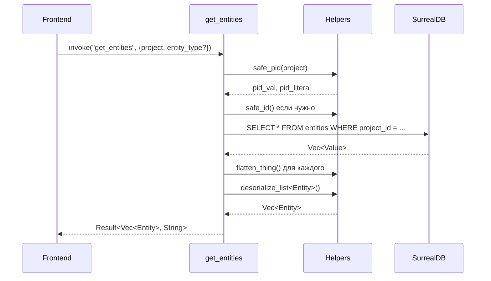

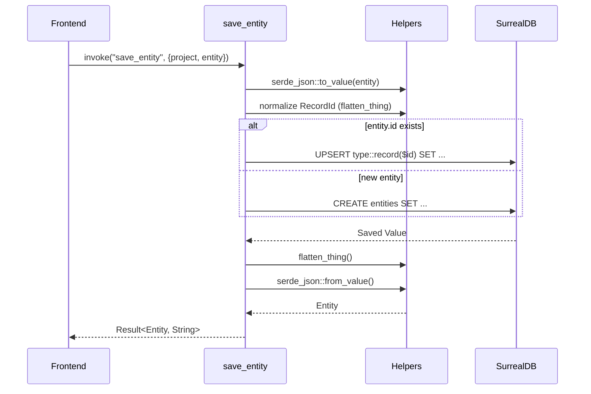

---

### volumes.rs — Иерархия и графовые запросы

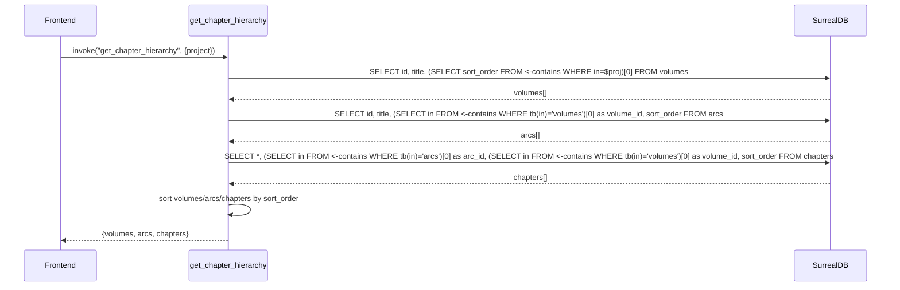

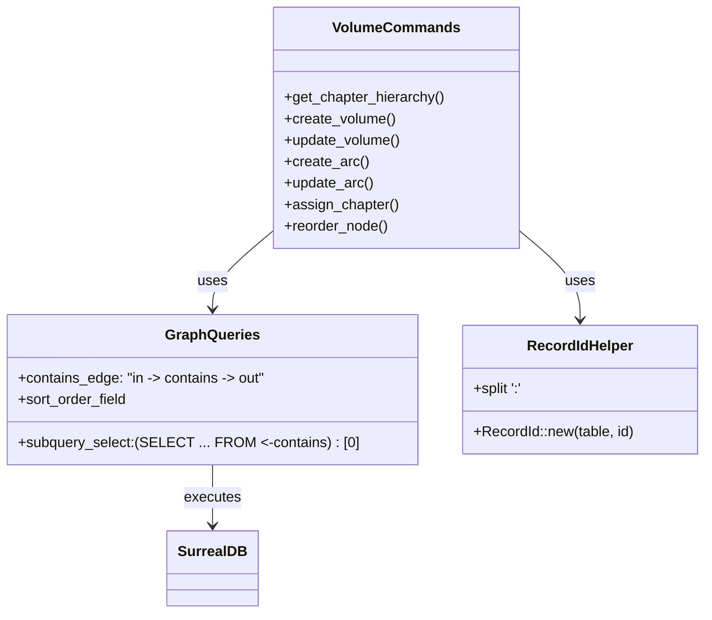

---

### export.rs — Бэкап и восстановление

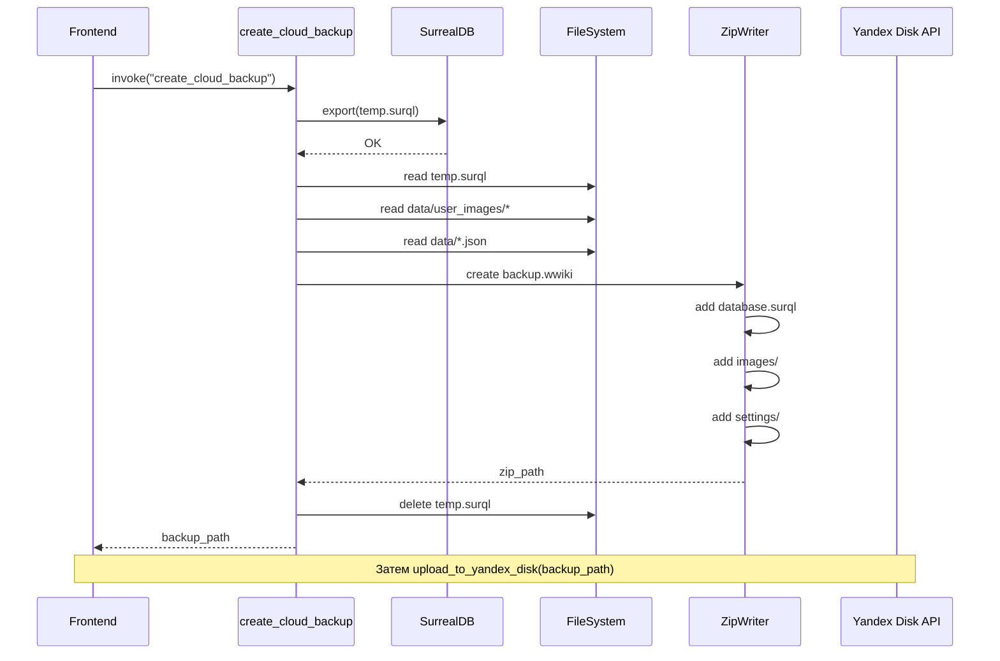

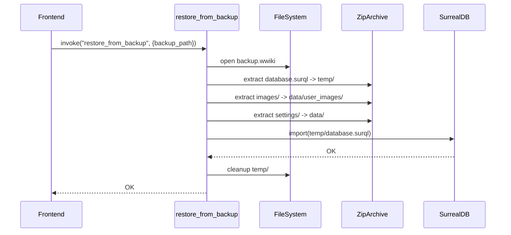

---

### batch.rs — Транзакционные операции

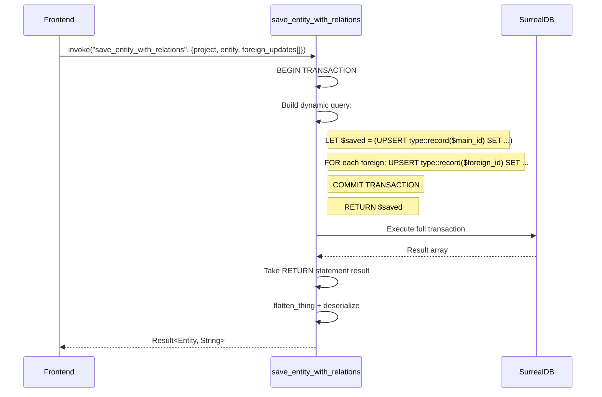

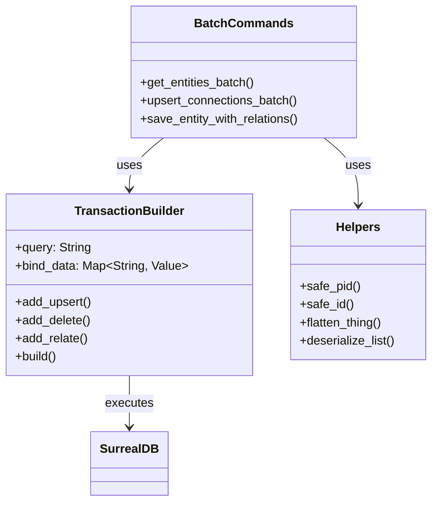

---

## 🔁 Mermaid: Sequence Diagrams — Ключевые флоу

### Создание проекта

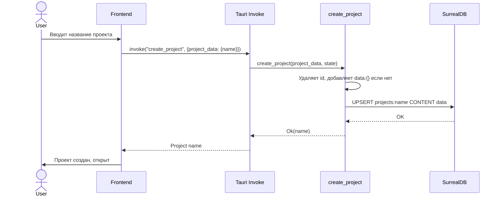

---

### Сохранение сущности с отношениями

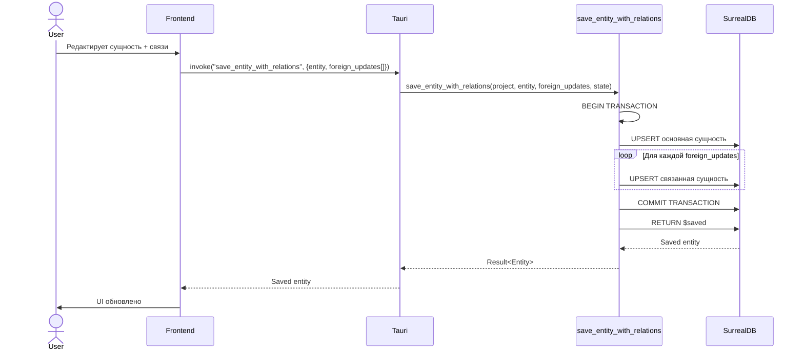

---

### Экспорт и бэкап в облако

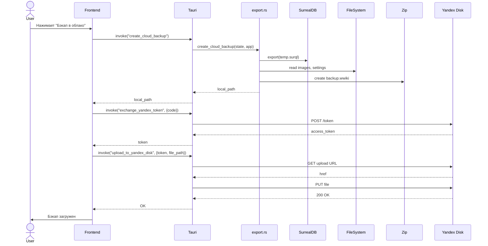

---

### Восстановление из бэкапа

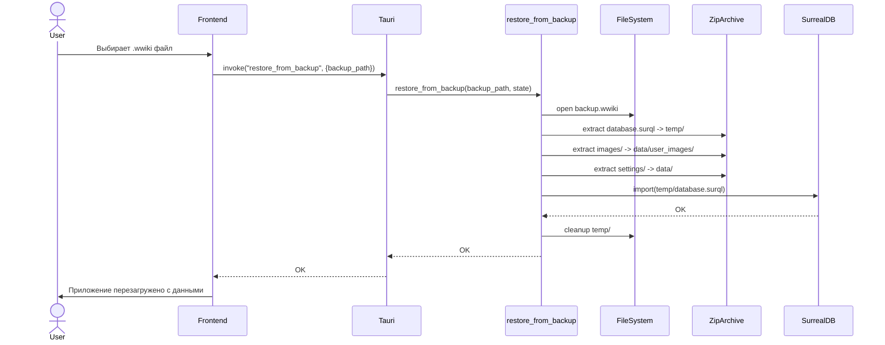

---

### ИИ-чат: отправка сообщения и агентский цикл

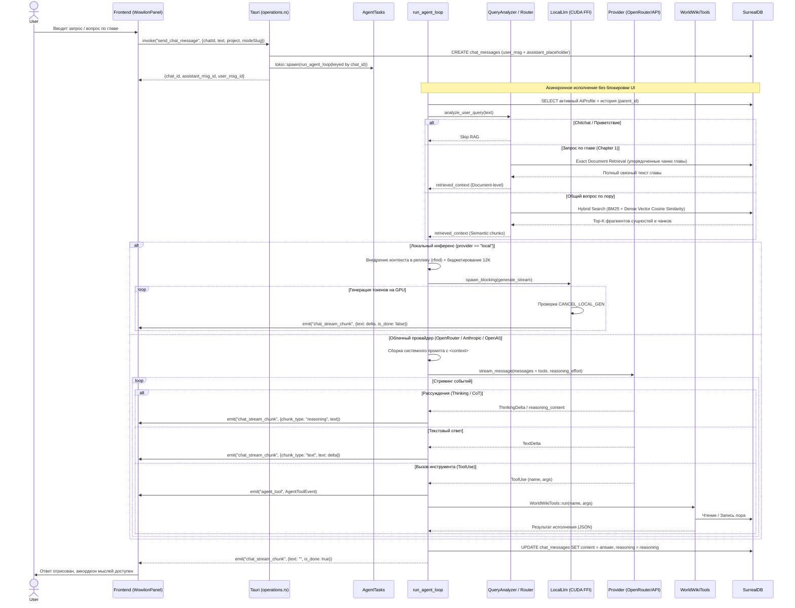

---

## 📝 Примечания и Архитектурные Решения

1. **Гексагональная Модульность**: Вся кодовая база бэкенда разделена на 5 изолированных крейтов (`worldwiki-domain`, `worldwiki-ports`, `worldwiki-application`, `worldwiki-infrastructure`, `worldwiki-tauri`).
2. **Макросы**:
   - `bridge_command!` (`worldwiki-tauri`) — механический мост, инжектирующий `AppState` и маппящий ошибки в `IpcError`.
   - `entity_commands!` (`surreal_domain_macros`) — сборка команд с поддержкой путей модулей (`syn::Path`) и генерацией CRUD.
3. **SurrealDB & GraphRAG**:
   - Работает в embedded режиме (`SurrealKv`), файлы в `data/surreal_db/`.
   - DDL схема вкомпилирована и применяется при старте из `apps/spa/src/logic/surreal_schema.surql`.
   - Внедрена нативная функция графового обхода окрестности `fn::get_chapter_multi_hop_context`.
   - Таймлайн индексирован по эталону абсолютной минуты $M_{\text{abs}}$ (`idx_event_m_abs`) со связями `participates_in`.
4. **Типизация RecordId**: Формат `table:id`, хелперы `safe_id`/`flatten_thing` нормализуют идентификаторы.
5. **Транзакции**: Критичные операции (удаление, батч, редактирование глав с ружьями и планами) обёрнуты в атомарные транзакции `EditManuscriptAtomicWorkflow`.
6. **Производительность**: `get_entities_batch`, `upsert_connections_batch` минимизируют round-trip'ы.
7. **AI-стек**:
   - Локальный инференс через прямой C++ FFI `llama-sys` / `llama.cpp` на GPU CUDA, сэмплеры со штрафами повторений, KV-кэш 16K, безопасный батчинг эмбеддеров (4096 токенов).
   - Облачный инференс через провайдеров (OpenRouter, Anthropic, OpenAI, DeepSeek, Gemini).
   - Двухуровневая модель ИИ: 8 высокоуровневых фасадов (`ai_query_world`, `ai_inspect_entity`, `ai_edit_manuscript` и т.д.) делегируют в типизированный Application Core.
   - Поддержка потокового **Reasoning / CoT (Thinking)** с отображением рассуждений в аккордеоне UI.
   - История чатов хранится в `chat_messages` в виде направленного дерева с поддержкой форков и веток.
8. **Стриминг ответа**: UI получает дельты через события `chat_stream_chunk` (payload `StreamChunk`) и `agent_tool` (payload `AgentToolEvent`); генерация запускается в `tokio::spawn` и регистрируется в `AgentTasks` для отмены через `cancel_generation` (включая мгновенный сброс GPU через атомик `CANCEL_LOCAL_GEN`).
9. **Лимиты контекста**: `prompt.rs` задаёт `MAX_AGENT_ITERATIONS = 8`, `DEFAULT_MAX_TOKENS = 4096`, `HISTORY_CHAR_BUDGET = 120_000`, локальный бюджет лора `12_000` символов.