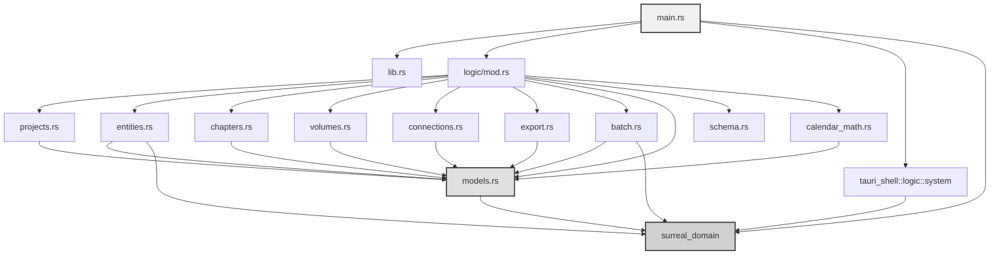
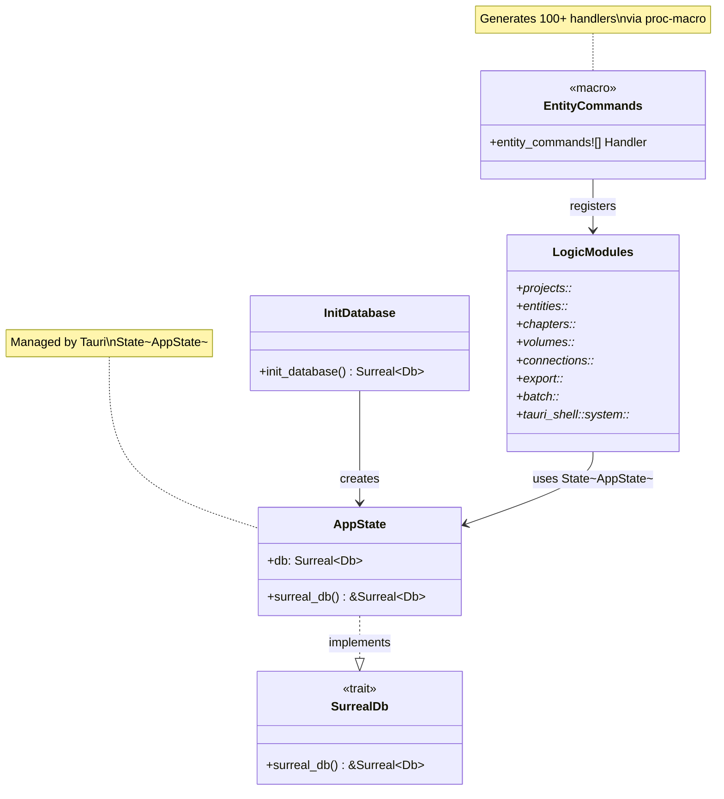
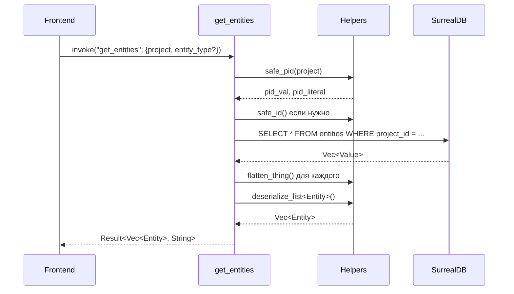
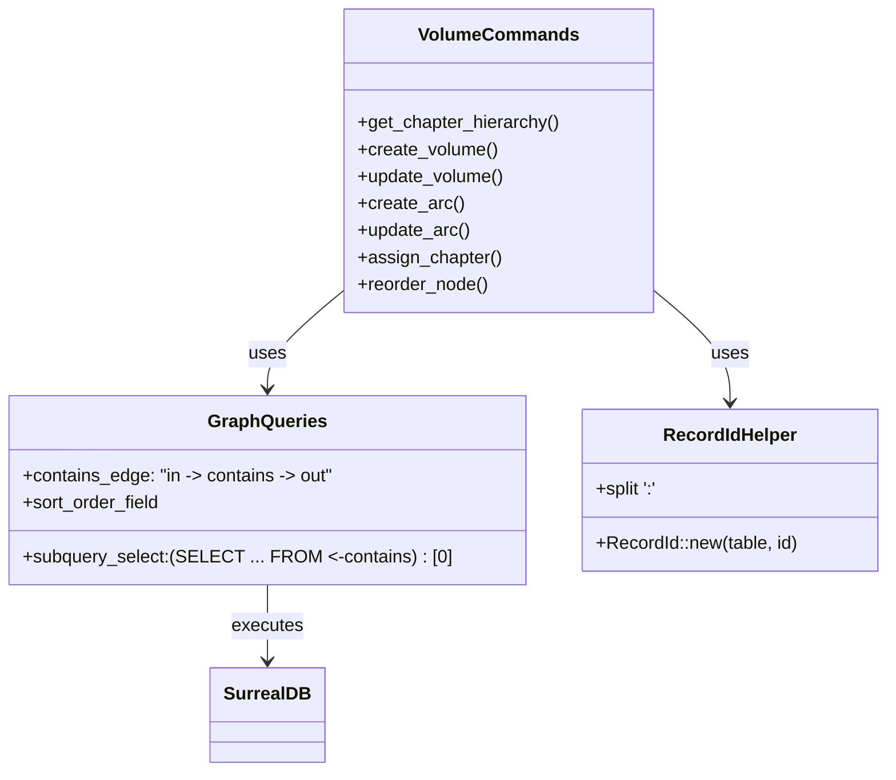
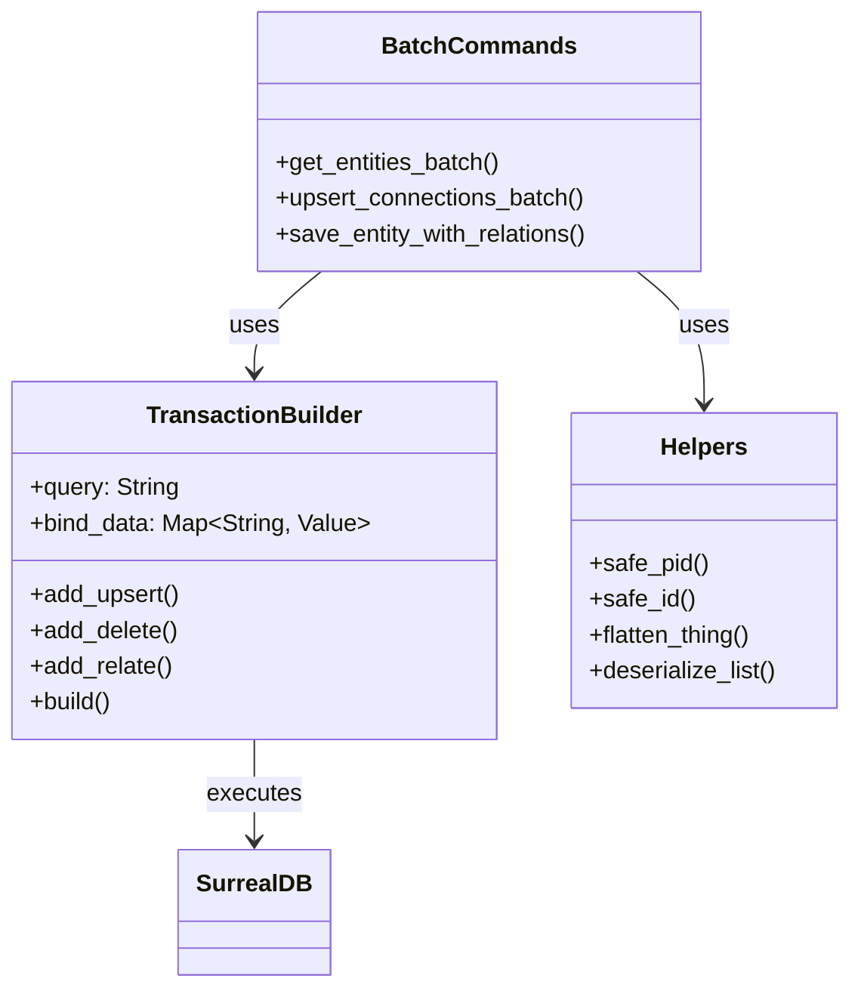
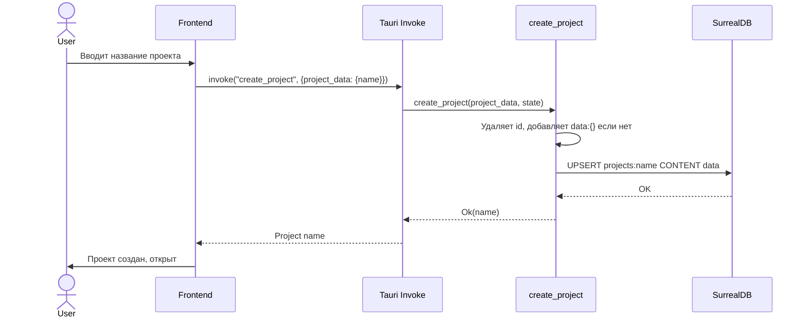
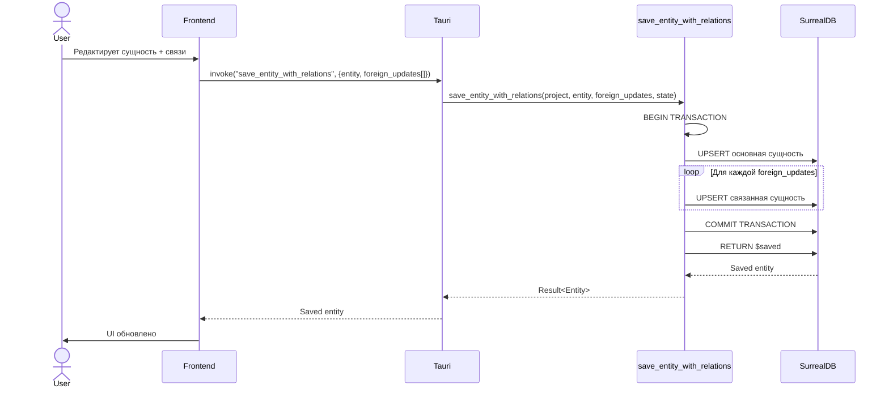
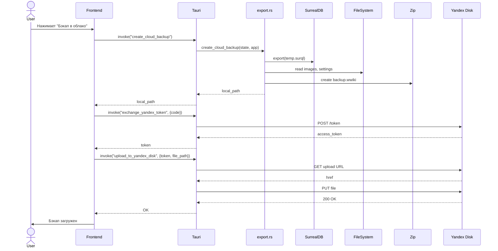
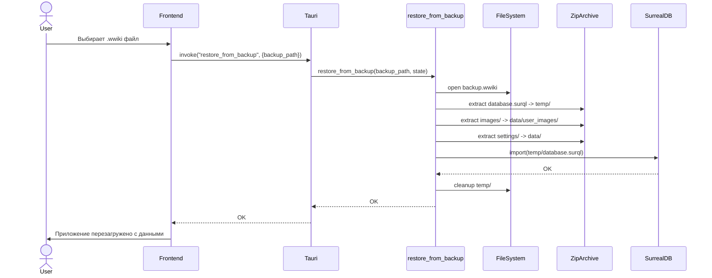

# src-tauri/src — Документация папки

> **Назначение**: Основное приложение Tauri (Rust backend). Точка входа, инициализация SurrealDB, регистрация всех Tauri-команд, бизнес-логика приложения WorldWiki.

---

## 📁 Структура папки

```
src-tauri/src/
├── main.rs              # Точка входа, инициализация БД, регистрация команд
├── lib.rs               # Базовый Tauri boilerplate
├── logic/
│   ├── mod.rs           # Реэкспорт всех модулей logic
│   ├── models.rs        # Определение всех сущностей (surreal_entity! макросы)
│   ├── projects.rs      # CRUD проектов
│   ├── entities.rs      # CRUD сущностей, схем, связей, истории ревизий
│   ├── chapters.rs      # Главы, текстовые блоки, ревизии глав
│   ├── volumes.rs       # Иерархия томов/арок/глав, CRUD
│   ├── connections.rs   # Связи между сущностями (entity_rel)
│   ├── export.rs        # Экспорт, бэкапы, Yandex Disk, восстановление
│   ├── batch.rs         # Пакетные операции, транзакции
│   ├── schema.rs        # Заглушка для совместимости
│   └── calendar_math.rs # Календарная математика
```

---

## 📄 Описание каждого файла

### `main.rs`
**Назначение**: Точка входа приложения. Инициализирует SurrealDB, применяет DDL схему, регистрирует все Tauri-команды через `entity_commands!` макрос, управляет состоянием приложения (`AppState`).

**Ключевые функции**:
- `init_database()` — создаёт/подключается к SurrealDB, применяет `surreal_schema.surql`
- `AppState` — хранит `Surreal<Db>`, реализует `surreal_domain::SurrealDb`
- `main()` — регистрирует 100+ команд через `entity_commands!`, настраивает плагины Tauri

**Зависимости**: Все модули `logic::*`, `tauri_shell::logic::system`, `surreal_domain`

---

### `lib.rs`
**Назначение**: Минимальный boilerplate для Tauri. Экспортирует функцию `run()` для тестов.

**Ключевые функции**:
- `greet()` — пример команды
- `run()` — запуск Tauri приложения

---

### `logic/mod.rs`
**Назначение**: Реэкспорт всех подмодулей `logic` для удобства импорта.

```rust
pub mod entities;
pub mod schema;
pub mod calendar_math;
pub mod chapters;
pub mod connections;
pub mod export;
pub mod volumes;
pub mod models;
pub mod projects;
pub mod batch;
```

---

### `logic/models.rs` — **Ключевой файл**
**Назначение**: Централизованное определение **всех сущностей** приложения через `surreal_entity!` и `surreal_relation!` макросы. Генерирует:
- Rust структуры с `serde`/`ts_rs` деривами
- Реализацию `SurrealRepository` трейта (CRUD)
- Tauri-команды (при `#[tauri_commands]`)
- TypeScript типы в `apps/spa/src/ts/types/generated/`

**Секции**:
1. **AI-инфраструктура** (системные таблицы): `AutoApprovalSettings`, `AiProfile`, `Artifact`, `AiSkill`, `Chat`, `ChatMessage`, `DictionaryWord`, `WebCache`, `AgentMemory`, `TextBlock`
2. **Системные сущности** (фиксированная схема): `Calendar`, `Volume`, `Arc`, `Chapter`, `Tag`, `Plan`
3. **Пользовательские сущности** (универсальная таблица `entities`): `Entity`, `EntitySchema`, `FieldDef`, `EntityRel`, `RelationSchema`
4. **Граф связей** (system edges): `Cites`, `VolumeContainsArc`, `ArcContainsChapter`, `ProjectContainsVolume`
5. **Схема генерации** (`surreal_schema!`) — список для кодогенерации

**Зависимости**: `surreal_domain`, `serde`, `ts_rs`, `chrono`

---

### `logic/projects.rs`
**Назначение**: CRUD операции для проектов (таблица `projects`).

**Команды**:
| Команда | Описание |
|---------|----------|
| `get_projects` | Список всех проектов |
| `create_project` | Создание проекта (upsert по имени) |
| `get_project_config` | Конфигурация проекта |
| `save_project_config` | Сохранение конфига (merge) |
| `delete_project` | Удаление проекта |

**Особенности**: Работает с записями `projects:<name>`, использует `type::record` для прямого доступа.

---

### `logic/entities.rs`
**Назначение**: CRUD для пользовательских сущностей (универсальная таблица `entities`), схем сущностей (`entity_schemas`), связей (`entity_rel`), схем связей (`relation_schemas`), истории ревизий.

**Команды — Сущности**:
- `get_entities` — список с фильтром по типу/проекту
- `get_entity` — по ID
- `save_entity` — create/upsert с нормализацией RecordId
- `delete_entity` — транзакционное удаление + связи + ревизии
- `search_entities` — полнотекстовый поиск по name/description
- `get_entities_batch` — батч загрузка по типам

**Команды — Схемы сущностей**:
- `get_entity_schemas` / `save_entity_schema` / `delete_entity_schema`
- `get_schema_history` / `toggle_schema_history_pin` — версионирование схем

**Команды — Связи**:
- `get_entity_relations` / `create_entity_relation` / `delete_entity_relation`
- `get_relation_schemas` / `save_relation_schema` / `delete_relation_schema`

**Команды — Ревизии**:
- `get_entity_revisions` / `toggle_entity_history_pin`

**Хелперы**: `safe_pid`, `safe_id`, `flatten_thing`, `deserialize_list` — нормализация RecordId и десериализация.

---

### `logic/chapters.rs`
**Назначение**: Работа с главами, текстовыми блоками, ревизиями глав.

**Команды**:
| Команда | Описание |
|---------|----------|
| `get_global_timeline` | Все главы проекта (через `Chapter::find_all`) |
| `save_text_blocks` | Парсинг HTML → структурированные блоки (`text_blocks`), ACID транзакция |
| `get_chapter_revisions` | История ревизий главы |
| `toggle_chapter_history_pin` | Закрепление ревизии |

**Особенности**: Использует `scraper` для парсинга HTML, специальный формат ID `chapters:⟨id⟩`.

---

### `logic/volumes.rs`
**Назначение**: Иерархия проект → тома → арки → главы. Управление порядком через ребро `contains` с полем `sort_order`.

**Команды**:
| Команда | Описание |
|---------|----------|
| `get_chapter_hierarchy` | Полная иерархия (volumes, arcs, chapters) с sort_order |
| `create_volume` | Создание тома + связь `contains` от проекта |
| `update_volume` | Обновление названия тома |
| `create_arc` | Создание арки внутри тома/проекта |
| `update_arc` | Обновление названия арки |
| `assign_chapter` | Перемещение главы в арку/том/проект (удаляет старые `contains`) |
| `reorder_node` | Изменение `sort_order` на входящем ребре `contains` |

**Особенности**: Работает через графовые запросы SurrealDB (`<-contains`), `RecordId::new` для типобезопасных ссылок.

---

### `logic/connections.rs`
**Назначение**: Управление пользовательскими связями между сущностями (таблица `entity_rel`).

**Команды**:
| Команда | Описание |
|---------|----------|
| `get_connections` | Все связи проекта (опционально по главе), нормализация source/target в `{entityType, entityId}` |
| `remove_connections_by_source` | Удаление исходящих связей сущности |
| `save_connections` | Полная перезапись связей сущности (устаревшие удаляются в т.ч. обратные) |

**Особенности**: Маппинг frontend `role` → БД `rel_type`, поддержка периодов (`start_chapter`, `end_chapter`).

---

### `logic/export.rs`
**Назначение**: Экспорт контента, бэкапы, облачное хранение (Yandex Disk), восстановление.

**Команды**:
| Команда | Описание |
|---------|----------|
| `export_chapters` | Экспорт глав в текстовый файл (Downloads) |
| `create_cloud_backup` | Полный бэкап (DB dump + images + settings) → ZIP `.wwiki` |
| `exchange_yandex_token` | OAuth код → access token |
| `upload_to_yandex_disk` | Загрузка бэкапа на Яндекс.Диск |
| `list_yandex_disk_backups` | Список бэкапов в облаке |
| `download_and_restore_yandex` | Скачивание + восстановление из облака |
| `restore_from_backup` | Восстановление из локального `.wwiki` (распаковка, импорт DB, файлы) |
| `get_launch_args` | Аргументы запуска (файл `.wwiki` для ассоциации) |

**Зависимости**: `reqwest`, `zip`, `chrono`, Tauri `AppHandle` для путей.

---

### `logic/batch.rs`
**Назначение**: Пакетные операции в одной транзакции для производительности.

**Команды**:
| Команда | Описание |
|---------|----------|
| `get_entities_batch` | Одним запросом загружает сущности нескольких типов, группирует по типам |
| `upsert_connections_batch` | Транзакционное удаление старых + создание новых связей батчем |
| `save_entity_with_relations` | Сохранение основной сущности + связанных (foreign_updates) в одной транзакции |

**Особенности**: Динамическое построение SurrealQL в транзакции (`BEGIN`/`COMMIT`), `RETURN $saved` для получения результата.

---

### `logic/schema.rs`
**Назначение**: Заглушка для обратной совместимости. В SurrealDB схема задаётся через `.surql` при старте.

---

### `logic/calendar_math.rs`
**Назначение**: Конвертация абсолютного времени в локальное (календарь проекта).

**Команда**: `convert_absolute_to_local` (регистрируется в `main.rs`)

---

## 🔗 Mermaid: Module Dependency Graph



---

## 🔄 Mermaid: DFD (Data Flow Diagram)

```mermaid
flowchart TD
    subgraph Frontend[Frontend (Vue/TypeScript)]
        UI[UI Components]
        Stores[Pinia Stores]
        API[API Services]
    end
    
    subgraph Tauri[Tauri Layer]
        Invoke[tauri::invoke]
        Commands[Tauri Commands]
    end
    
    subgraph Logic[Logic Modules]
        Projects[projects.rs]
        Entities[entities.rs]
        Chapters[chapters.rs]
        Volumes[volumes.rs]
        Connections[connections.rs]
        Export[export.rs]
        Batch[batch.rs]
    end
    
    subgraph Models[Models & Macros]
        Models[models.rs]
        Macros[surreal_domain macros]
    end
    
    subgraph DB[SurrealDB]
        KV[(SurrealKV Engine)]
        Tables[Tables: projects, entities, chapters, ...]
        Edges[Edges: contains, cites, entity_rel, ...]
    end
    
    UI --> Stores
    Stores --> API
    API --> Invoke
    Invoke --> Commands
    
    Commands --> Projects
    Commands --> Entities
    Commands --> Chapters
    Commands --> Volumes
    Commands --> Connections
    Commands --> Export
    Commands --> Batch
    
    Projects --> Models
    Entities --> Models
    Chapters --> Models
    Volumes --> Models
    Connections --> Models
    Export --> Models
    Batch --> Models
    
    Models --> Macros
    Macros --> KV
    
    Projects --> KV
    Entities --> KV
    Chapters --> KV
    Volumes --> KV
    Connections --> KV
    Export --> KV
    Batch --> KV
    
    KV --> Tables
    KV --> Edges
    
    style Frontend fill:#f5f5f5,stroke:#333
    style Tauri fill:#e8e8e8,stroke:#333
    style Logic fill:#dcdcdc,stroke:#333
    style Models fill:#d0d0d0,stroke:#333
    style DB fill:#c4c4c4,stroke:#333
```

---

## 🏗 Mermaid: Class/Function Interaction Diagrams

### main.rs — Взаимодействие компонентов



---

### models.rs — Сущности и макросы


---

### entities.rs — Взаимодействие функций



```mermaid
sequenceDiagram
    participant Frontend
    Command as save_entity
    Helpers as Helpers
    DB as SurrealDB
    
    Frontend->>Command: invoke("save_entity", {project, entity})
    Command->>Helpers: serde_json::to_value(entity)
    Command->>Helpers: normalize RecordId (flatten_thing)
    alt entity.id exists
        Command->>DB: UPSERT type::record($id) SET ...
    else new entity
        Command->>DB: CREATE entities SET ...
    end
    DB-->>Command: Saved Value
    Command->>Helpers: flatten_thing()
    Command->>Helpers: serde_json::from_value()
    Helpers-->>Command: Entity
    Command-->>Frontend: Result<Entity, String>
```

---

### volumes.rs — Иерархия и графовые запросы

```mermaid
sequenceDiagram
    participant Frontend
    Command as get_chapter_hierarchy
    DB as SurrealDB
    
    Frontend->>Command: invoke("get_chapter_hierarchy", {project})
    Command->>DB: SELECT id, title, (SELECT sort_order FROM <-contains WHERE in=$proj)[0] FROM volumes
    DB-->>Command: volumes[]
    Command->>DB: SELECT id, title, (SELECT in FROM <-contains WHERE tb(in)='volumes')[0] as volume_id, sort_order FROM arcs
    DB-->>Command: arcs[]
    Command->>DB: SELECT *, (SELECT in FROM <-contains WHERE tb(in)='arcs')[0] as arc_id, (SELECT in FROM <-contains WHERE tb(in)='volumes')[0] as volume_id, sort_order FROM chapters
    DB-->>Command: chapters[]
    Command->>Command: sort volumes/arcs/chapters by sort_order
    Command-->>Frontend: {volumes, arcs, chapters}
```



---

### export.rs — Бэкап и восстановление

```mermaid
sequenceDiagram
    participant Frontend
    Command as create_cloud_backup
    DB as SurrealDB
    FS as FileSystem
    Zip as ZipWriter
    Yandex as Yandex Disk API
    
    Frontend->>Command: invoke("create_cloud_backup")
    Command->>DB: export(temp.surql)
    DB-->>Command: OK
    Command->>FS: read temp.surql
    Command->>FS: read data/user_images/*
    Command->>FS: read data/*.json
    Command->>Zip: create backup.wwiki
    Zip->>Zip: add database.surql
    Zip->>Zip: add images/
    Zip->>Zip: add settings/
    Zip-->>Command: zip_path
    Command->>FS: delete temp.surql
    Command-->>Frontend: backup_path
    
    Note over Frontend, Yandex: Затем upload_to_yandex_disk(backup_path)
```

```mermaid
sequenceDiagram
    participant Frontend
    Command as restore_from_backup
    FS as FileSystem
    Zip as ZipArchive
    DB as SurrealDB
    
    Frontend->>Command: invoke("restore_from_backup", {backup_path})
    Command->>FS: open backup.wwiki
    Command->>Zip: extract database.surql -> temp/
    Command->>Zip: extract images/ -> data/user_images/
    Command->>Zip: extract settings/ -> data/
    Command->>DB: import(temp/database.surql)
    DB-->>Command: OK
    Command->>FS: cleanup temp/
    Command-->>Frontend: OK
```

---

### batch.rs — Транзакционные операции

```mermaid
sequenceDiagram
    participant Frontend
    Command as save_entity_with_relations
    DB as SurrealDB
    
    Frontend->>Command: invoke("save_entity_with_relations", {project, entity, foreign_updates[]})
    Command->>Command: BEGIN TRANSACTION
    Command->>Command: Build dynamic query:
    Note right of Command: LET $saved = (UPSERT type::record($main_id) SET ...)
    Note right of Command: FOR each foreign: UPSERT type::record($foreign_id) SET ...
    Note right of Command: COMMIT TRANSACTION
    Note right of Command: RETURN $saved
    Command->>DB: Execute full transaction
    DB-->>Command: Result array
    Command->>Command: Take RETURN statement result
    Command->>Command: flatten_thing + deserialize
    Command-->>Frontend: Result<Entity, String>
```



---

## 🔁 Mermaid: Sequence Diagrams — Ключевые флоу

### Создание проекта



---

### Сохранение сущности с отношениями



---

### Экспорт и бэкап в облако



---

### Восстановление из бэкапа



---

## 📝 Примечания

1. **Все Tauri-команды** регистрируются в `main.rs` через макрос `entity_commands!` из `surreal_domain_macros`
2. **Макросы в `models.rs`** генерируют структуры, трейты, команды и TypeScript типы автоматически
3. **SurrealDB** используется в embedded режиме (SurrealKV), файлы в `data/surreal_db/`
4. **DDL схема** применяется при старте из `apps/spa/src/logic/surreal_schema.surql`
5. **Типизация RecordId**: везде используется формат `table:id`, хелперы `safe_id`/`flatten_thing` нормализуют
6. **Транзакции**: критичные операции (удаление, батч) обёрнуты в `BEGIN`/`COMMIT`
7. **Производительность**: `get_entities_batch`, `upsert_connections_batch` минимизируют round-trip'ы