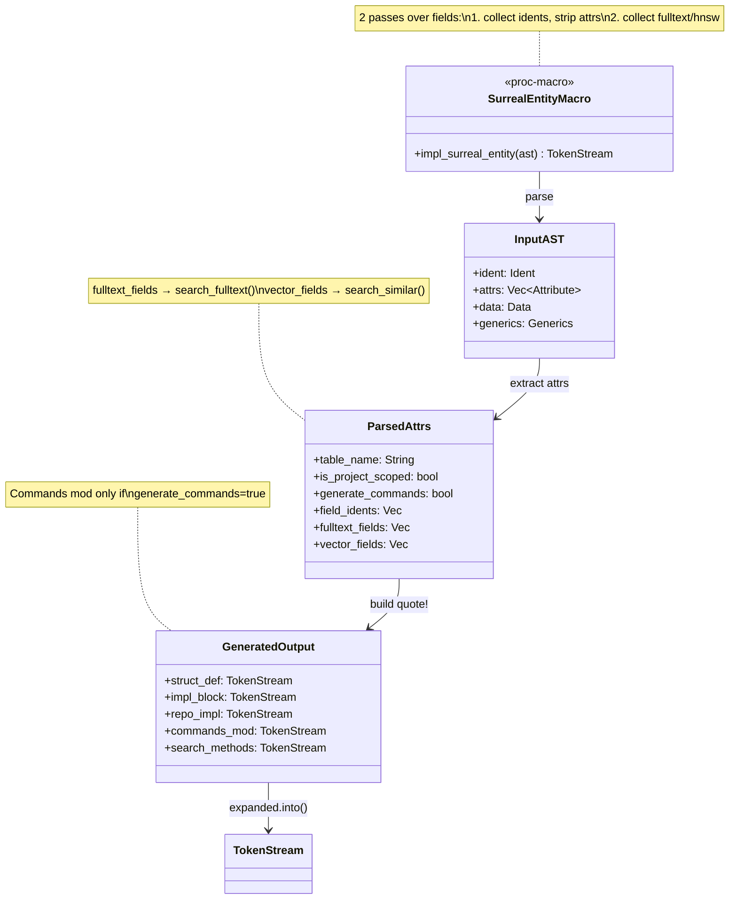
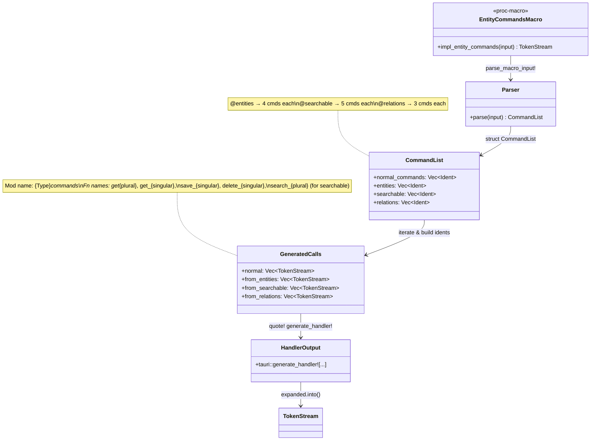
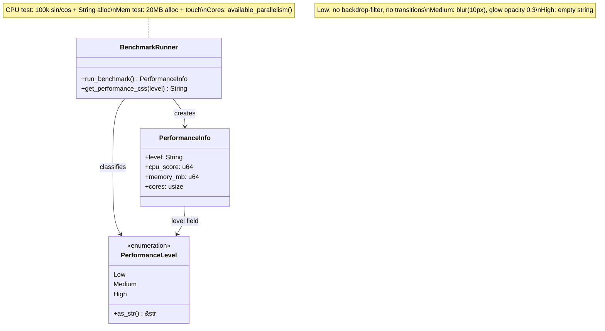
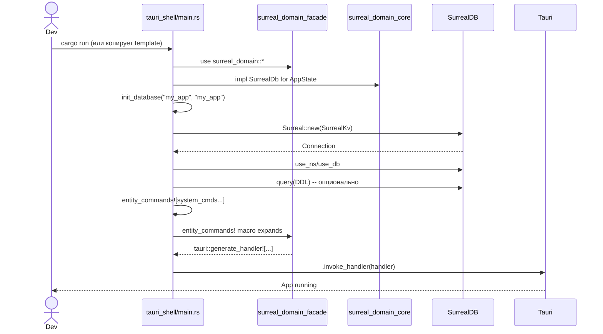
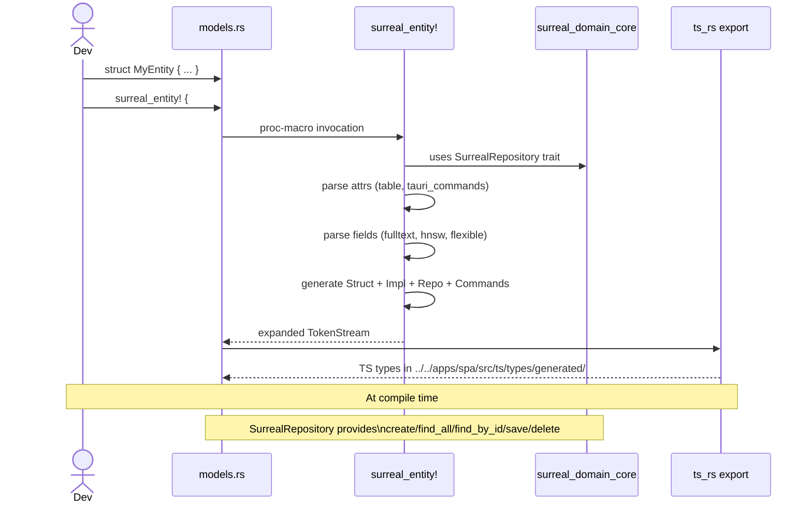
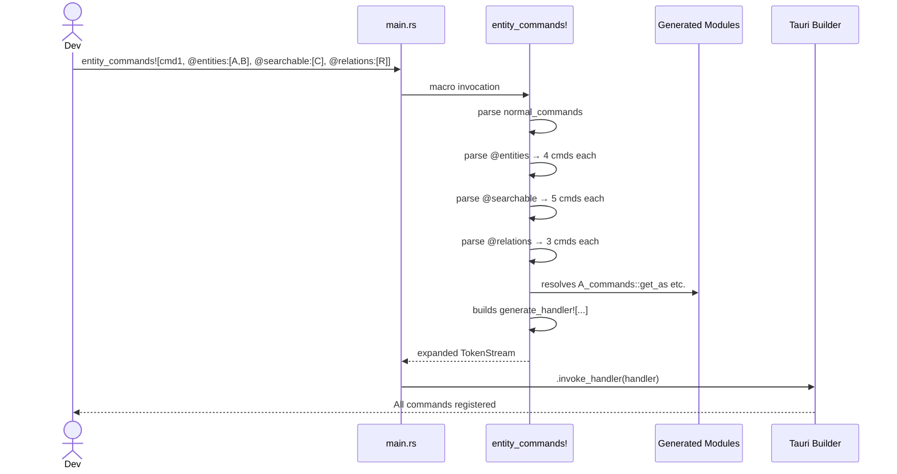
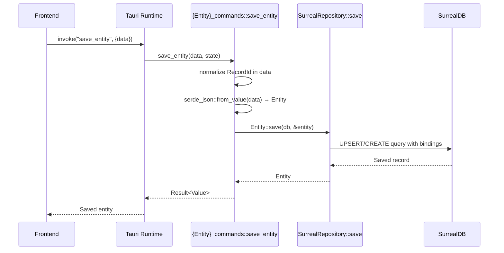

# tauri-surreal-kit/backend — Документация папки

> **Назначение**: Переиспользуемая библиотека (kit) для построения Tauri + SurrealDB приложений. Состоит из трёх crate'ов: `surreal_domain` (core + macros + facade) и `tauri_shell` (шаблон приложения).

---

## 📁 Структура папки

```
tauri-surreal-kit/backend/
├── surreal_domain/
│   ├── Cargo.toml                    # Workspace для surreal_domain
│   ├── surreal_domain_core/          # Core трейты и DTO
│   │   ├── Cargo.toml
│   │   └── src/lib.rs                # SurrealDb, SurrealRepository, SearchResult, GraphEdge, ...
│   ├── surreal_domain_macros/        # Proc-макросы кодогенерации
│   │   ├── Cargo.toml
│   │   └── src/
│   │       ├── lib.rs                # Экспорт макросов
│   │       ├── entity.rs             # surreal_entity! — генерация структур, CRUD, команд
│   │       ├── relation.rs           # surreal_relation! — генерация ребер, CRUD, команд
│   │       ├── schema.rs             # surreal_schema! — регистрация для кодогенерации
│   │       └── entity_commands.rs    # entity_commands! — сборка tauri::generate_handler!
│   └── surreal_domain_facade/        # Реэкспорт core + macros
│       ├── Cargo.toml
│       └── src/lib.rs                # pub use surreal_domain_core::*; pub use surreal_domain_macros::*;
│
└── tauri_shell/                      # Domain-agnostic Tauri template
    ├── Cargo.toml
    ├── tauri.conf.json
    ├── build.rs
    └── src/
        ├── main.rs                   # Bootstrap, init_database, регистрация системных команд
        ├── lib.rs                    # pub mod logic
        └── logic/
            ├── mod.rs                # pub mod performance; pub mod system;
            ├── system.rs             # Файловая система, настройки, темы, окно, производительность
            └── performance.rs        # Бенчмарк CPU/памяти, адаптивный CSS
```

---

## 📄 Описание каждого crate/файла

### surreal_domain_core (`surreal_domain/surreal_domain_core/src/lib.rs`)

**Назначение**: Фундаментальные трейты и DTO, независимые от макросов. Используются и макросами, и пользовательским кодом.

**Экспорты**:

| Элемент | Тип | Описание |
|---------|-----|----------|
| `SurrealDb` | Trait | Трейт, который должен реализовать `AppState` пользователя для доступа к `Surreal<Db>` |
| `SurrealRepository` | Trait | CRUD трейт, реализуется макросом `surreal_entity!` для каждой сущности |
| `SearchKind` | Enum | `Fulltext \| Vector \| Hybrid` — вид поиска |
| `SearchResult<T>` | Struct | Результат поиска: `entity`, `score`, `kind` |
| `SimilarResult<T>` | Struct | Результат векторного поиска: `entity`, `similarity` |
| `EdgeDirection` | Enum | `Outgoing \| Incoming \| Both` — направление ребра |
| `GraphEdge<E, T>` | Struct | Ребро графа: `edge_id`, `edge_data`, `node`, `direction` |
| `GraphNeighborhood` | Struct | Окрестность графа: `center_id`, `nodes[]`, `edges[]`, `depth` |
| `ChapterRange` | Struct | Диапазон глав: `start_chapter`, `end_chapter` |

**SurrealDb trait**:
```rust
pub trait SurrealDb: Send + Sync + 'static {
    type Connection: surrealdb::Connection;
    fn surreal_db(&self) -> &surrealdb::Surreal<Self::Connection>;
}
```

**SurrealRepository trait** — предоставляет дефолтную реализацию:
- `create()` — INSERT с биндингами параметров, поддержка RecordId
- `find_by_id()` — SELECT по ID
- `find_all()` — SELECT с фильтром по `project_id` (3 варианта формата)
- `save()` — UPSERT с нормализацией полей
- `delete()` — DELETE по ID

---

### surreal_domain_macros (`surreal_domain/surreal_domain_macros/src/`)

#### `lib.rs` — Точка входа макросов
Экспортирует 4 proc-макроса:
- `surreal_entity!` → `entity::impl_surreal_entity`
- `surreal_relation!` → `relation::impl_surreal_relation`
- `surreal_schema!` → `schema::impl_surreal_schema`
- `entity_commands!` → `entity_commands::impl_entity_commands`

#### `entity.rs` — `surreal_entity!` макрос
**Назначение**: Генерация структуры сущности + CRUD + Tauri-команд + TS типов.

**Атрибуты структуры**:
| Атрибут | Описание |
|---------|----------|
| `#[table = "name"]` | Имя таблицы (по умолчанию lowercase имени структуры) |
| `#[project_scoped]` | Маркер (не используется в коде, для семантики) |
| `#[tauri_commands]` | Включает генерацию Tauri-команд |

**Атрибуты полей**:
| Атрибут | Описание |
|---------|----------|
| `#[fulltext]` | Поле добавляется в полнотекстовый поиск |
| `#[hnsw]` | Поле добавляется в векторный поиск (HNSW) |
| `#[flexible]` | Тип в TS = `any`, поле пропускается при сериализации null |

**Генерирует**:
1. **Struct** с полями + `id`, `project_id`, `serde`/`ts_rs` деривами
2. **Impl блок** с `TABLE` константой + `search_fulltext` / `search_similar` методы (если есть атрибуты)
3. **SurrealRepository impl** — дефолтный CRUD через trait
4. **Модуль `{Name}_commands`** (если `#[tauri_commands]`) с командами:
   - `get_{name}s(project, state)` → `find_all`
   - `get_{name}(id, state)` → `find_by_id`
   - `save_{name}(data, state)` → десериализация + `save` + нормализация RecordId
   - `delete_{name}(id, state)` → `delete`
   - `search_{name}s(project, query, state)` → `search_fulltext` (если `#[fulltext]`)

**Нормализация RecordId в save_**: Преобразует `{"tb": "...", "id": "..."}` объекты в строки `"table:id"`, массивы рекурсивно.

#### `relation.rs` — `surreal_relation!` макрос
**Назначение**: Генерация структуры ребра (edge) + графовые методы + Tauri-команд.

**Атрибуты структуры**:
| Атрибут | Описание |
|---------|----------|
| `#[edge = "name"]` | Имя таблицы ребра (по умолчанию lowercase) |
| `#[from = Type]` | Исходная таблица (по умолчанию `entities`) |
| `#[to = Type]` | Целевая таблица (по умолчанию `entities`) |
| `#[project_scoped]` | Маркер |
| `#[tauri_commands]` | Включает генерацию команд |

**Генерирует**:
1. **Struct** с полями + `id`, `in`, `out`, `project_id`
2. **Impl блок** с константами `TABLE`, `FROM`, `TO` + методами:
   - `relate(db, from_id, to_id, data)` — `RELATE from->TABLE->to CONTENT data`
   - `find_between(db, from_id, to_id)` — SELECT по in/out
   - `find_all(db, project_id)` — все ребра проекта
   - `delete(db, edge_id)` — DELETE
3. **Модуль `{Name}_commands`** (если `#[tauri_commands]`) с командами:
   - `get_{name}s(from_id, to_id, state)` → `find_between`
   - `create_{name}(from_id, to_id, data, state)` → `relate`
   - `delete_{name}(id, state)` → `delete`

#### `schema.rs` — `surreal_schema!` макрос
**Назначение**: Регистрация списка сущностей и релей для кодогенерации (используется в `models.rs` для экспорта TS типов).

**Синтаксис**:
```rust
surreal_schema! {
    entities: [Type1, Type2, ...],
    relations: [Rel1, Rel2, ...]
}
```
Расширяется в пустой `TokenStream` (нет кодогенерации в рантайме), используется только для `ts_rs` экспорта в тестах.

#### `entity_commands.rs` — `entity_commands!` макрос
**Назначение**: Сборка `tauri::generate_handler!` из списка команд и генерируемых модулей.

**Синтаксис**:
```rust
entity_commands![
    // Обычные команды (функции)
    cmd1, cmd2, cmd3,
    
    // Автогенерация для сущностей (CRUD)
    @entities: [Chapter, Volume, Arc, Plan, Tag, Calendar],
    
    // Автогенерация для поисковых сущностей (CRUD + search)
    @searchable: [TextBlock, ChatMessage, AgentMemory, WebCache],
    
    // Автогенерация для релей (get, create, delete)
    @relations: [Cites]
]
```

**Парсинг**:
- Идентификаторы без `@` → `normal_commands`
- `@entities: [...]` → генерирует 4 команды на тип (get_all, get_one, save, delete)
- `@searchable: [...]` → 5 команд (4 CRUD + search)
- `@relations: [...]` → 3 команды (get_all, create, delete)

**Результат**: `tauri::generate_handler![...]` со всеми функциями.

---

### surreal_domain_facade (`surreal_domain/surreal_domain_facade/src/lib.rs`)

**Назначение**: Единая точка реэкспорта для пользователей kit'а.
```rust
pub use surreal_domain_core::*;
pub use surreal_domain_macros::*;
```
Позволяет писать `use surreal_domain::*;` вместо импорта из двух crate'ов.

---

### tauri_shell (`tauri_shell/src/`)

#### `main.rs` — Bootstrap шаблона
**Назначение**: Демонстрационный/шаблонный `main.rs` для новых проектов на базе kit'а.

**Ключевые элементы**:
- `AppState { db: Surreal<Db> }` + `impl SurrealDb for AppState`
- `init_database(ns, db)` — параметризованная инициализация (namespace, database name)
- `main()` — регистрация **системных команд** через `entity_commands!`:
  - Файловая система: `upload_photo`, `copy_background_file`, `get_local_file`
  - Производительность: `run_performance_benchmark`, `get_performance_styles`
  - Настройки: `save_settings`, `load_settings`
  - Окно: `toggle_fullscreen`
  - Темы: `get_custom_themes`, `load_theme`, `save_custom_theme`
- Комментарии с инструкцией: заменить `"my_app"` на свой namespace, добавить доменные команды

#### `lib.rs` — Реэкспорт logic
```rust
pub mod logic;
```

#### `logic/mod.rs` — Реэкспорт подмодулей
```rust
pub mod performance;
pub mod system;
```

#### `logic/system.rs` — Системные Tauri-команды
**Назначение**: Доменно-независимые утилиты для любого Tauri+SurrealDB приложения.

**Команды — Файловая система**:
| Команда | Описание |
|---------|----------|
| `upload_photo(bytes, filename)` | Сохранение в `data/user_images/{timestamp}_{filename}` |
| `copy_background_file(source_path)` | Копирование в `data/user_images/` с timestamp |
| `get_local_file(path)` | Чтение файла → `Vec<u8>` (для сервировки картинок в webview) |

**Команды — Производительность**:
| Команда | Описание |
|---------|----------|
| `run_performance_benchmark()` → `PerformanceInfo` | CPU (DOM-like), Memory (20MB alloc), Cores |
| `get_performance_styles(level)` → `String` | CSS overrides для Low/Medium/High |

**Команды — Настройки**:
| Команда | Описание |
|---------|----------|
| `save_settings(Value)` | Запись в `data/settings.json` |
| `load_settings()` → `Value` | Чтение из `data/settings.json` или `Null` |

**Команды — Окно**:
| Команда | Описание |
|---------|----------|
| `toggle_fullscreen(window)` | Переключение полноэкранного режима |

**Команды — Темы**:
| Команда | Описание |
|---------|----------|
| `get_custom_themes()` → `Vec<String>` | Сканирует `data/settings-*.json`, `data/settings-theme-*.json` |
| `load_theme(name)` → `Value` | Загружает `settings-{name}.json` или `settings-theme-{name}.json` |
| `save_custom_theme(name, Value)` | Сохраняет в `data/settings-theme-{name}.json` |

**Хелпер**: `get_data_dir()` — определяет папку `data/` (dev: от `target/`, prod: `cwd/data/`)

#### `logic/performance.rs` — Бенчмарк и адаптивный CSS
**Назначение**: Измерение производительности устройства и генерация CSS для деградации UI.

**Структуры**:
```rust
enum PerformanceLevel { Low, Medium, High }

struct PerformanceInfo {
    level: String,
    cpu_score: u64,      // ms для 100k DOM-like ops
    memory_mb: u64,      // ms для 20MB alloc+touch
    cores: usize,
}
```

**Алгоритм классификации**:
| Уровень | CPU < | Memory < | Cores ≥ |
|---------|-------|----------|---------|
| High | 150ms | 300ms | 8 |
| Medium | 400ms | 600ms | 4 |
| Low | — | — | — |

**CSS overrides**:
- **Low**: отключает `backdrop-filter`, `transition`, `hover transform`, glow-эффекты
- **Medium**: `backdrop-filter: blur(10px)`, `opacity: 0.3` для glow
- **High**: пустая строка (полные эффекты)

---

## 🔗 Mermaid: Crate Dependency Graph

```mermaid
graph TD
    subgraph SurrealDomain[surreal_domain workspace]
        Core[surreal_domain_core]
        Macros[surreal_domain_macros]
        Facade[surreal_domain_facade]
    end
    
    subgraph TauriShell[tauri_shell]
        ShellMain[main.rs]
        ShellLogic[logic/system.rs, performance.rs]
    end
    
    subgraph UserApp[User Application<br/>(например, src-tauri)]
        UserMain[main.rs]
        UserModels[models.rs]
        UserLogic[logic/*.rs]
    end
    
    Core --> Macros : trait SurrealRepository<br/>DTO types
    Macros --> Core : uses SurrealDb, SurrealRepository
    Facade --> Core : re-export
    Facade --> Macros : re-export
    
    ShellMain --> Facade : use surreal_domain::*
    ShellLogic --> Facade : use surreal_domain::SurrealDb
    
    UserMain --> Facade : use surreal_domain::*
    UserModels --> Facade : surreal_entity!, surreal_relation!
    UserLogic --> Facade : uses SurrealDb trait
    
    Macros -.-> UserModels : proc-macro expansion<br/>at compile time
    Macros -.-> UserMain : entity_commands!<br/>at compile time
    
    style Core fill:#d0d0d0,stroke:#333,stroke-width:2px
    style Macros fill:#c0c0c0,stroke:#333,stroke-width:2px
    style Facade fill:#b0b0b0,stroke:#333,stroke-width:2px
    style ShellMain fill:#e0e0e0,stroke:#333
    style UserMain fill:#f0f0f0,stroke:#333,stroke-width:2px
```

---

## 🔄 Mermaid: DFD (Data Flow Diagram) — Code Generation

```mermaid
flowchart TD
    subgraph CompileTime[Compile Time - Proc Macros]
        UserCode[User Code<br/>models.rs]
        EntityMacro[surreal_entity!]
        RelationMacro[surreal_relation!]
        SchemaMacro[surreal_schema!]
        CommandsMacro[entity_commands!]
    end
    
    subgraph Generated[Generated Code]
        Structs[Struct Definitions<br/>+ serde/TS derives]
        RepoImpl[SurrealRepository Impl<br/>CRUD methods]
        SearchMethods[search_fulltext<br/>search_similar]
        CommandMods[Command Modules<br/>get_*, save_*, delete_*]
        Handler[tauri::generate_handler!]
    end
    
    subgraph Runtime[Runtime]
        TauriApp[Tauri App]
        SurrealDB[(SurrealDB)]
        Frontend[Frontend TS]
    end
    
    UserCode --> EntityMacro
    UserCode --> RelationMacro
    UserCode --> SchemaMacro
    UserCode --> CommandsMacro
    
    EntityMacro --> Structs
    EntityMacro --> RepoImpl
    EntityMacro --> SearchMethods
    EntityMacro --> CommandMods
    
    RelationMacro --> Structs
    RelationMacro --> RepoImpl
    RelationMacro --> CommandMods
    
    SchemaMacro --> Structs : registers for TS export
    
    CommandsMacro --> CommandMods : collects
    CommandsMacro --> Handler : generates
    
    Handler --> TauriApp : registered in main()
    TauriApp --> SurrealDB : queries
    TauriApp --> Frontend : invoke/response
    
    Frontend -.-> Structs : TS types via ts_rs<br/>(generated at build)
    
    style CompileTime fill:#f0f0f0,stroke:#333
    style Generated fill:#e0e0e0,stroke:#333
    style Runtime fill:#d0d0d0,stroke:#333
```

---

## 🏗 Mermaid: Class/Function Interaction Diagrams

### surreal_domain_macros/entity.rs — Генерация сущности



---

### surreal_domain_macros/entity_commands.rs — Сборка handler'а



---

### tauri_shell/logic/system.rs — Системные команды

```mermaid
classDiagram
    class SystemCommands {
        +upload_photo(bytes, filename) String
        +copy_background_file(source) String
        +get_local_file(path) Vec~u8~
        +run_performance_benchmark() PerformanceInfo
        +get_performance_styles(level) String
        +save_settings(Value) ()
        +load_settings() Value
        +toggle_fullscreen(window) ()
        +get_custom_themes() Vec~String~
        +load_theme(name) Value
        +save_custom_theme(name, Value) ()
    }
    
    class DataDirHelper {
        +get_data_dir() PathBuf
    }
    
    class FileSystem {
        +create_dir_all()
        +write()
        +read()
        +copy()
        +read_dir()
    }
    
    class TauriWindow {
        +is_fullscreen() bool
        +set_fullscreen(bool)
    }
    
    SystemCommands --> DataDirHelper : uses
    SystemCommands --> FileSystem : uses
    SystemCommands --> TauriWindow : uses
    DataDirHelper --> std::env : current_exe/current_dir
    
    note for DataDirHelper "Dev: target/debug → target → root/data\nProd: cwd/data"
    note for SystemCommands "All #[tauri::command]\nasync except toggle_fullscreen"
```

---

### tauri_shell/logic/performance.rs — Бенчмарк



---

## 🔁 Mermaid: Sequence Diagrams — Ключевые флоу

### Инициализация приложения на базе kit'а



---

### Кодогенерация сущности пользователем



---

### Регистрация команд через entity_commands!



---

### Runtime: Вызов сгенерированной команды save_*



---

## 📝 Примечания

1. **Architecture**: `surreal_domain` — это библиотека кодогенерации (compile-time), `tauri_shell` — шаблон runtime.
2. **Proc-macros** требуют отдельного crate'а (`surreal_domain_macros`) с `proc-macro = true` в Cargo.toml.
3. **Facade pattern** (`surreal_domain_facade`) упрощает импорт: `use surreal_domain::*;`
4. **ts_rs экспорт** происходит при компиляции пользовательского кода (в `models.rs`), генерирует TS типы в `apps/spa/src/ts/types/generated/`
5. **entity_commands!** — ключевой макрос для регистрации всех Tauri-команд одним вызовом.
6. **tauri_shell** не зависит от доменной логики — только системные команды. Пользователь добавляет свои через `@entities`, `@searchable`, `@relations`.
7. **Performance adaptation**: `run_performance_benchmark()` вызывается при старте, результат кэшируется, CSS применяется через `get_performance_styles()`.
8. **Data directory resolution**: работает и в dev (`target/debug/...` → `root/data`), и в prod (`cwd/data`).
9. **Themes**: built-in (`settings-light.json`, `settings-dark.json`) + custom (`settings-theme-{name}.json`).
10. **SurrealRepository** default impl обрабатывает RecordId биндинги автоматически (парсит `table:id` строки).