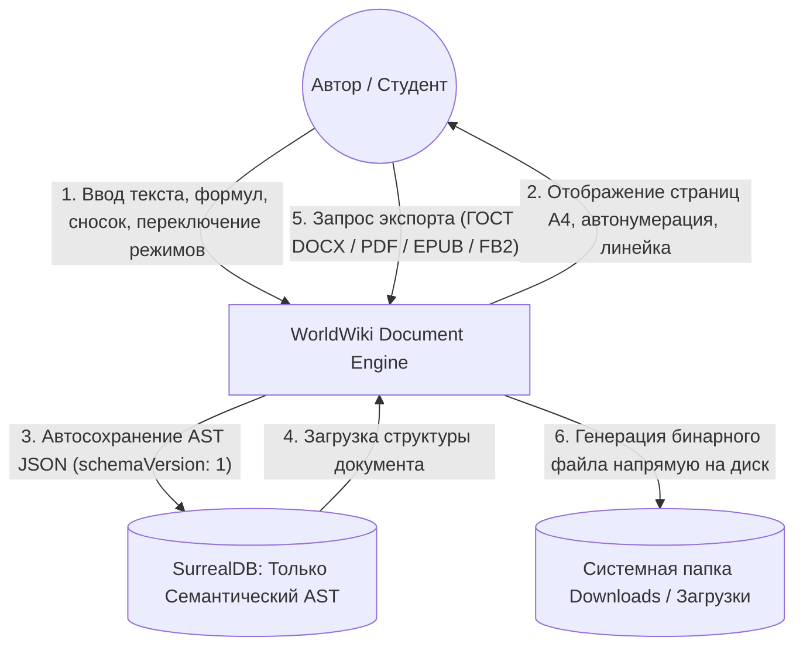
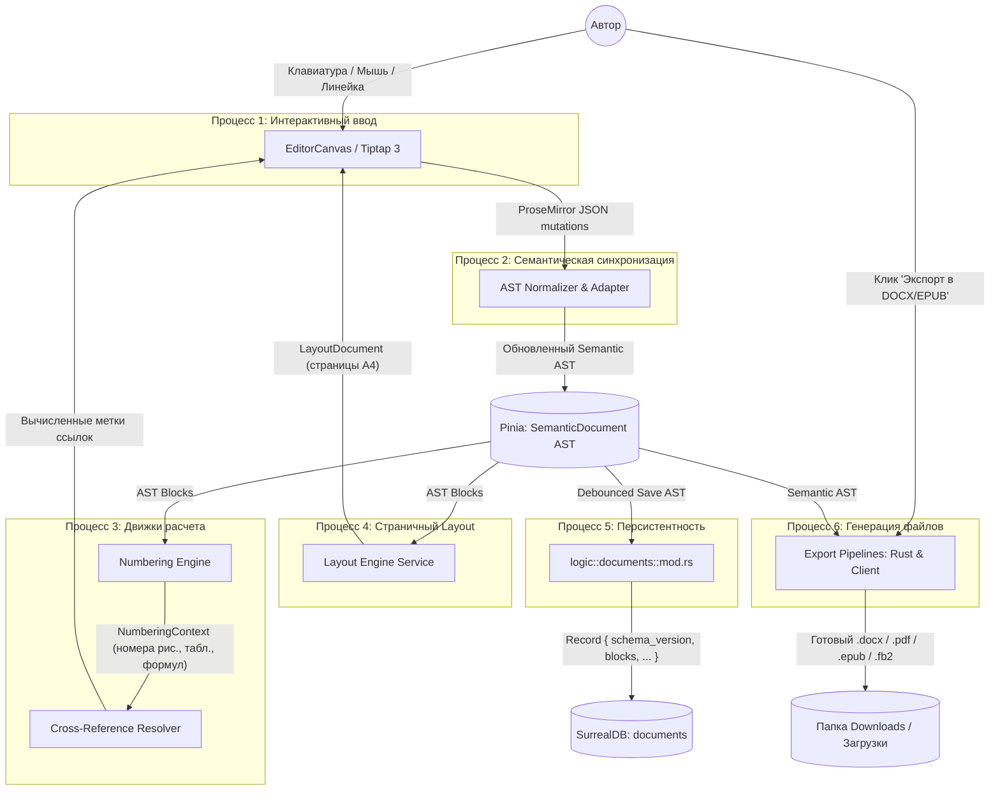
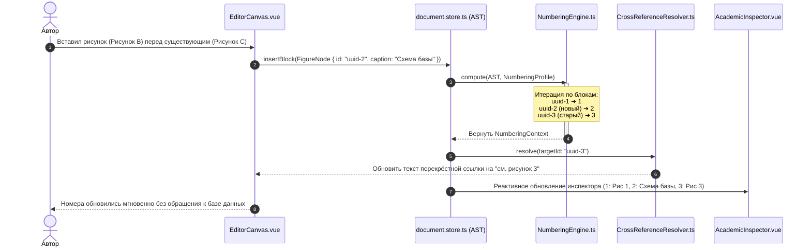
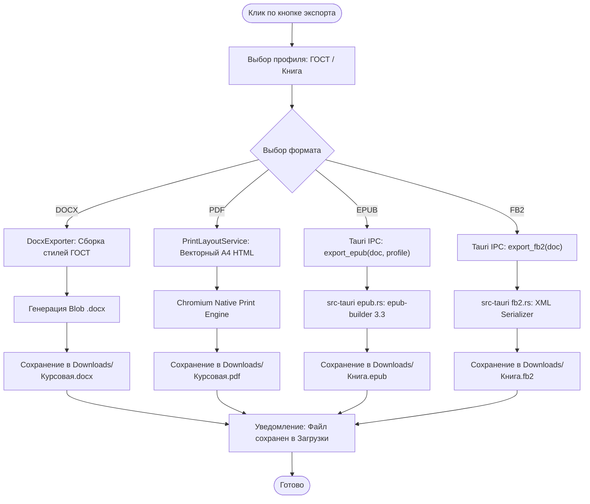

# Спецификация текстового процессора WorldWiki (Document Engine)
## Академический процессор (ГОСТ) и инструмент писателя (Word + Overleaf + Scrivener)

---

## 1. Видение и архитектурные принципы

### 1.1. Назначение системы
WorldWiki Document Engine превращает встроенный редактор глав в локальный, независимый от облаков текстовый процессор профессионального уровня:
1. **Для академических работ (курсовые, дипломы, НИР, статьи)**: строгое соблюдение ГОСТ 7.32-2017 и ГОСТ Р 7.0.5-2008 (поля 30/20/10/20 мм, Times New Roman 14pt, межстрочный интервал 1.5, красная строка 1.25 см, выравнивание по ширине, сквозная динамическая нумерация рисунков/таблиц/формул, подстрочные сноски, формулы LaTeX, перенос шапок таблиц, оглавление).
2. **Для художественной литературы (романы, повести, сборники)**: структура «Том — Арка — Глава — Сцена», разделители сцен (астеризмы `* * *`), спусковые книжные полосы, экспорт готовых книг в FB2 и EPUB 3.3 для Author.Today, ЛитРес, Amazon KDP и печать в PDF.

### 1.2. Фундаментальный архитектурный принцип
> **Tiptap — это только интерактивный холст (View / Controller), а не модель документа и не источник истины.**
> 1. **Semantic Document Model (AST)** — единственный источник истины. Знает, что перед нами `Figure`, `Table`, `Equation`, `Heading`, `Footnote`.
> 2. **Numbering Engine** — рассчитывает все номера («Рисунок 17», «Раздел 2.3», «(4)») на лету как чистую функцию. Никаких захардкоженных номеров в базе данных.
> 3. **Cross-References** — привязываются к стабильным `targetId: UUID`. При вставке нового рисунка ссылки обновляются автоматически.
> 4. **Composite Profiles** — независимые профили оформления документа (`AcademicGOSTProfile`, `NovelBookProfile`, `ContinuousDraftProfile`) и экспорта.
> 5. **Layout Model** — промежуточная страничная модель (`LayoutDocument`), гарантирующая идентичность верстки на экране и в итоговом файле.
> 6. **Хранилище vs Экспорт**:
>    * В SurrealDB хранятся **ТОЛЬКО** текстовые семантические данные (`blocks`, `metadata`, `profile_id`) в формате JSON (`schemaVersion: 1`). Бинарников в базе нет.
>    * Экспорт компилируется на лету и сохраняется напрямую в системную папку **`Downloads` (Загрузки)** пользователя (или по пути из системного диалога).

---

## 2. Полный стек библиотек и расширений

Все выбранные библиотеки являются **100% бесплатными (Open Source / MIT)**.

### 2.1. Frontend: Редактор и страницы (Tiptap 3 / Vue 3)

| Пакет / Расширение | Назначение в WorldWiki | Особенности интеграции |
| :--- | :--- | :--- |
| **`tiptap-pagination-plus`** | Страничная верстка А4, колонтитулы, разрыв страниц и таблиц | Поддерживает Tiptap 3, runtime toggle (мгновенное переключение между холстом и А4), макрос номера страницы `{page}` |
| **`@devslab/editor-ruler-tiptap`** | Интерактивная линейка Word над листом | Ползунок красной строки (1.25 см), ползунки левого/правого полей листа, визуальные направляющие с привязкой |
| **`@tiptap/extension-mathematics`** + **`katex`** | Официальный модуль математических формул | Векторный рендер KaTeX, поддержка inline `$E=mc^2$` и выносных блочных формул `$$...$$` |
| **`tiptap-footnotes`** | Подстрочные сноски на литературу | Инлайн-суперскрипт `[1]` в тексте, блок сносок с разделительной полосой внизу страницы, двусторонняя навигация |
| **`tiptap-extension-resize-image`** + **`Figure`** | Масштабирование картинок и подписи по ГОСТ | 8 маркеров ресайза за углы, выравнивание, редактируемое поле `<figcaption>` («Рисунок 1 — Схема») |
| **`TablePlus`** (из pagination-plus) | Таблицы с переносом по ГОСТ | Перенос строк таблицы на новую страницу с автоматическим повтором шапки («Продолжение таблицы 1») |
| **`tiptap-extension-line-height`** | Межстрочный интервал | Команды `setLineHeight('1.0' \| '1.15' \| '1.5' \| '2.0')` |
| **`tiptap-extension-text-indent`** | Абзацный отступ (красная строка) | Команда задания отступа первой строки (по умолчанию ГОСТ 1.25 см) |
| **`@tiptap/extension-font-family`** + **`tiptap-extension-font-size`** | Гарнитуры и кегль шрифта | Times New Roman, Arial, Georgia, Inter; размеры в pt (10pt, 12pt, 14pt) |
| **`@tiptap/extension-text-align`** | Выравнивание текста | Выравнивание по ширине (`justify`), по левому краю, по центру |
| **`@tiptap/extension-table-of-contents`** | Автосоздание содержания | Сканирование заголовков H1–H4, построение кликабельного дерева оглавления |

### 2.2. Движки экспорта (Client & Rust Backend)

| Формат | Движок / Библиотека | Где работает | Как генерирует |
| :--- | :--- | :--- | :--- |
| **DOCX** | **`docx`** (npm) / `@office-open/docx` | Client / TS | Преобразует семантический AST в нативные стили Word (`Normal`, `Heading 1`, `Caption`, `FootnoteReferenceRun`), поля А4 (30/20/10/20), сохраняет файл в Загрузки |
| **PDF** | Chromium WebView2 Print Engine | Client / Tauri | Изолированный CSS-шаблон `@media print` с жесткой сеткой А4, векторными формулами KaTeX и номерами страниц без растрового мыла |
| **EPUB 3.3** | **`epub-builder`** (Rust) | Backend / Rust | Tauri IPC команда `export_epub`: транслирует главы в чистый XHTML + CSS книги, вшивает обложку, генерирует OCF контейнер в Загрузки |
| **FB2** | Кастомный XML-сериализатор | Backend / Rust | Высокоскоростной генератор строгой XML-структуры `<FictionBook>` для Author.Today и ЛитРес в Загрузки |
| **TXT / MD** | `editor.getText()` / `turndown` | Client / TS | Чистая рукопись для нейросетей, Главреда и резервного хранения |

---

## 3. Архитектура файлов и каталогов

### 3.1. Frontend (`apps/spa` и `@worldwiki/resources`)
Строгое соблюдение правила изоляции: `.vue` содержит **ТОЛЬКО** `<template>` и вызов композабла. Логика — в `use*.ts`, типы — в `*.model.ts`, стили — в `packages/resources`.

```text
apps/spa/src/ts/
├── features/
│   └── documents/
│       ├── DocumentEditor/                      # Главный экран редактора
│       │   ├── DocumentEditor.vue               # Шаблон и вызов useDocumentEditor
│       │   ├── useDocumentEditor.ts             # Управление холстом, хоткеями, сохранением
│       │   ├── DocumentEditor.model.ts          # Интерфейсы пропсов и стейта
│       │   └── __tests__/
│       │       └── DocumentEditor.spec.ts
│       ├── EditorToolbar/                       # Панель инструментов Word-style
│       │   ├── EditorToolbar.vue
│       │   ├── useEditorToolbar.ts
│       │   └── EditorToolbar.model.ts
│       ├── EditorRuler/                         # Интерактивная линейка
│       │   ├── EditorRuler.vue
│       │   ├── useEditorRuler.ts
│       │   └── EditorRuler.model.ts
│       ├── AcademicInspector/                   # Панель объектов (рисунки, формулы, сноски)
│       │   ├── AcademicInspector.vue
│       │   ├── useAcademicInspector.ts
│       │   └── AcademicInspector.model.ts
│       ├── DocumentOutline/                     # Дерево структуры глав и разделов
│       │   ├── DocumentOutline.vue
│       │   ├── useDocumentOutline.ts
│       │   └── DocumentOutline.model.ts
│       ├── ExportDialog/                        # Модальное окно выбора формата экспорта
│       │   ├── ExportDialog.vue
│       │   ├── useExportDialog.ts
│       │   └── ExportDialog.model.ts
│       └── nodes/                               # Кастомные Tiptap NodeViews
│           ├── FigureNode/
│           │   ├── FigureNodeView.vue           # Рендер картинки с рамкой и подписью
│           │   ├── useFigureNodeView.ts
│           │   └── FigureNodeView.model.ts
│           ├── EquationNode/
│           │   ├── EquationNodeView.vue         # KaTeX вектор + кликабельный редактор
│           │   ├── useEquationNodeView.ts
│           │   └── EquationNodeView.model.ts
│           ├── TablePlusNode/
│           │   ├── TablePlusNodeView.vue        # Таблицы с опцией повтора шапки
│           │   ├── useTablePlusNodeView.ts
│           │   └── TablePlusNodeView.model.ts
│           └── FootnoteNode/
│               ├── FootnoteNodeView.vue         # Сноска со всплывающим редактором
│               ├── useFootnoteNodeView.ts
│               └── FootnoteNodeView.model.ts
├── services/
│   └── document/
│       ├── ast/
│       │   ├── ASTAdapter.ts                    # Двусторонний мост Semantic AST ↔ Tiptap JSON
│       │   ├── ASTNormalizer.ts                 # Валидация и назначение stable UUID
│       │   └── types.ts                         # Типы Document -> Block -> Inline
│       ├── numbering/
│       │   ├── NumberingEngine.ts               # Чистый расчет счетчиков 1, 1.1, (1), Рис. 1
│       │   └── types.ts
│       ├── crossref/
│       │   ├── CrossReferenceResolver.ts        # Разрешение targetId: UUID -> текст ссылки
│       │   └── types.ts
│       ├── layout/
│       │   ├── LayoutEngineService.ts           # Промежуточный расчет страниц А4
│       │   └── types.ts
│       └── export/
│           ├── DocxExporter.ts                  # Клиентский сборщик DOCX
│           ├── PdfPrintService.ts               # Подготовка печати в PDF
│           └── types.ts
└── stores/
    ├── document.store.ts                        # Pinia: текущий Semantic AST, история, статус
    └── document_profiles.store.ts               # Pinia: активные профили (ГОСТ / Book)

# ИЗОЛИРОВАННЫЕ СТИЛИ (CSS):
packages/resources/src/styles/features/documents/
├── DocumentEditor.css
├── EditorToolbar.css
├── EditorRuler.css
├── AcademicInspector.css
├── DocumentOutline.css
├── ExportDialog.css
├── FigureNodeView.css
├── EquationNodeView.css
├── TablePlusNodeView.css
└── FootnoteNodeView.css
```

### 3.2. Backend на Rust (`src-tauri/src/logic/documents/`)
Строго по канону WorldWiki: `mod.rs` (доменная логика и транзакции SurrealDB) + `commands.rs` (IPC) + доменные сервисы.

```text
src-tauri/src/logic/documents/
├── mod.rs                                       # Доменная логика, транзакции SurrealDB, CRUD
├── commands.rs                                  # Tauri IPC команды (#[tauri::command])
├── models.rs                                    # Rust-структуры AST, DTO, схемы SurrealDB
├── epub.rs                                      # Сборка EPUB 3.3 на базе epub-builder в Downloads
├── fb2.rs                                       # Высокоскоростной XML-сериализатор FB2 в Downloads
└── docx.rs                                      # Нативный модуль сборки DOCX
```

---

## 4. Модель данных Semantic AST (TypeScript)

### 4.1. Документ и версионирование схемы
```typescript
export interface VersionedDocument {
  schemaVersion: number; // 1, 2...
  document: SemanticDocument;
}

export interface SemanticDocument {
  id: string; // UUID документа
  metadata: DocumentMetadata;
  profileId: string; // Ссылка на DocumentProfile
  blocks: BlockNode[];
}
```

### 4.2. Блочные элементы (BlockNode)
```typescript
export type BlockNode =
  | ParagraphNode
  | HeadingNode
  | FigureNode
  | TableNode
  | EquationNode
  | QuoteNode
  | ListNode
  | PageBreakNode
  | SceneBreakNode;

export interface HeadingNode {
  type: 'heading';
  id: string; // UUID обязателен: цель для «см. раздел 2.3»
  level: 1 | 2 | 3 | 4;
  content: InlineNode[];
  numberingMode: 'auto' | 'none'; // 'none' для "ВВЕДЕНИЕ", "ЗАКЛЮЧЕНИЕ"
}

export interface FigureNode {
  type: 'figure';
  id: string; // UUID для перекрёстной ссылки
  mediaUrl: string;
  captionContent: InlineNode[]; // Без захардкоженного номера!
  numberingMode: 'global' | 'by_chapter' | 'none';
  alignment: 'center' | 'left' | 'right';
  width: string | number;
}

export interface TableNode {
  type: 'table';
  id: string; // UUID для ссылки «см. табл. 1»
  captionContent: InlineNode[];
  numberingMode: 'global' | 'by_chapter' | 'none';
  repeatHeaderOnPageBreak: boolean; // ГОСТ: шапка на новой странице
  keepWithCaption: boolean;
  rows: TableRowNode[];
}

export interface EquationNode {
  type: 'equation';
  id: string; // UUID для ссылки «(1)»
  latex: string;
  numberingMode: 'auto' | 'none';
}
```

### 4.3. Инлайн элементы (InlineNode)
```typescript
export type InlineNode =
  | TextNode
  | MathInlineNode
  | CrossReferenceNode
  | FootnoteReferenceNode;

// Сноска хранит семантическое дерево узлов, а не сырой HTML!
export interface FootnoteReferenceNode {
  type: 'footnote_reference';
  id: string;
  content: InlineNode[]; // [TextNode("Иванов И.И. Теория поля. — 2020.")]
}

// Перекрёстная ссылка: ссылается на UUID цели
export interface CrossReferenceNode {
  type: 'cross_reference';
  targetId: string; // UUID любого HeadingNode, FigureNode, TableNode, EquationNode
  kind: 'heading' | 'figure' | 'table' | 'equation' | 'page';
  displayMode: 'full' | 'short' | 'number_only'; // "Рисунок 3" / "рис. 3" / "3"
}
```

---

## 5. Data Flow Diagrams (DFD)

### 5.1. DFD Уровень 0 (Контекстная диаграмма)



---

### 5.2. DFD Уровень 1 (Основные процессы и хранилища данных)



---

### 5.3. DFD Уровень 2.1 (Пайплайн вставки/удаления объекта и реактивной нумерации)



---

### 5.4. DFD Уровень 2.2 (Пайплайн экспорта файла в Загрузки)



---

## 6. Режимы работы редактора (Workspaces)

1. ✍️ **Write Mode (Свободный холст)**: Пагинация отключена. Непрерывный лист без отвлекающих разрывов страниц для быстрого набора текста.
2. 📄 **Page Mode (А4 / Книга)**: Пагинация включена (`tiptap-pagination-plus`), отображается интерактивная линейка `@devslab/editor-ruler-tiptap`, видны границы страниц, поля ГОСТ, колонтитулы и сноски.
3. 🧭 **Outline Mode (Навигатор Scrivener)**: Иерархическое дерево глав, карточки сцен, drag-and-drop перестановка разделов.
4. 🔬 **Academic Inspector**: Боковая панель со списками всех рисунков, таблиц, формул и сносок. Вставка ссылки на любой объект в один клик.
5. 🖨 **Print Preview**: Чистовое отображение книги/курсовой перед сохранением.

---

## 7. Поэтапная дорожная карта реализации

### Phase 0: Фундамент семантики и схемы (Без вмешательства в Tiptap)
* [x] Типизация `SemanticDocument`, `BlockNode`, `InlineNode` с версионированием схемы `schemaVersion: 1`.
* [x] Реализация `NumberingEngine` (расчет номеров рисунков, таблиц, формул, разделов).
* [x] Реализация `CrossReferenceResolver` (разрешение `targetId: UUID`).
* [x] Описание профилей `DocumentProfile` и `ExportProfile` с базовым профилем **ГОСТ**.

### Phase 1: Интерактивный Tiptap-адаптер
* [x] Реализация адаптера `Semantic AST ↔ Tiptap JSON`.
* [x] Подключение `@tiptap/extension-mathematics` + `katex` (inline и block).
* [x] Создание кастомных NodeViews: `FigureNodeView` (ресайз + `figcaption`), `FootnoteNodeView` и `CrossReferenceNodeView`.
* [x] Подключение типографики: выравнивание по ширине (`justify`), межстрочный интервал, отступы.

### Phase 2: Страничный Layout и Линейка
* [x] Интеграция `tiptap-pagination-plus` с переключением Write / Page Mode.
* [x] Подключение `@devslab/editor-ruler-tiptap` для визуального управления полями и красной строкой (1.25 см).
* [x] Настройка колонтитулов и автоматической нумерации страниц.

### Phase 3: Академические модули и UI режимов
* [x] Боковая панель `AcademicInspector.vue` с перечнем объектов и быстрой вставкой ссылок.
* [x] Автоматическое оглавление (`TOC` на базе семантического AST и `NumberingEngine`).
* [x] Переключатель профилей оформления (ГОСТ / Книга / Рукопись).

### Phase 4: Мультиформатный экспорт в папку Загрузки
* [x] Модуль `DocxExporter` (стили Word, сноски, таблицы) с сохранением в `Downloads`.
* [x] Изолированный векторный шаблон печати в PDF.
* [x] Rust-модуль `epub.rs` (EPUB 3.3 в zip-контейнере) с генерацией в `Downloads`.
* [x] Rust-модуль `fb2.rs` (XML-сериализатор FictionBook) с генерацией в `Downloads`.

## 8. Итоги реализации
Все модули текстового процессора полностью реализованы:
1. **Семантическое ядро**: чистый AST с UUID и версионированием, реактивная нумерация без мутаций в БД, резолв перекрестных ссылок по стабильным ID.
2. **Профили оформления**: ГОСТ 7.32 (А4, 30/20/10/20 мм, TNR 14pt, 1.5 интервал, красная строка 1.25 см), Книга (А5), Свободный черновик.
3. **Холст Tiptap**: пагинация А4 (`tiptap-pagination-plus`), горизонтальная линейка полей (`@devslab/editor-ruler-tiptap`), интерактивные формулы KaTeX, ресайз рисунков и сноски.
4. **Академический инспектор**: оглавление и реестры объектов с быстрой вставкой ссылок.
5. **Мультиформатный экспорт**: генерация DOCX, PDF, EPUB 3.3, FB2 на лету с сохранением в системную папку **Загрузки (Downloads)**.
6. **Качество кода**: строго 0 `any` типов, 100% прохождение тестов Vitest, typecheck и eslint.
