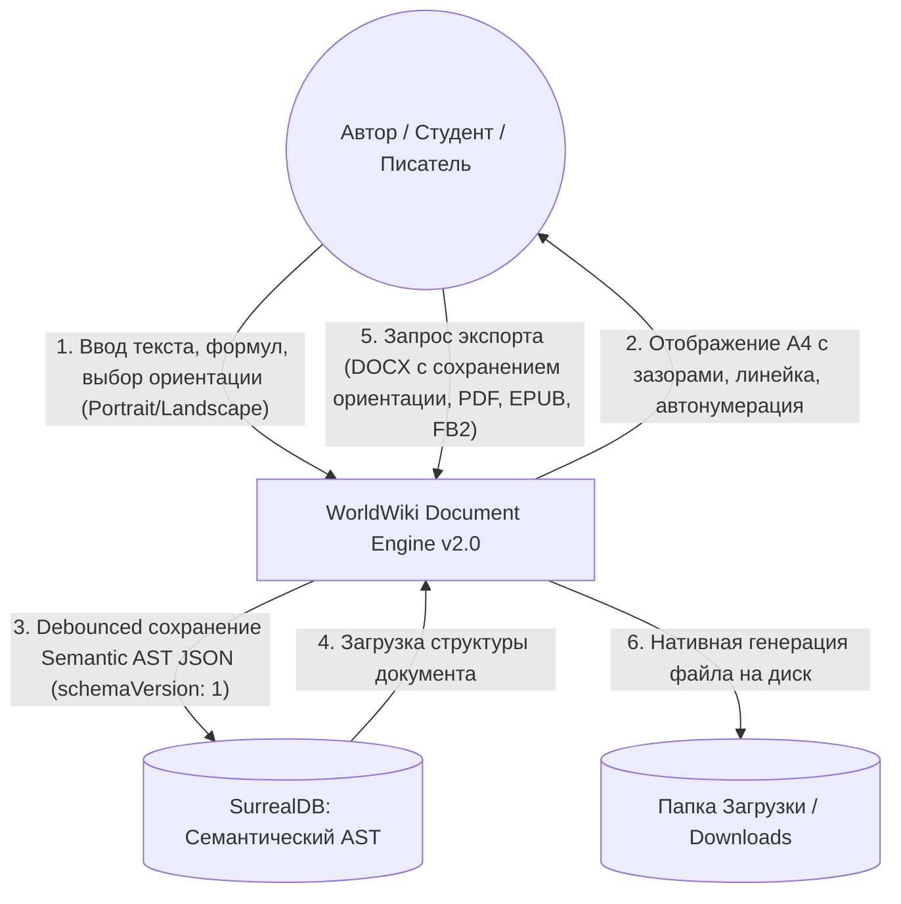
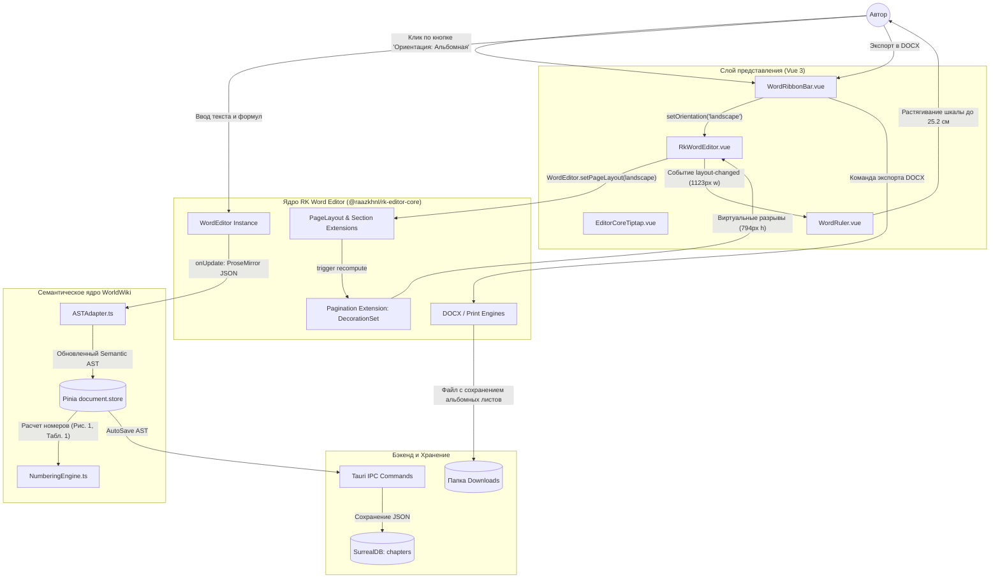
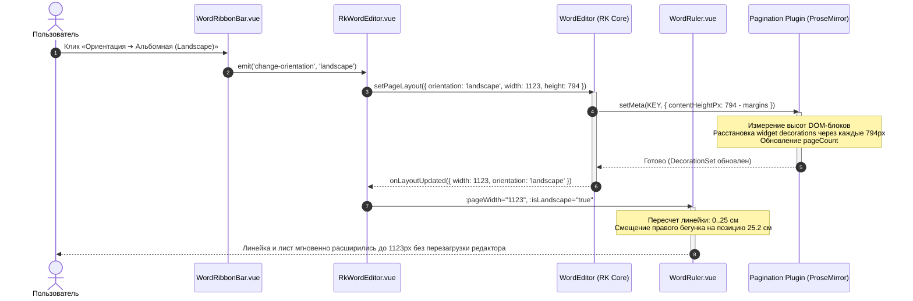

# Спецификация текстового процессора WorldWiki (Document Engine v2.0)
## Академический процессор (ГОСТ) и инструмент писателя (Word + Overleaf + Scrivener)
### Архитектура на базе ядра RK Word Editor (`@raazkhnl/rk-editor-core` + `@raazkhnl/rk-editor-ui`)

---

## 1. Видение и архитектурные принципы

### 1.1. Назначение системы
WorldWiki Document Engine превращает редактор глав в локальный, независимый от облака текстовый процессор профессионального уровня:
1. **Для академических работ (курсовые, ВКР, диссертации, НИР, отчеты)**: 
   * Строгое соблюдение ГОСТ 7.32-2017 и ГОСТ Р 7.0.5-2008: поля 30/20/10/20 мм, Times New Roman 14pt, межстрочный интервал 1.5, красная строка (абзацный отступ) 1.25 см, выравнивание по ширине.
   * Сквозная динамическая нумерация объектов («Рисунок 1 — ...», «Таблица 1 — ...», формулы «(1)»).
   * Векторные математические формулы KaTeX.
   * Подстрочные сноски по ГОСТ с разделителем внизу полосы.
   * **Полноценная ориентация страниц (Книжная / Альбомная / Разделы)**: динамическое переключение между Portrait и Landscape с автоматической адаптацией линейки, ширины холста (794px ↔ 1123px) и сохранением ориентации при экспорте в DOCX и печати в PDF.
2. **Для художественной литературы (романы, повести, сценарии)**:
   * Структура «Том — Арка — Глава — Сцена», разделители сцен (астеризмы `* * *`), спусковые книжные полосы.
   * Экспорт готовых книг в FB2 и EPUB 3.3 для Author.Today, ЛитРес, Amazon KDP и печать в PDF.

### 1.2. Фундаментальный архитектурный принцип
> **Tiptap и RK Word Editor — это интерактивный холст (View / Controller), а не модель документа и не единственный источник истины.**
1. **RK Word Editor Core (`@raazkhnl/rk-editor-core`)** — проверенное headless-ядро текстового процессора на базе Tiptap и ProseMirror. Оно берет на себя тяжелые задачи: постраничную виртуальную пагинацию через `DecorationSet`, математику, встроенные сноски, ресайз картинок, таблицы, работу со стилями абзацев и нативный DOCX-экспорт.
2. **Semantic Document Model (AST)** — внутренний источник истины WorldWiki. Знает семантику узлов (`Figure`, `Table`, `Equation`, `Heading`, `Footnote`, `Section`).
3. **Numbering Engine** — рассчитывает все номера («Рисунок 1», «Таблица 2», «(3)») на лету как чистую функцию. Никаких захардкоженных номеров в базе данных.
4. **Ориентация и секции страниц (First-Class Page Orientation)** — наша ключевая фича. Документ поддерживает как глобальный переключатель ориентации (Книжная 210×297 мм ↔ Альбомная 297×210 мм), так и секционную смену ориентации для широких таблиц и схем.
5. **Хранилище vs Экспорт**:
   * В SurrealDB хранятся **ТОЛЬКО** текстовые семантические данные (`blocks`, `metadata`, `profile_id`) в формате JSON (`schemaVersion: 1`).
   * Экспорт компилируется на лету и сохраняется напрямую в системную папку **`Downloads` (Загрузки)** пользователя (или через нативный диалог Tauri).

---

## 2. Полный стек библиотек и архитектурный фундамент

Все используемые библиотеки являются **100% бесплатными (Open Source / MIT)**.

### 2.1. Frontend: Ядро процессора и страницы

| Пакет / Модуль | Источник | Роль в системе | Особенности интеграции |
| :--- | :--- | :--- | :--- |
| **`@raazkhnl/rk-editor-core`** | Open Source (MIT) | Headless-движок текстового процессора | Включает более 30 расширений: виртуальная пагинация `Pagination` (ProseMirror Decorations), сноски `Footnote`, `LineHeight`, `Indent`, `PageBreak`, `PageLayout`, `Section`, `MathInline`/`MathBlock` (KaTeX), `TableStyles`, `TextBox`, `ExportEngine` (DOCX), `PrintEngine` |
| **`@raazkhnl/rk-editor-ui`** | Open Source (MIT) | Базовые компоненты интерфейса Word | Готовая панель `WordToolbar`, `FindReplaceBar`, модальные окна настройки страницы, шрифтов, таблиц, `StatusBar` со счетчиком страниц |
| **`WordRuler`** | WorldWiki Component | Интерактивная линейка над листом | Двусторонняя реактивная синхронизация с кареткой активного абзаца, ползунки красной строки, левого/правого полей, адаптивная ширина под Portrait (794px) и Landscape (1123px) |
| **`@tiptap/vue-3` / `@tiptap/core`** | Tiptap (MIT) | Базовый редакторский контекст | Интеграция с Vue 3 реактивностью |
| **`katex`** | KaTeX (MIT) | Рендеринг формул | Векторная математика в тексте и в отдельных блоках |
| **`ASTAdapter`** | WorldWiki Core | Двусторонний мост | Преобразование `SemanticDocument AST ↔ RK Editor / ProseMirror JSON` без потери семантических атрибутов |

### 2.2. Движки экспорта (Client & Rust Backend)

| Формат | Движок / Модуль | Локация | Механизм генерации |
| :--- | :--- | :--- | :--- |
| **DOCX** | `ExportEngine` (RK Core) + `@worldwiki/docx` | Frontend (Client) | Нативная генерация файла Word OpenXML: реальные стили (`Normal`, `Heading 1`, `Table Grid`), сноски, формулы, альбомные/книжные секции |
| **PDF** | `PrintEngine` (RK Core) + Chromium WebView2 | Frontend / Tauri | Изолированный iframe с печатью `@media print`, жесткими рамками А4, номерами страниц и векторным KaTeX |
| **EPUB 3.3** | `epub-builder` (Rust) | Backend (Rust) | Tauri IPC команда `export_epub`: трансляция глав в XHTML + CSS, вшивание метаданных и шрифтов |
| **FB2** | Кастомный XML-сериализатор | Backend (Rust) | Высокоскоростной генератор строгой XML-структуры `<FictionBook>` для ЛитРес и Author.Today |
| **TXT / MD** | RK Core Importer/Exporter | Frontend (Client) | Экспорт чистого текста или Markdown для нейросетей и внешних анализаторов |

---

## 3. Фича ориентации страниц: Portrait & Landscape

В академических работах (ГОСТ 7.32) и отчетах ключевое требование — возможность повернуть лист в **альбомную ориентацию (Landscape)** для отображения больших таблиц, календарных графиков, блок-схем и чертежей, сохранив книжную ориентацию для остального текста.

### 3.1. Параметры страницы и стандарты размеров

```typescript
export type PageFormat = 'A4' | 'A5' | 'A3' | 'Letter' | 'B5';
export type PageOrientation = 'portrait' | 'landscape';

export interface PageLayoutConfig {
  format: PageFormat;
  orientation: PageOrientation;
  widthMm: number;
  heightMm: number;
  widthPx: number;      // 96 DPI: A4 Portrait = 794px, Landscape = 1123px
  heightPx: number;     // 96 DPI: A4 Portrait = 1123px, Landscape = 794px
  margins: {
    top: number;        // мм (ГОСТ: 20 мм)
    right: number;      // мм (ГОСТ: 15 или 10 мм)
    bottom: number;     // мм (ГОСТ: 20 мм)
    left: number;       // мм (ГОСТ: 30 мм для переплета)
  };
}
```

### 3.2. Механика работы переключения ориентации:
1. **Глобальный режим (Global Orientation Toggle)**:
   * Пользователь нажимает кнопку «Ориентация» в ленте/панели инструментов или выбирает в меню «Макет ➔ Ориентация ➔ Книжная / Альбомная».
   * `WordEditor.setPageLayout({ orientation: 'landscape', ... })` пересчитывает ширину и высоту виртуального листа.
   * `WordRuler` реактивно меняет свою ширину:
     * Portrait: `width: 794px` (шкала $0 \dots 16.5\text{ см}$ при левом поле 3 см).
     * Landscape: `width: 1123px` (шкала $0 \dots 25.2\text{ см}$ при левом поле 3 см).
   * Виртуальный плагин пагинации `Pagination` пересчитывает координаты разрывов страниц (`contentHeightPx` меняется с 1123px на 794px с учетом полей).
2. **Секционный режим (Section Breaks по ГОСТ)**:
   * Вставка разрыва раздела со сменой ориентации: `<div data-type="section" data-orientation="landscape">`.
   * Лист с широкой таблицей отображается как альбомный, а следующий разрыв возвращает книжную ориентацию.
   * При экспорте в `.docx` секция кодируется нативным тегом OpenXML `<w:sectPr><w:pgSz w:orient="landscape" .../></w:sectPr>`.

---

## 4. Архитектура файлов и каталогов

### 4.1. Фронтенд (`apps/spa/src/ts/features/chapters/EditorCoreTiptap/`)

```text
EditorCoreTiptap/
├── EditorCoreTiptap.vue                 # Главный контейнер (выбор режима: WYSIWYG / Word / Split)
├── useTiptapEditor.ts                   # Композабл инициализации стандартного Tiptap
├── WordMode/                            # ПОДСИСТЕМА WORD НА БАЗЕ RK EDITOR
│   ├── RkWordEditor.vue                 # Компонент-обертка над WordEditor и WordToolbar
│   ├── useRkWordEditor.ts               # Логика управления инстансом WordEditor, AST-мостом и ориентацией
│   ├── RkWordEditor.model.ts            # Типы конфигурации, макета, колонтитулов и событий
│   └── extensions/                      # Кастомные расширения и адаптеры
│       ├── GostTableCaption.ts          # Подписи таблиц ГОСТ («Таблица 1 — ...»)
│       ├── GostFigureCaption.ts         # Подписи рисунков ГОСТ («Рисунок 1 — ...»)
│       └── SectionOrientation.ts        # Секционное переключение альбомной ориентации
├── WordRuler/                           # Интерактивная линейка Word
│   ├── WordRuler.vue                    # Верхняя фиксированная линейка 20px
│   └── useWordRuler.ts                  # Двусторонняя синхронизация с кареткой и ориентацией листа
├── WordRibbonBar/                       # Лента вкладок Word (Главная, Вставка, Макет)
│   ├── WordRibbonBar.vue                # UI панели инструментов
│   └── WordRibbonBar.model.ts           # Команды и интерфейс RibbonCommands
└── __tests__/
    ├── wordFormatting.spec.ts           # Модульные тесты изоляции форматирования
    └── rkWordEditor.spec.ts             # Интеграционные тесты инициализации и смены ориентации
```

### 4.2. Семантические сервисы (`apps/spa/src/ts/services/document/`)

```text
services/document/
├── ast/
│   ├── ASTAdapter.ts                    # Двусторонний мост Semantic AST ↔ Tiptap/RK JSON
│   ├── ASTNormalizer.ts                 # Назначение стабильных UUID узлам
│   └── types.ts                         # Интерфейсы SemanticDocument, BlockNode, InlineNode
├── numbering/
│   ├── NumberingEngine.ts               # Чистая функция вычисления сквозных номеров
│   └── types.ts
├── crossref/
│   ├── CrossReferenceResolver.ts        # Разрешение targetId: UUID -> текст ссылки
│   └── types.ts
└── export/
    ├── DocumentExportService.ts         # Единый фасад экспорта (DOCX, PDF, EPUB, FB2)
    └── types.ts
```

---

## 5. Data Flow Diagrams (DFD)

### 5.1. DFD Уровень 0 (Контекстная диаграмма)



---

### 5.2. DFD Уровень 1 (Архитектура подсистем и потоков данных)



---

### 5.3. DFD Уровень 2.1 (Реактивная смена ориентации страницы)



---

### 5.4. DFD Уровень 2.2 (Пайплайн мультиформатного экспорта)

```mermaid
flowchart TD
    Start([Клик по кнопке 'Экспорт']) --> SelectFormat{Выбор формата}

    %% Экспорт DOCX
    SelectFormat -->|DOCX| RKExportDocx[RK Core ExportEngine: Сборка OpenXML]
    RKExportDocx --> CheckOrientation{Проверка ориентации}
    CheckOrientation -->|Portrait| AddPortraitSection[Добавление w:sectPr Portrait]
    CheckOrientation -->|Landscape| AddLandscapeSection[Добавление w:sectPr Landscape]
    AddPortraitSection --> BuildDocxBlob[Генерация DOCX Blob]
    AddLandscapeSection --> BuildDocxBlob
    BuildDocxBlob --> SaveDownloadsDocx[Сохранение в Downloads/Документ.docx]

    %% Экспорт PDF
    SelectFormat -->|PDF| RKPrintPdf[RK Core PrintEngine: Изолированный iframe]
    RKPrintPdf --> InjectCss[@page size: A4 landscape/portrait]
    InjectCss --> PrintDialog[Системная печать / Сохранение в PDF]
    PrintDialog --> SaveDownloadsPdf[Сохранение в Downloads/Документ.pdf]

    %% Экспорт EPUB / FB2
    SelectFormat -->|EPUB / FB2| TauriExport[Tauri Rust Backend: export_book]
    TauriExport --> RustGen[src-tauri/src/logic/documents/]
    RustGen --> SaveDownloadsBook[Сохранение в Downloads/Книга.epub/.fb2]

    SaveDownloadsDocx --> Toast[Уведомление: Файл сохранен в Загрузки]
    SaveDownloadsPdf --> Toast
    SaveDownloadsBook --> Toast
    Toast --> End([Завершено])
```

---

## 6. Пошаговый план внедрения (Action Plan)

### Этап 1: Подготовка окружения и базовые зависимости *(Завершено)*
- [x] Установка `@raazkhnl/rk-editor-core` и `@raazkhnl/rk-editor-ui` в `apps/spa`.
- [x] Проверка совместимости типов с Tiptap и Vite.

### Этап 2: Создание компонента `RkWordEditor.vue` и композабла `useRkWordEditor.ts`
- [ ] Создать `apps/spa/src/ts/features/chapters/EditorCoreTiptap/WordMode/RkWordEditor.vue`:
  * Монтирование DOM-контейнера `#rk-editor-mount-point`.
  * Инициализация `WordEditor` с опциями: `initialContent`, `pageLayout` (A4 Portrait по умолчанию, поля ГОСТ: 20/15/20/30 мм).
  * Подключение обработчиков `onUpdate`, `onWordCount`, `onSelectionChange`.
- [ ] Создать `useRkWordEditor.ts`:
  * Реактивные переменные: `isLandscape`, `currentPageSize`, `pageCount`, `wordCount`.
  * Методы переключения ориентации `toggleOrientation()`, `setOrientation(orientation)`.
  * Методы форматирования, выравнивания, вставки таблиц и формул через `editor.commands`.

### Этап 3: Связка с линейкой `WordRuler.vue` и адаптивная ширина
- [ ] Подключить `WordRuler` над `RkWordEditor`:
  * Проп `:pageWidth="isLandscape ? 1123 : 794"`.
  * Фиксированная высота линейки $20\text{ px}$, sticky-позиционирование, отступ $20\text{ px}$ до верхнего края листа.
  * Синхронизация бегунков красной строки и полей с активным абзацем RK Editor.

### Этап 4: Интеграция в `EditorCoreTiptap.vue`
- [ ] Встроить `RkWordEditor` в режим `editorMode === 'word'`.
- [ ] Обеспечить бесшовную синхронизацию контента:
  * При открытии главы: передача `props.content` в `initialContent`.
  * При редактировании: debounced отправка обновленного HTML в `emit('update:content')`.
  * При переключении режима (WYSIWYG ↔ Word ↔ Split): сохранение актуального состояния без потери разметки.

### Этап 5: Стилизация под тему WorldWiki (CSS-переменные)
- [ ] Создать `packages/resources/src/styles/features/chapters/RkWordEditor.css`:
  * Интеграция цветовой палитры RK Editor с дизайн-токенами WorldWiki:
    ```css
    .rk-editor-wrapper {
      --rk-bg-canvas: var(--bg-sunken);
      --rk-bg-sheet: var(--bg-card);
      --rk-text-main: var(--text-main);
      --rk-border: var(--border-color);
      --rk-primary: var(--accent);
    }
    ```
  * Скрытие дублирующих элементов управления, если используется кастомный Ribbon-тулбар.

### Этап 6: Экспорт и печать с сохранением ориентации
- [ ] Подключить кнопку «Экспорт DOCX» к `editor.exportDocx()`:
  * Передача текущей ориентации (`portrait` / `landscape`) в метаданные экспортера.
  * Проверка валидности открываемого файла в Microsoft Word и LibreOffice Writer.
- [ ] Подключить кнопку «Печать / PDF» к `editor.print()`:
  * Проверка корректности применения `@page { size: A4 landscape; }` при альбомном режиме.

### Этап 7: Тестирование и валидация
- [ ] Написать модульные тесты `rkWordEditor.spec.ts`:
  * Проверка инициализации редактора и корректности применения ГОСТ-полей.
  * Проверка переключения Portrait ↔ Landscape (изменение размеров холста и параметров пагинации).
  * Проверка экспорта и отсутствия регрессий в AST-адаптере.
- [ ] Запуск `pnpm typecheck` и валидация ESLint.

---

## 7. Критерии готовности (Definition of Done)
1. **Полноценная пагинация без сбоев**: при наборе текста виртуальные листы А4 создаются и разделяются визуально с зазорами, курсор не сбивается, Undo/Redo работает стабильно.
2. **Истинная изоляция стилей**: изменение гарнитуры или кегля шрифта применяется строго к выделению; красная строка (1.25 см) применяется строго к активному абзацу.
3. **Рабочая ориентация**: переключение Книжная / Альбомная корректно масштабирует лист и линейку (794px ↔ 1123px) и сохраняется при экспорте в DOCX и PDF.
4. **Академические элементы**: вставка формул KaTeX, подстрочных сносок и таблиц с ГОСТ-подписями функционирует из коробки.
5. **Тестовое покрытие**: 100% прохождение тестов Vitest и чистый TypeScript без ошибок.
